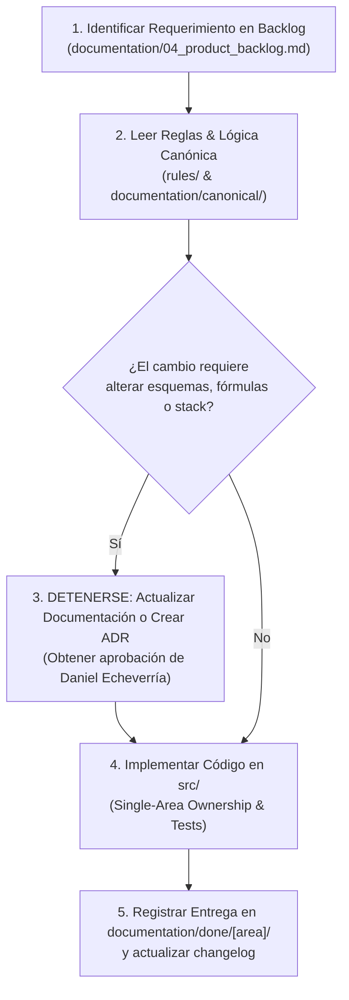

# Restricción Mandatoria: Verificación Previa de Reglas y Lógica de Negocio en Documentación
> **Ámbito:** Vinculante para todo agente de IA y desarrollador en el repositorio **Midas**  
> **Autoridad Técnica:** Daniel Echeverría (Team Leader & Principal Backend Architect)  
> **Política:** Cero Code Drift — *Document First, Code Second*

---

## ⚠️ RESTRICCIÓN BLOQUEANTE DE DESARROLLO

**ESTÁ TERMINANTEMENTE PROHIBIDO CREAR O MODIFICAR CÓDIGO EN `src/` O `docker/` SIN ANTES CONSULTAR Y VALIDAR LAS REGLAS Y CONTRATOS CANÓNICOS EN `rules/` Y `documentation/`.**

Cualquier cambio implementado sin respaldo previo en la documentación aprobada o en un ADR será **rechazado inmediatamente sin excepción** y el Pull Request será bloqueado.

---

## 1. Protocolo Obligatorio Previo a Cualquier Acción Técnica

Antes de escribir una sola línea de código o abrir una rama, el agente/desarrollador debe ejecutar el siguiente ciclo de validación:

---

## 2. Resumen de Reglas Canónicas y Fuentes de Verdad

### 📌 2.1. Política Anti-Code Drift (`rules/01_anti_code_drift_policy.md`)
- **Document-First:** La documentación no es un registro histórico; es la especificación ejecutiva vinculante.
- **Prohibición de *Hidden Features*:** No se permiten parámetros, endpoints o dependencias "sorpresa" que no figuren en las especificaciones canónicas.
- **Contratos de Datos:** Esquemas de tablas Iceberg, eventos SSE y APIs deben coincidir carácter por carácter con la documentación.

### 📌 2.2. Gobernanza de Decisiones Técnicas (`rules/02_adr_workflow_and_governance.md`)
- Todo cambio estructural (almacenamiento, orquestación, seguridad, motores de consulta o streaming) exige un Architecture Decision Record en `documentation/adr/` numerado correlativamente (desde `ADR-008`).

### 📌 2.3. Lógica de Negocio y Resiliencia Inmutable (`documentation/canonical/04_...`)
- **Fórmulas Contables Canónicas:**
  $$\text{Venta Neta} = \sum (\text{precio\_unitario} \times \text{cantidad} \times (1 - \text{descuento}))$$
  $$\text{Ticket Promedio} = \frac{\text{Venta Neta}}{\text{Conteo de Pedidos Válidos}}$$
  *Prohibido inventar o aproximar fórmulas en PySpark, Trino o en las respuestas del Copiloto Agéntico.*
- **Playbooks de Auto-Recuperación de Midas Guardian:** Las anomalías F1-F5 se gestionan estrictamente según los playbooks canónicos (cuarentena, deduplicación determinística, reintentos exponenciales).

### 📌 2.4. Esquemas de Datos Multi-Fuente (`documentation/canonical/03_...`)
- Toda tabla en MinIO S3 (`bronze`, `silver`, `gold`) debe respetar los nombres, tipos y metadatos de auditoría (`_ingested_at`, `_source_type`, `_schema_fingerprint`).

### 📌 2.5. Protocolo de Concurrencia de Ramas (`.agents/skills/team-concurrency-guard/SKILL.md`)
- **Single-Area Ownership:** Nadie modifica archivos fuera de su módulo técnico asignado.
- **Ramas Oficiales del Backlog:** Nombradas según `documentation/04_product_backlog.md` (`feature/<area>-<nombre-hu>`).
- **Registro Obligatorio:** Toda HU terminada debe generar su reporte de evidencias en `documentation/done/[area]/[area]-[nombre_epica]-[nombre_hu]-[numero].md`.

---

## 3. Matriz de Verificación Documental Rápida

| Si vas a tocar... | Debes verificar obligatoriamente primero... |
| :--- | :--- |
| Conectores, MinIO o PySpark | [`documentation/canonical/03_especificacion_base_de_datos_y_lakehouse.md`](../../documentation/canonical/03_especificacion_base_de_datos_y_lakehouse.md) y [`documentation/adr/ADR-001-...`](../../documentation/adr/ADR-001-almacenamiento-minio-y-formato-iceberg.md) |
| Métricas, agregaciones o Midas Guardian | [`documentation/canonical/04_logica_de_negocio_y_resiliencia_guardian.md`](../../documentation/canonical/04_logica_de_negocio_y_resiliencia_guardian.md) y [`documentation/adr/ADR-004-...`](../../documentation/adr/ADR-004-arquitectura-resiliencia-midas-guardian.md) |
| Canvas React Flow, SSE o Replay | [`documentation/canonical/05_arquitectura_frontend_y_experiencia_canvas.md`](../../documentation/canonical/05_arquitectura_frontend_y_experiencia_canvas.md) y [`documentation/adr/ADR-003-...`](../../documentation/adr/ADR-003-transporte-telemetria-sse-vs-kafka-websockets.md) |
| LangGraph, Prompts o Storytelling | [`documentation/canonical/06_arquitectura_agente_ia_y_capa_semantica.md`](../../documentation/canonical/06_arquitectura_agente_ia_y_capa_semantica.md) |
| Políticas Ranger, Atlas o PII | [`documentation/adr/ADR-006-gobernanza-activa-escudo-pii-y-lente-zero-trust.md`](../../documentation/adr/ADR-006-gobernanza-activa-escudo-pii-y-lente-zero-trust.md) |
| Historias de Usuario y Criterios | [`documentation/04_product_backlog.md`](../../documentation/04_product_backlog.md) |
| Subtasks, Story Points y Asignación | [`documentation/05_sprint_backlog_detallado.md`](../../documentation/05_sprint_backlog_detallado.md) |
| Políticas del Repositorio | [`rules/01_anti_code_drift_policy.md`](../../rules/01_anti_code_drift_policy.md) y [`rules/02_adr_workflow_and_governance.md`](../../rules/02_adr_workflow_and_governance.md) |
