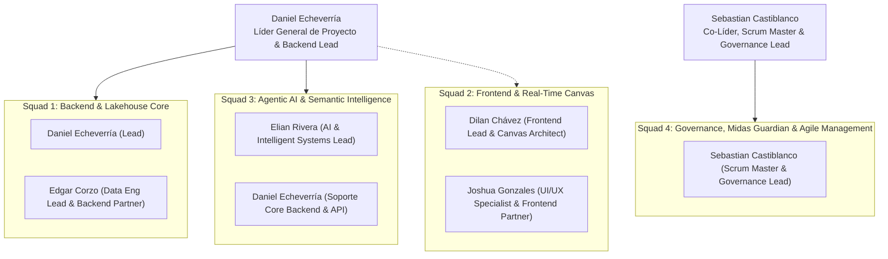

# Midas

## Local startup after the integration audit

The repository describes the target architecture. Ranger/Atlas enforcement,
all Guardian playbooks and the canonical business marts are still incomplete.
The local API currently supports one authenticated director account.

1. Copy `.env.example` to `.env` if no local configuration exists. Generate two
   different random tokens with `python -c "import secrets; print(secrets.token_urlsafe(32))"`
   and set `MIDAS_OPERATOR_TOKEN` and `MIDAS_TELEMETRY_TOKEN` in that file.
   Keep the database URL consistent with the configured database credentials.
2. Validate with `docker compose --profile orchestration config --quiet`.
3. For a **new local database**, run
   `docker compose --profile orchestration up -d --build`.
   This includes PostgreSQL, MinIO, Iceberg REST, Spark, Trino, the API and Airflow.
   The first Spark job downloads pinned connectors from Maven Central.
4. Run `npm ci` and `npm run dev` from the repository root. Open
   `http://localhost:3000` and sign in with the operator token.
   The browser uses `http://localhost:8000` for the API by default. Use the same
   hostname for both applications so the login cookie reaches SSE requests.
5. Airflow is at `http://localhost:8085`; Trino is at `http://localhost:8082`.
   Ollama runs separately on the host, with `qwen2.5:3b` downloaded if using the model.

For an **existing database**, initialization scripts will not run again. Back up
the local database and apply these additive scripts before starting the updated API:

```powershell
Get-Content docker/postgres/02-init-sessions-schema.sql | docker compose exec -T midas-postgres psql -v ON_ERROR_STOP=1 -U midas_admin -d midas_operational
Get-Content docker/postgres/03-init-telemetry.sql | docker compose exec -T midas-postgres psql -v ON_ERROR_STOP=1 -U midas_admin -d midas_operational
```

Use your configured PostgreSQL username in these commands. Never delete an
existing volume to apply a schema update. Compose projects have separate names
and volumes; an isolated project also needs different host ports in its env file.
Images with old explicit container names may require a planned container recreation
when upgrading; preserve their volumes.

The `api` profile starts the query stack without Airflow/Spark. The `governance`
profile adds OpenMetadata/OpenSearch; it does not provide Ranger/Atlas policies.
All published service ports bind to localhost. These are development settings.

Verification and remaining release gates:
[audit repair report](documentation/done/other/infra-audit-integration-repairs-04.md).

> **Enterprise Active Lakehouse & Conversational Intelligence Platform**  
> Data Fabric Medallón con Gobernanza Zero-Trust, Resiliencia Activa (Midas Guardian), Observabilidad en Tiempo Real y Copiloto Agéntico Dialógico


---

## 🎯 Fechas Clave del Sprint

- **Inicio del Sprint:** Domingo 18 de Octubre de 2026 (08:00)
- **Fecha Límite de Congelación y Entrega:** **Miércoles 21 de Octubre de 2026 (23:59)**
- **Demostración y Pitch en Vivo (30 Minutos):** **Jueves 22 de Octubre de 2026** (5 minutos exactos por integrante, software real sobre Docker)

---

## 🚀 Visión General y Capacidades Diferenciales

Midas trasciende los pipelines de datos pasivos y los tableros estáticos tradicionales. Es un **Active Lakehouse Empresarial** dotado de **5 pilares tecnológicos integrados**:

1. **Motor de Ingesta Universal y Arquitectura Medallón:**  
   Ingesta desacoplada y simultánea desde bases relacionales (**PostgreSQL JDBC**), hojas de cálculo (**Excel multi-hoja**) y feeds de **APIs REST**, organizados en capas **Bronze**, **Silver** y **Gold** sobre almacenamiento **MinIO S3** en formato transaccional **Apache Iceberg v2** (ACID, evolución de esquemas y time-travel).
2. **Gobernanza y Seguridad Zero-Trust de Grado Bancario:**  
   Catálogo central y linaje automatizado de extremo a extremo con **OpenMetadata**, detección y etiquetado en caliente de datos sensibles (PII) con **Apache Atlas**, y políticas centralizadas de acceso en **Apache Ranger** (enmascaramiento dinámico de columnas y filtrado de filas *Row-Level Security* en Trino).
3. **Resiliencia Activa y Auto-Healing (Midas Guardian):**  
   Subsistema autónomo de detección de incidentes en tiempo de ejecución. Ante datos corruptos o anomalías (fallos F1 a F5), aísla los registros en cuarentena (`s3://midas-quarantine/`), ejecuta playbooks automatizados de recuperación y garantiza que el 99.8% de los datos sanos continúe hacia Gold sin interrumpir el servicio ni corromper métricas financieras.
4. **Canvas de Flujo de Datos en Tiempo Real con Time-Travel Replay:**  
   Interfaz visual interactiva con **React Flow** que muestra la topología viva de los nodos (Bronze, Silver, Guardian, Gold). Consume telemetría por **Server-Sent Events (SSE)** modulando la velocidad de partículas según el tráfico de registros, y cuenta con una barra de **Replay Histórico** para rebobinar el estado del pipeline como una película.
5. **Copiloto Agéntico Dialógico y Materialización Text-to-Gold:**  
   Asistente inteligente con **LangGraph** y FastAPI. No solo responde consultas analíticas con narrativa ejecutiva (*Data Storytelling*) y visualizaciones interactivas en **Apache ECharts**, sino que entabla un diálogo proactivo guiando al directivo sobre qué fuentes analizar, permite auditar el linaje exacto de cada cifra (*"Explícame esta cifra"*) y materializa nuevos pipelines en **Apache Airflow** en lenguaje natural (*Pipeline-as-a-Prompt*).

---

## 👥 Equipo de Ingeniería y Asignación de Roles (Riwi)

El proyecto cuenta con un equipo de 6 ingenieros organizados en **4 Células de Trabajo (Squads)** bajo el principio de **Propiedad Unitaria de Código (`Single-Area Ownership`)**:



### 📋 Detalle de Roles y Responsabilidades Técnicas

| Integrante | Rol Oficial | Squad | Responsabilidades Clave y Entregables Técnicos | Módulo de Código (`Single-Area Ownership`) |
| :--- | :--- | :---: | :--- | :--- |
| **Daniel Echeverría** | **Líder General de Proyecto & Backend Lead** | Squad 1 / 3 | - Dirección estratégica, arquitectura general y aseguramiento de resiliencia.<br>- Core Backend en FastAPI: API Gateway, Hub de eventos SSE (`/api/v1/telemetry/stream`).<br>- Integración del motor de consultas Trino sobre Iceberg y PostgreSQL.<br>- Gatekeeper técnico: revisión y aprobación mandatoria de PRs hacia `develop` y `main`. | `src/api/`<br>`src/core/`<br>`docker/trino/` |
| **Edgar Corzo** | **Data Engineering Lead & Backend Partner** | Squad 1 | - Aprovisionamiento de almacenamiento distribuido en MinIO S3 y catálogo Iceberg REST.<br>- Universal Ingestion Engine: conectores para PostgreSQL (JDBC), Excel multi-hoja y REST APIs.<br>- Jobs de PySpark Bronze $\rightarrow$ Silver (inferencia de esquemas, normalización de montos y deduplicación).<br>- Modelado dimensional Silver $\rightarrow$ Gold (marts de hechos y dimensiones con Iceberg v2). | `src/lakehouse/`<br>`docker/minio/`<br>`docker/spark/` |
| **Dilan Chávez** | **Frontend Lead & Real-Time Canvas Architect** | Squad 2 | - Arquitectura de la plataforma web interactiva en Next.js / React 18 con React Flow.<br>- Canvas interactivo de flujo de datos con partículas animadas y topología dinámica de nodos.<br>- Consumo en tiempo real de eventos SSE con manejo de reconexión y fallback de conectividad.<br>- Time-Travel Replay: barra de deslizamiento temporal para rebobinar el estado del pipeline.<br>- Integración con DAG Factory de Apache Airflow. | `src/frontend/components/canvas/`<br>`src/frontend/hooks/`<br>`src/orchestration/` |
| **Joshua Gonzales** | **UI/UX Specialist & Frontend Partner** | Squad 2 | - Diseño de interfaces, ergonomía visual y experiencia conversacional.<br>- Interfaz del Copiloto Agéntico (chat flotante y drawer interactivo expandible).<br>- Renderizado dinámico de gráficas de negocio con Apache ECharts a partir del JSON del agente.<br>- Lente Zero-Trust interactivo: selector de roles en cabecera que atenúa nodos y enmascara datos en caliente.<br>- Drawer de linaje y certificación de métricas ("Explícame esta cifra"). | `src/frontend/components/copilot/`<br>`src/frontend/components/security/`<br>`src/frontend/components/lineage/` |
| **Elian Rivera** | **AI & Intelligent Systems Lead** | Squad 3 | - Máquina de estados conversacional y orquestación agéntica con LangGraph y FastAPI.<br>- Modo Dialógico Proactivo: introspección de esquemas y sugerencia de análisis al directivo.<br>- Motor Text-to-Gold: traducción de lenguaje natural a SQL Trino con guardrails de seguridad OWASP.<br>- Motor de Data Storytelling: generación de síntesis narrativa ejecutiva y configuración ECharts.<br>- Pipeline-as-a-Prompt: generador declarativo de DAGs YAML para materializar capas Gold en Airflow. | `src/agent/` |
| **Sebastian Castiblanco** | **Co-Líder, Scrum Master & Governance Lead** | Squad 4 | - Facilitación ágil del sprint, cadencia de daily standups y verificación de entregas diarias.<br>- Auditoría estricta de Cero Code Drift y gatekeeper de reportes en `documentation/done/`.<br>- Despliegue de OpenMetadata y extracción automatizada de linaje end-to-end.<br>- Escudo PII en caliente con taxonomías en Apache Atlas y políticas dinámicas en Apache Ranger.<br>- Configuración y validación del subsistema de resiliencia Midas Guardian (fallos F1 a F5). | `src/security_governance/`<br>`rules/`<br>`documentation/done/` |

---

## 🏗️ Stack Tecnológico Unificado

```
┌────────────────────────────────────────────────────────────────────────────────────────┐
│                              ARQUITECTURA DE LA PLATAFORMA                             │
├─────────────────────┬──────────────────────────────────────────────────────────────────┤
│ Capa                │ Tecnologías / Frameworks                                         │
├─────────────────────┼──────────────────────────────────────────────────────────────────┤
│ **Storage**         │ MinIO Object Storage S3, Apache Iceberg v2 (Catálogo REST)      │
│ **Cómputo & Data**  │ Apache Spark 3.5 (PySpark), Trino 440+ (Consultas federadas)      │
│ **Orquestación**    │ Apache Airflow 2.8+ (Dynamic DAG Factory, Sensores S3)           │
│ **Gobernanza**      │ OpenMetadata (Catálogo/Linaje), Apache Atlas (Clasificación PII) │
│ **Seguridad**       │ Apache Ranger (RBAC, ABAC, Dynamic Masking, Row-Level Filtering)│
│ **Resiliencia**     │ Midas Guardian (Auto-Healing Engine, Playbooks F1 a F5)         │
│ **Backend Core**    │ Python 3.11, FastAPI, Pydantic v2, Server-Sent Events (SSE)      │
│ **Inteligencia IA** │ LangGraph, LangChain, Guardrails OWASP Top 10, Pydantic Output   │
│ **Frontend Web**    │ Next.js 14 / React 18, React Flow (@xyflow/react), Apache ECharts│
│ **Infraestructura** │ Docker, Docker Compose (Monorepo contenerizado multi-servicio)    │
└─────────────────────┴──────────────────────────────────────────────────────────────────┘
```

---

## 📂 Estructura del Repositorio

```bash
PROYECTO-JUEVES-22/
├── .agents/                    # Reglas operativas y habilidades del equipo
│   ├── rules/                  # Restricción mandatoria: anti_code_drift_and_documentation_guard.md
│   └── skills/                 # Habilidad team-concurrency-guard (aislamiento y no-colisión)
├── docker/                     # Manifiestos Docker Compose, Dockerfiles y configuraciones
│   ├── minio/                  # Setup y scripts de inicialización de buckets
│   ├── trino/                  # Catálogos Iceberg y PostgreSQL
│   └── spark/                  # Configuración PySpark y dependencias Iceberg
├── documentation/              # Suite documental oficial del proyecto
│   ├── 04_product_backlog.md   # Product Backlog macro (criterios de aceptación funcionales)
│   ├── 05_sprint_backlog_detallado.md # Backlog táctico (subtasks, Story Points, responsables y horas)
│   ├── canonical/              # Especificaciones maestras inmutables del MVP Dorado (01 a 07)
│   │   ├── 01_master_architecture_and_project_plan.md
│   │   ├── 02_mvp_dorado_blueprint_global.md
│   │   ├── 03_especificacion_base_de_datos_y_lakehouse.md
│   │   ├── 04_logica_de_negocio_y_resiliencia_guardian.md
│   │   ├── 05_arquitectura_frontend_y_experiencia_canvas.md
│   │   ├── 06_arquitectura_agente_ia_y_capa_semantica.md
│   │   └── 07_guion_presentacion_en_vivo_30_minutos.md
│   ├── adr/                    # Architecture Decision Records formales (ADR-001 a ADR-007)
│   ├── changelog/              # Bitácoras diarias de avance
│   ├── done/                   # Evidencias de entrega obligatorias por área (HU completadas)
│   └── propuestas/             # Reportes de investigación originales del equipo
├── rules/                      # Políticas vinculantes de gobierno de código
│   ├── 01_anti_code_drift_policy.md   # Política estricta: Document First, Code Second
│   └── 02_adr_workflow_and_governance.md # Protocolo obligatorio para registrar ADRs
├── scripts/                    # Scripts de auditoría e inyección de fallos controlados
│   └── inject_fault.py         # Inyector de fallos F1-F5 para demostración de auto-healing
├── src/                        # Código fuente modular (Single-Area Ownership)
│   ├── lakehouse/              # PySpark jobs, conectores multi-fuente y modelos Iceberg
│   ├── core/                   # Clientes Trino, telemetría SSE y utilidades centrales
│   ├── api/                    # API Gateway FastAPI y routers REST
│   ├── orchestration/          # DAG Factory de Airflow y sensores
│   ├── security_governance/    # Políticas Ranger, cliente Atlas y motor Midas Guardian
│   ├── agent/                  # Grafo LangGraph, guardrails y motor de Data Storytelling
│   └── frontend/               # UI web: Canvas React Flow, Copiloto Chat y componentes ECharts
└── tests/                      # Suites de pruebas automatizadas por módulo
```

---

## 📖 Suite Documental Oficial y Gobernanza

Toda modificación en el repositorio está regida por la política **Cero Code Drift** ([`rules/01_anti_code_drift_policy.md`](rules/01_anti_code_drift_policy.md)). Ningún agente o desarrollador puede escribir código que no esté previamente especificado en esta suite:

### 1. Planificación Ágil y Backlogs (Sprint 18 al 21 de Octubre)
- 👉 [04. Product Backlog Macro](documentation/04_product_backlog.md) *(21 Historias de Usuario, criterios funcionales y DoD)*
- 👉 [05. Sprint Backlog Detallado](documentation/05_sprint_backlog_detallado.md) *(Desglose de ~80 subtasks, Story Points, responsables y horas)*

### 2. Especificaciones Canónicas del MVP Dorado
- [01. Master Architecture & Project Plan](documentation/canonical/01_master_architecture_and_project_plan.md) *(Arquitectura general, RACI y roadmap)*
- [02. MVP Dorado Blueprint Global](documentation/canonical/02_mvp_dorado_blueprint_global.md) *(Puertos, redes Docker y variables de entorno)*
- [03. Especificación Base de Datos & Lakehouse](documentation/canonical/03_especificacion_base_de_datos_y_lakehouse.md) *(Contratos multi-fuente Bronze, Silver y Gold)*
- [04. Lógica de Negocio Canónica & Resiliencia Guardian](documentation/canonical/04_logica_de_negocio_y_resiliencia_guardian.md) *(Fórmulas oficiales y playbooks)*
- [05. Arquitectura Frontend & Experiencia Canvas](documentation/canonical/05_arquitectura_frontend_y_experiencia_canvas.md) *(React Flow, SSE y Replay)*
- [06. Arquitectura Agente IA & Capa Semántica](documentation/canonical/06_arquitectura_agente_ia_y_capa_semantica.md) *(LangGraph, Text-to-Gold y Storytelling)*
- [07. Guión de Presentación en Vivo (30 Minutos)](documentation/canonical/07_guion_presentacion_en_vivo_30_minutos.md) *(Minutero y relevos de los 6 oradores)*

### 3. Decisiones de Arquitectura Registradas (ADRs)
- [`documentation/adr/`](documentation/adr/):
  - [ADR-001: Almacenamiento MinIO S3 y Formato Apache Iceberg v2](documentation/adr/ADR-001-almacenamiento-minio-y-formato-iceberg.md)
  - [ADR-002: Estrategia de Consultas Federadas con Trino y Apache Ranger](documentation/adr/ADR-002-estrategia-consultas-trino-con-ranger.md)
  - [ADR-003: Transporte de Telemetría en Tiempo Real con Server-Sent Events (SSE)](documentation/adr/ADR-003-transporte-telemetria-sse-vs-kafka-websockets.md)
  - [ADR-004: Arquitectura de Resiliencia y Auto-Healing con Midas Guardian](documentation/adr/ADR-004-arquitectura-resiliencia-midas-guardian.md)
  - [ADR-005: Orquestación Declarativa y DAG Factory en Apache Airflow](documentation/adr/ADR-005-orquestacion-y-dag-factory-en-airflow.md)
  - [ADR-006: Gobernanza Zero-Trust con Escudo PII en Caliente y Lente de Roles](documentation/adr/ADR-006-gobernanza-activa-escudo-pii-y-lente-zero-trust.md)
  - [ADR-007: Motor de Ingesta Universal Multi-Fuente Adaptativo](documentation/adr/ADR-007-motor-de-ingesta-universal-multi-fuente.md)

### 4. Políticas de Calidad y No-Colisión
- [Regla 01: Política Estricta Anti-Code Drift](rules/01_anti_code_drift_policy.md)
- [Regla 02: Gobernanza y Flujo de Trabajo para ADRs](rules/02_adr_workflow_and_governance.md)
- [Protocolo Team Concurrency Guard](.agents/skills/team-concurrency-guard/SKILL.md)

---

## 🔄 Protocolo de Contribución y Cero Colisiones

Para evitar conflictos de fusión (*merge conflicts*) y garantizar la máxima velocidad de entrega durante los 4 días de sprint:

1. **Sincronización:** Siempre partir de `develop` actualizado:
   ```bash
   git checkout develop && git pull origin develop
   ```
2. **Creación de Rama Oficial:** Utilizar estrictamente el nombre asignado en el Backlog:
   ```bash
   git checkout -b feature/<area>-<nombre-descriptivo-hu>
   # Ejemplo: git checkout -b feature/lakehouse-universal-ingestion
   ```
3. **Desarrollo con Tests Automatizados:** Todo cambio debe incluir su suite de pruebas pasando al 100%:
   ```bash
   pytest tests/<modulo>/ -v
   ```
4. **Registro de Entrega Obligatorio:** Antes de solicitar PR, crear el archivo de evidencias en:
   ```bash
   documentation/done/<area>/<area>-<nombre_epica>-<nombre_hu>-<numero>.md
   ```
5. **Revisión y Fusión:** Todo PR debe ser revisado por el compañero de squad asignado y contar con la aprobación final de **Daniel Echeverría** (arquitectura) y **Sebastian Castiblanco** (gobernanza y proceso).
