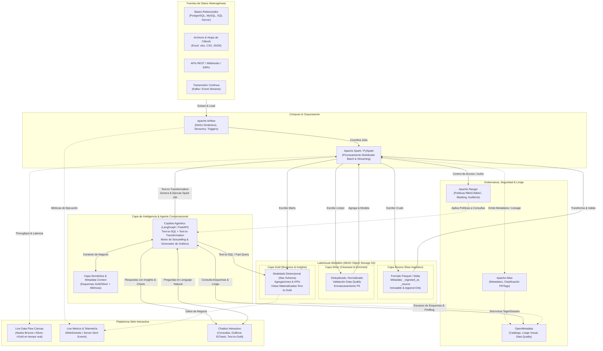
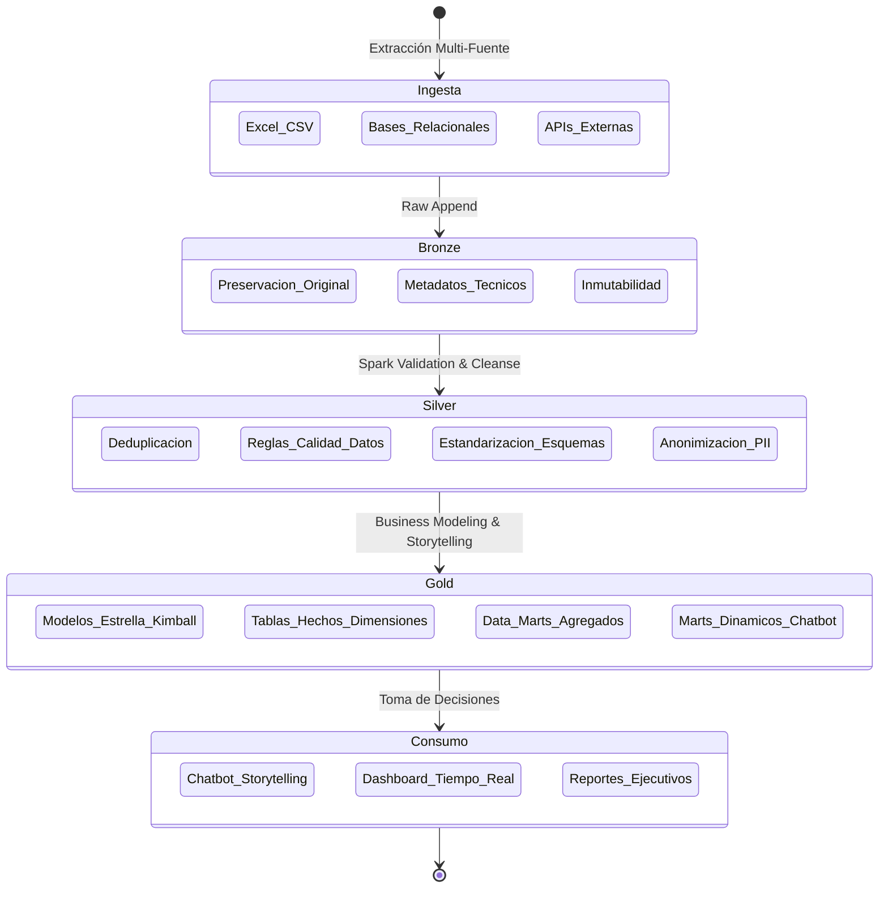
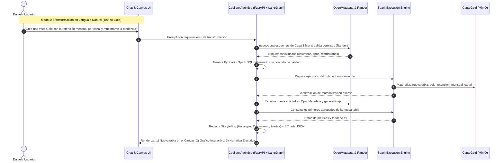
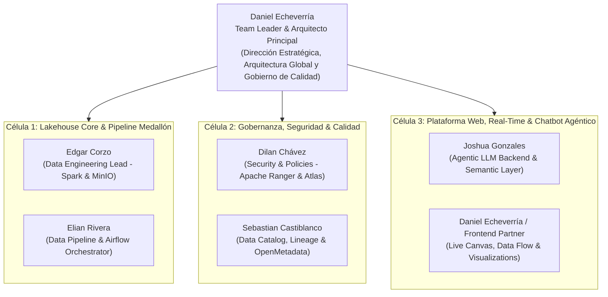
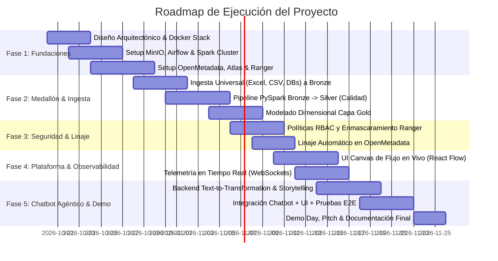

# Blueprint Arquitectónico Empresarial & Plan de Proyecto
## Plataforma de Lakehouse Inteligente, Gobernanza y Agente Conversacional Activo

> **Organización:** Riwi  
> **Líder de Proyecto & Arquitecto Principal:** Daniel Echeverría  
> **Equipo de Ingeniería:** Joshua Gonzales, Edgar Corzo, Elian Rivera, Dilan Chávez, Sebastian Castiblanco  
> **Fecha:** Octubre 2026  
> **Versión:** 1.0.0 (Enterprise Production Target)

---

## 1. Visión Ejecutiva y Factor Diferencial ("The Wow Factor")

El objetivo de este proyecto trasciende la construcción de un pipeline de datos tradicional o un chatbot estático de preguntas frecuentes. La meta es crear un **Data Fabric / Active Lakehouse Empresarial** dotado de **tres capacidades vanguardistas integradas**:

1. **Ingesta y Procesamiento Medallón Universal:** Ingesta agnóstica a la fuente (Bases de datos SQL/NoSQL, APIs REST, archivos Excel, CSV y streaming) procesada a través de un lago de datos estructurado en capas **Bronze (Crudo)**, **Silver (Limpio/Confiable)** y **Gold (Marts de Negocio/Storytelling)** usando MinIO y Apache Spark con formato transaccional Delta Lake / Apache Iceberg.
2. **Gobernanza y Seguridad Zero-Trust:** Linaje de datos de extremo a extremo, catálogo activo y observabilidad con **OpenMetadata**, clasificación de datos sensibles (PII) con **Apache Atlas**, y políticas de acceso centralizadas (RBAC/ABAC con enmascaramiento dinámico de columnas y filtrado de filas) con **Apache Ranger**.
3. **Observabilidad en Tiempo Real y Copiloto Agéntico (Text-to-Transformation & Storytelling):**
   - Una interfaz web moderna que muestra la **topología y el flujo de los datos en vivo** (tasas de ingesta, registros procesados, latencia, nodos activos).
   - Un **Chatbot Agéntico Analítico y Operacional**: No solo responde con gráficas interactivas y narrativa de negocio (storytelling) a partir de los datos reales, sino que permite **transformar datos en vivo a cualquier capa Gold mediante lenguaje natural** (*"Crea una vista Gold con la retención mensual de clientes por sector y genera el gráfico comparativo"*), validando permisos, ejecutando la transformación en Spark, registrando la nueva tabla en el catálogo y mostrándola en la UI en segundos.

---

## 2. Diagrama de Arquitectura Global de la Solución

---

## 3. Desglose Tecnológico y Responsabilidad por Componente

| Componente | Rol en la Arquitectura | Justificación & Estándar Técnico |
| :--- | :--- | :--- |
| **MinIO** | Almacenamiento Lakehouse (Object Storage S3-compatible) | Rendimiento ultrarrápido, compatibilidad 100% S3 API, soporte para tablas Delta Lake / Iceberg con versionamiento y ACID. Buckets dedicados: `lake-bronze`, `lake-silver`, `lake-gold`. |
| **Apache Spark (PySpark)** | Motor de Procesamiento Distribuido | Ejecuta las transformaciones masivas entre capas. Procesa archivos Excel/CSV, tablas relacionales o streams. Capacidad de ejecutar SQL dinámico generado por el agente para materializar nuevas capas Gold. |
| **Apache Airflow** | Orquestador de Flujos y Tareas | Orquestación basada en código (Python DAGs), reintentos automáticos, alertas, ejecución periódica y disparadores basados en eventos (*sensor triggers* cuando llega un nuevo archivo/dataset). |
| **OpenMetadata** | Catálogo de Datos, Linaje y Calidad | La cara moderna de la gobernanza: visualización instantánea del linaje de datos de extremo a extremo, perfilado automático de datos (data profiling), alertas de frescura y catálogo consumible vía API REST por el Chatbot. |
| **Apache Atlas** | Gestión de Metadatos y Clasificación | Taxonomía empresarial, clasificación automática de atributos (ej. `@PII`, `@Confidencial`, `@Financiero`), seguimiento de linaje a nivel de entidad de datos. |
| **Apache Ranger** | Motor de Seguridad y Políticas Centralizadas | Autorización granular de políticas (RBAC y ABAC), enmascaramiento dinámico (*masking* de hashes/nombres/teléfonos según el rol del usuario) y auditoría centralizada de accesos. |
| **FastAPI + LangGraph** | Backend del Copiloto Agéntico | Orquestación del flujo conversacional: validación semántica, generación segura de consultas SQL/Spark, motor de data storytelling y generación de especificaciones de gráficos. |
| **React / Next.js + ECharts + React Flow** | Plataforma Web Interactiva | Visualización en vivo del pipeline (React Flow animado con eventos WebSockets), panel de métricas operativas y de negocio, y consola conversacional integrada. |

---

## 4. El Ciclo de Vida de los Datos: Arquitectura Medallón

### 4.1. Capa Bronze (Raw / Crudo)
- **Propósito:** Ingesta fiel y sin modificaciones desde cualquier origen.
- **Estructura:** Particionado por `source_system/entity_name/year=YYYY/month=MM/day=DD/`.
- **Campos de Auditoría Obligatorios:**
  - `_raw_id`: UUID único del registro.
  - `_source_file_or_table`: Nombre del archivo o tabla original.
  - `_ingested_at`: Timestamp UTC de ingesta.
  - `_ingestion_batch_id`: Identificador de ejecución de Airflow.
  - `_payload`: Formato estructurado preservando tipos originales.

### 4.2. Capa Silver (Confiable / Enriquecida)
- **Propósito:** Los datos de la compañía limpios, auditados, deduplicados y tipados.
- **Acciones Clave:**
  - Tratamiento de nulos, valores atípicos y normalización de fechas/monedas.
  - Validación de esquemas y reglas de calidad (completitud, unicidad).
  - Aplicación de tags de Atlas (`PII`) y enmascaramiento coordinado con Ranger.
  - Esquema estructurado y optimizado (Parquet / Delta con compresión Snappy/ZSTD).

### 4.3. Capa Gold (Inteligencia de Negocio & Storytelling)
- **Propósito:** Responder preguntas directas del negocio y empoderar la toma de decisiones.
- **Modelado:**
  - Modelado Dimensional Kimball (Tablas de Hechos y Dimensiones: `dim_cliente`, `dim_tiempo`, `dim_producto`, `fact_transacciones`, `fact_asistencia`).
  - Capas de Agregación de Alto Rendimiento (KPIs precalculados: tasas de retención, márgenes, crecimiento interanual).
  - **Marts Dinámicos Agénticos:** Capacidad de registrar vistas materializadas Gold creadas por el chatbot bajo demanda para responder hipótesis complejas de los líderes.

---

## 5. El Funcionamiento del Chatbot: "Text-to-Transformation" & Data Storytelling

---

## 6. Distribución del Equipo (6 Personas) & Matriz RACI

El proyecto se estructura en 3 células técnicas de 2 integrantes, lideradas por Daniel Echeverría:

### Responsabilidades Detalladas por Integrante:

#### 1. Daniel Echeverría (Team Leader & Principal Data Architect)
- **Enfoque Principal:** Dirección estratégica de la solución, arquitectura general de sistemas, estándares de calidad, aprobación de Pull Requests y diseño de la experiencia global.
- **Entregables:**
  - Blueprint arquitectónico y lineamientos de integración empresarial.
  - Definición de interfaces entre Lakehouse, Gobernanza y Plataforma Web.
  - Supervisión de sprints, revisión de código y aseguramiento de resiliencia.

#### 2. Joshua Gonzales (Agentic AI & Semantic Layer Specialist)
- **Enfoque Principal:** Orquestación de agentes con LangGraph / FastAPI, motor Text-to-Transformation y Capa Semántica.
- **Entregables:**
  - Agente con herramientas de consulta (`get_schema`, `execute_query`, `create_gold_mart`).
  - Generador de Spark SQL / PySpark con validación de seguridad (Zero-Hallucination Guardrails).
  - Motor de Data Storytelling (narrativa ejecutiva e inferencia de gráficos ECharts).

#### 3. Edgar Corzo (Data Engineering Specialist - Spark & Storage)
- **Enfoque Principal:** Motor de procesamiento distribuido (Apache Spark) y arquitectura de almacenamiento en MinIO.
- **Entregables:**
  - Configuración de MinIO con buckets multi-inquilino (`bronze`, `silver`, `gold`).
  - Jobs de PySpark para la ingesta universal (conectores para Excel, CSV, PostgreSQL).
  - Optimización de tablas Delta Lake / Parquet (compresión, particionado y z-ordering).

#### 4. Elian Rivera (Pipeline Orchestration & Ingestion Specialist - Airflow)
- **Enfoque Principal:** Orquestación automatizada y resiliente con Apache Airflow.
- **Entregables:**
  - Setup de Airflow en Docker con operadores de Spark y sensores de llegada de datos.
  - Creación de DAGs modulares para la transición automatizada Bronze -> Silver -> Gold.
  - Manejo de reintentos, alertas de fallo (Slack/Email/Webhooks) y métricas de ejecución.

#### 5. Dilan Chávez (Data Security & Governance Specialist - Apache Ranger)
- **Enfoque Principal:** Políticas de seguridad, autenticación, control de accesos (RBAC/ABAC) y enmascaramiento dinámico.
- **Entregables:**
  - Despliegue y configuración de Apache Ranger Admin y Plugins.
  - Definición de roles de usuario (Ej: `Analista`, `Líder de Negocio`, `Auditor`).
  - Configuración de políticas de enmascaramiento de columnas y filtrado de filas para datos clasificados.

#### 6. Sebastian Castiblanco (Data Observability & Catalog Specialist - OpenMetadata & Atlas)
- **Enfoque Principal:** Catálogo de datos central, visualización del linaje, clasificación de metadatos y perfilado de calidad.
- **Entregables:**
  - Despliegue de OpenMetadata y conectores de ingesta de metadatos desde Spark, MinIO y Airflow.
  - Integración de Apache Atlas para taxonomías y clasificación de tipos de datos.
  - Pruebas automatizadas de calidad de datos (Great Expectations / Soda Core integrado con OpenMetadata).

---

## 7. Plan de Ejecución por Sprints (Roadmap Ágil - 5 Fases)

---

## 8. Protocolo de Trabajo Colaborativo (Zero-Collision & Concurrencia)

1. **Estructura de Ramas Estricta:**
   - `main`: Código probado y estable en producción.
   - `develop`: Rama de integración activa.
   - `feature/<area>-<nombre-funcionalidad>`
2. **Propiedad de Código por Módulos (Single-Area Ownership):**
   - `src/lakehouse/`: Propiedad de Célula 1 (Spark & Ingestion - Edgar & Elian).
   - `src/orchestration/`: Propiedad de Célula 1 (Airflow DAGs - Elian & Edgar).
   - `src/security_governance/`: Propiedad de Célula 2 (Ranger/Atlas/OpenMetadata - Dilan & Sebastian).
   - `src/agent/`: Propiedad de Célula 3 (FastAPI & LangGraph - Joshua & Daniel).
   - `src/frontend/`: Propiedad de Célula 3 (React/Next.js).
3. **Registro Diario de Entregas (`documentation/done/`):**
   - Cada entrega completada se documenta bajo:  
     `documentation/done/[area]/[area]-[feature]-[id].md`  
     con criterios de aceptación, pruebas ejecutadas y comando de verificación.
