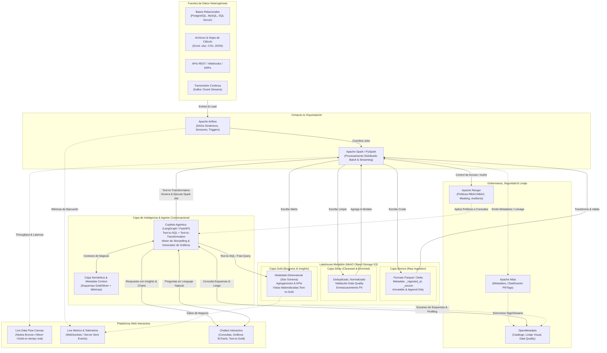
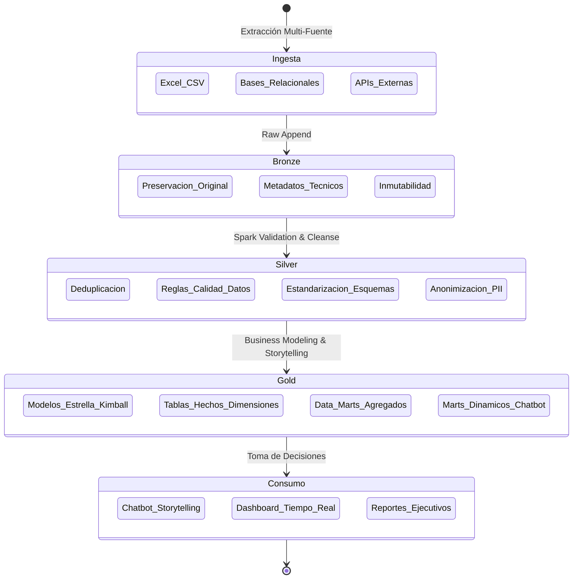
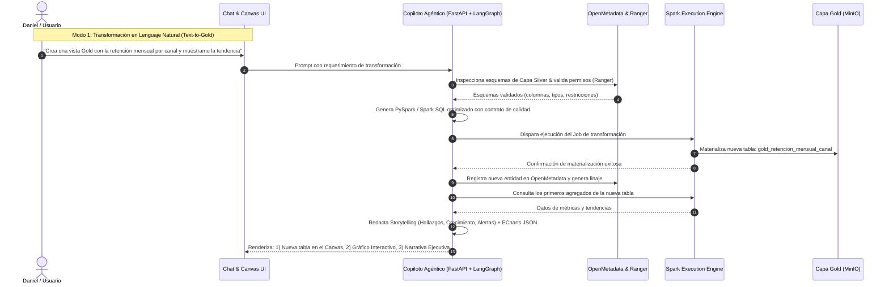

# Midas — Blueprint Arquitectónico Empresarial & Plan de Proyecto
## Enterprise Active Lakehouse & Conversational Intelligence Platform

> **Organización:** Riwi  
> **Líder de Proyecto & Arquitecto Principal:** Daniel Echeverría  
> **Equipo de Ingeniería:** Joshua Gonzales, Edgar Corzo, Elian Rivera, Dilan Chávez, Sebastian Castiblanco  
> **Fecha:** Octubre 2026  
> **Versión:** 1.0.0 (Enterprise Production Target)

---

## 1. Visión Ejecutiva y Factor Diferencial ("The Wow Factor")

El objetivo de este proyecto trasciende la construcción de un pipeline de datos tradicional o un chatbot estático de preguntas frecuentes. La meta es crear un **Data Fabric / Active Lakehouse Empresarial** dotado de **tres capacidades vanguardistas integradas**:

1. **Ingesta y Procesamiento Medallón Universal:** Ingesta agnóstica a la fuente (Bases de datos SQL/NoSQL, APIs REST, archivos Excel, CSV y streaming) procesada a través de un lago de datos estructurado en capas **Bronze (Crudo)**, **Silver (Limpio/Confiable)** y **Gold (Marts de Negocio/Storytelling)** usando MinIO y Apache Spark con formato transaccional Delta Lake / Apache Iceberg.
2. **Gobernanza y Seguridad Zero-Trust:** Linaje de datos de extremo a extremo, catálogo activo y observabilidad con **OpenMetadata**, clasificación de datos sensibles (PII) con **Apache Atlas**, y políticas de acceso centralizadas (RBAC/ABAC con enmascaramiento dinámico de columnas y filtrado de filas) con **Apache Ranger**.
3. **Observabilidad en Tiempo Real y Copiloto Agéntico (Text-to-Transformation & Storytelling):**
   - Una interfaz web moderna que muestra la **topología y el flujo de los datos en vivo** (tasas de ingesta, registros procesados, latencia, nodos activos).
   - Un **Chatbot Agéntico Analítico y Operacional**: No solo responde con gráficas interactivas y narrativa de negocio (storytelling) a partir de los datos reales, sino que permite **transformar datos en vivo a cualquier capa Gold mediante lenguaje natural** (*"Crea una vista Gold con la retención mensual de clientes por sector y genera el gráfico comparativo"*), validando permisos, ejecutando la transformación en Spark, registrando la nueva tabla en el catálogo y mostrándola en la UI en segundos.

---

## 2. Diagrama de Arquitectura Global de la Solución



---

## 3. Desglose Tecnológico y Responsabilidad por Componente

| Componente | Rol en la Arquitectura | Justificación & Estándar Técnico |
| :--- | :--- | :--- |
| **MinIO** | Almacenamiento Lakehouse (Object Storage S3-compatible) | Rendimiento ultrarrápido, compatibilidad 100% S3 API, soporte para tablas Delta Lake / Iceberg con versionamiento y ACID. Buckets dedicados: `lake-bronze`, `lake-silver`, `lake-gold`. |
| **Apache Spark (PySpark)** | Motor de Procesamiento Distribuido | Ejecuta las transformaciones masivas entre capas. Procesa archivos Excel/CSV, tablas relacionales o streams. Capacidad de ejecutar SQL dinámico generado por el agente para materializar nuevas capas Gold. |
| **Apache Airflow** | Orquestador de Flujos y Tareas | Orquestación basada en código (Python DAGs), reintentos automáticos, alertas, ejecución periódica y disparadores basados en eventos (*sensor triggers* cuando llega un nuevo archivo/dataset). |
| **OpenMetadata** | Catálogo de Datos, Linaje y Calidad | La cara moderna de la gobernanza: visualización instantánea del linaje de datos de extremo a extremo, perfilado automático de datos (data profiling), alertas de frescura y catálogo consumible vía API REST por el Chatbot. |
| **Apache Atlas** | Gestión de Metadatos y Clasificación | Taxonomía empresarial, clasificación automática de atributos (ej. `@PII`, `@Confidencial`, `@Financiero`), seguimiento de linaje a nivel de entidad de datos. |
| **Apache Ranger** | Motor de Seguridad y Políticas Centralizadas | Autorización granular de políticas (RBAC y ABAC), enmascaramiento dinámico (*masking* de hashes/nombres/teléfonos según el rol del usuario) y auditoría centralizada de accesos. |
| **FastAPI + LangGraph** | Backend del Copiloto Agéntico | Orquestación del flujo conversacional: validación semántica, generación segura de consultas SQL/Spark, motor de data storytelling y generación de especificaciones de gráficos. |
| **React / Next.js + ECharts + React Flow** | Plataforma Web Interactiva | Visualización en vivo del pipeline (React Flow animado con eventos WebSockets), panel de métricas operativas y de negocio, y consola conversacional integrada. |

---

## 4. El Ciclo de Vida de los Datos: Arquitectura Medallón



### 4.1. Capa Bronze (Raw / Crudo)
- **Propósito:** Ingesta fiel y sin modificaciones desde cualquier origen.
- **Estructura:** Particionado por `source_system/entity_name/year=YYYY/month=MM/day=DD/`.
- **Campos de Auditoría Obligatorios:**
  - `_raw_id`: UUID único del registro.
  - `_source_file_or_table`: Nombre del archivo o tabla original.
  - `_ingested_at`: Timestamp UTC de ingesta.
  - `_ingestion_batch_id`: Identificador de ejecución de Airflow.
  - `_payload`: Formato estructurado preservando tipos originales.

### 4.2. Capa Silver (Confiable / Enriquecida)
- **Propósito:** Los datos de la compañía limpios, auditados, deduplicados y tipados.
- **Acciones Clave:**
  - Tratamiento de nulos, valores atípicos y normalización de fechas/monedas.
  - Validación de esquemas y reglas de calidad (completitud, unicidad).
  - Aplicación de tags de Atlas (`PII`) y enmascaramiento coordinado con Ranger.
  - Esquema estructurado y optimizado (Parquet / Delta con compresión Snappy/ZSTD).

### 4.3. Capa Gold (Inteligencia de Negocio & Storytelling)
- **Propósito:** Responder preguntas directas del negocio y empoderar la toma de decisiones.
- **Modelado:**
  - Modelado Dimensional Kimball (Tablas de Hechos y Dimensiones: `dim_cliente`, `dim_tiempo`, `dim_producto`, `fact_transacciones`, `fact_asistencia`).
  - Capas de Agregación de Alto Rendimiento (KPIs precalculados: tasas de retención, márgenes, crecimiento interanual).
  - **Marts Dinámicos Agénticos:** Capacidad de registrar vistas materializadas Gold creadas por el chatbot bajo demanda para responder hipótesis complejas de los líderes.

---

## 5. El Funcionamiento del Chatbot: "Text-to-Transformation" & Data Storytelling



---

## 6. Distribución del Equipo (6 Personas) & Matriz RACI

El proyecto se estructura en 3 células técnicas de 2 integrantes, lideradas por Daniel Echeverría:

```mermaid
flowchart TD
    DE["Daniel Echeverría\nTeam Leader & Arquitecto Principal\n(Dirección Estratégica, Arquitectura Global y Gobierno de Calidad)"]

```mermaid
flowchart TD
    DE["Daniel Echeverría\n(Team Leader & Backend Lead)"]
    SC["Sebastian Castiblanco\n(Co-Líder & Scrum Master)"]

    subgraph SQUAD1["Squad 1: Backend & Data Lakehouse"]
        DEV1["Daniel Echeverría (Lead)"]
        DEV2["Edgar Corzo (Data Eng Lead & Backend Partner)"]
    end

    subgraph SQUAD2["Squad 2: Frontend & Real-Time Canvas"]
        DEV3["Dilan Chávez (Frontend Lead)"]
        DEV4["Joshua Gonzales (UI/UX & Frontend Partner)"]
    end

    subgraph SQUAD3["Squad 3: Agentic AI & Semantic Intelligence"]
        DEV5["Elian Rivera (AI & Intelligent Systems Lead)"]
        DEV6["Daniel Echeverría (Backend & API Support)"]
    end

    subgraph SQUAD4["Squad 4: Governance, Midas Guardian & Agile Management"]
        DEV7["Sebastian Castiblanco (Scrum Master & Governance Lead)"]
    end

    DE --> SQUAD1
    DE --> SQUAD3
    SC --> SQUAD4
    DE -.-> SQUAD2
```

### Responsabilidades Detalladas por Integrante:

#### 1. Daniel Echeverría (Team Leader & Principal Backend Architect)
- **Enfoque Principal:** Dirección estratégica de la solución, arquitectura general de sistemas, Core Backend (FastAPI, API Gateway, transporte de telemetría SSE) y supervisión del Lakehouse.
- **Entregables:**
  - Blueprint arquitectónico general, estándares de calidad y revisión de Pull Requests hacia `develop` y `main`.
  - API Gateway FastAPI y Hub de eventos SSE (`/api/v1/telemetry/stream`).
  - Integración con Trino / PostgreSQL y definición de contratos de datos.

#### 2. Edgar Corzo (Data Engineering Lead & Backend Partner)
- **Enfoque Principal:** Motor de procesamiento distribuido (Apache Spark), almacenamiento de objetos en MinIO S3 y tablas transaccionales Iceberg v2.
- **Entregables:**
  - Setup de MinIO S3 con buckets multi-fuente (`bronze`, `silver`, `gold`).
  - Universal Ingestion Engine: conectores para PostgreSQL (JDBC), Excel multi-hoja y feeds de API REST.
  - Transformaciones PySpark Bronze $\rightarrow$ Silver (inferencia dinámica de esquemas, normalización de fechas y montos) y Silver $\rightarrow$ Gold (marts dimensionales y agregaciones).

#### 3. Dilan Chávez (Frontend Lead & Real-Time Canvas Architect)
- **Enfoque Principal:** Liderazgo del desarrollo de la plataforma web interactiva y arquitectura del Canvas de flujo de datos en tiempo real.
- **Entregables:**
  - Canvas interactivo de flujo de datos con **React Flow** (topología visual de nodos Bronze, Silver y Gold con conexiones dinámicas).
  - Consumo en tiempo real de eventos SSE con animaciones de partículas y partículas de flujo.
  - Control de Time-Travel Replay (barra de scrubbing temporal para inspeccionar estados pasados).
  - Co-orquestación de Airflow DAG Factory e integración de telemetría hacia la UI.

#### 4. Joshua Gonzales (UI/UX Specialist & Frontend Partner)
- **Enfoque Principal:** Diseño visual y experiencia de usuario (UI/UX), plataforma conversacional del Copiloto Agéntico y componentes de gobernanza visual.
- **Entregables:**
  - Interfaz conversacional moderna para el Copiloto Agéntico (chat flotante y drawer interactivo).
  - Renderizado dinámico de visualizaciones de negocio con **Apache ECharts** (barras, series temporales, dispersión).
  - Lente Zero-Trust interactivo (selector de roles que atenúa o ilumina el Canvas y enmascara datos en tiempo real).
  - Drawer de linaje de datos y trazabilidad ("Explícame esta cifra").

#### 5. Elian Rivera (AI & Intelligent Systems Lead)
- **Enfoque Principal:** Inteligencia artificial agéntica, orquestación conversacional con LangGraph, Capa Semántica y motor Text-to-Gold.
- **Entregables:**
  - Máquina de estados conversacional con LangGraph en FastAPI.
  - Modo dialógico proactivo: introspección de esquemas y preguntas inteligentes al usuario sobre qué tablas o métricas explorar.
  - Motor Text-to-Gold: generación de consultas analíticas y especificaciones de DAG con guardrails OWASP (Zero-Hallucination, inyección de `LIMIT`, bloqueo de DDL/DML destructivo).
  - Motor de Data Storytelling (narrativa ejecutiva con recomendaciones accionables y síntesis de opciones ECharts).

#### 6. Sebastian Castiblanco (Co-Líder, Scrum Master & Data Governance Lead)
- **Enfoque Principal:** Co-liderazgo y facilitación ágil (Scrum Master), auditoría de no-colisión y anti-drift en `documentation/done/`, catálogo central y resiliencia con Midas Guardian.
- **Entregables:**
  - Cadencia ágil del sprint, verificación diaria del cumplimiento de criterios de aceptación y control de Code Drift.
  - Catálogo central y linaje de datos automatizado con **OpenMetadata**.
  - Clasificación de metadatos sensibles (PII) con **Apache Atlas** y definición de políticas de enmascaramiento con **Apache Ranger**.
  - Configuración y validación del subsistema de resiliencia **Midas Guardian** (clasificador de fallos F1-F5 y playbooks de auto-recuperación).

---

## 7. Plan de Ejecución del Sprint Intensivo (Entrega Miércoles 21 de Octubre)

> **Sprint de 4 Días:** Del Domingo 18 de Octubre al Miércoles 21 de Octubre (23:59).  
> **Demostración y Pitch en Vivo:** Jueves 22 de Octubre (30 minutos, 5 minutos por integrante).

```mermaid
gantt
    title Sprint Intensivo Midas (Entrega Miércoles 21 Oct)
    dateFormat  YYYY-MM-DD
    section Día 1 (Dom 18 Oct): Fundaciones
    Docker Stack & MinIO S3 Iceberg setup       :2026-10-18, 1d
    FastAPI Gateway & SSE Telemetry Hub         :2026-10-18, 1d
    React Flow Canvas & Scaffold Base UI        :2026-10-18, 1d
    LangGraph Core State Machine                :2026-10-18, 1d
    section Día 2 (Lun 19 Oct): Ingesta & Canales
    Universal Ingestion (Postgres, Excel, API)  :2026-10-19, 1d
    PySpark Bronze -> Silver con Calidad        :2026-10-19, 1d
    SSE Telemetry Stream conectado a Canvas     :2026-10-19, 1d
    Atlas PII Shield & OpenMetadata Catalog     :2026-10-19, 1d
    section Día 3 (Mar 20 Oct): Inteligencia & Guardian
    Capa Semántica, Text-to-Gold & Storytelling :2026-10-20, 1d
    Chat UI + ECharts Rendering + Drawer        :2026-10-20, 1d
    Midas Guardian: Inyección de Fallos F1-F5   :2026-10-20, 1d
    Lente Zero-Trust & Políticas Ranger         :2026-10-20, 1d
    section Día 4 (Mié 21 Oct): E2E & Congelación
    Pruebas E2E de Flujo Completo Multi-Fuente  :2026-10-21, 1d
    Time-Travel Replay & Ajustes de Estabilidad :2026-10-21, 1d
    Ensayo de Demo 30 Minutos (6 Integrantes)   :2026-10-21, 1d
    Congelación de Código & Release v1.0.0      :2026-10-21, 1d
```

---

## 8. Protocolo de Trabajo Colaborativo (Zero-Collision & Concurrencia)

1. **Estructura de Ramas Estricta:**
   - `main`: Código probado y estable en producción.
   - `develop`: Rama de integración activa.
   - `feature/<area>-<nombre-funcionalidad>` según el Product Backlog oficial (`documentation/04_product_backlog.md`).
2. **Propiedad de Código por Módulos (Single-Area Ownership en Midas):**
   - `src/lakehouse/`: Propiedad de Squad 1 (Spark & Ingestion - Edgar & Daniel).
   - `src/orchestration/`: Propiedad de Squad 1 / Squad 2 (Airflow DAGs & Sensores - Edgar & Dilan).
   - `src/security_governance/`: Propiedad de Squad 4 (Ranger/Atlas/OpenMetadata & Guardian - Sebastian).
   - `src/agent/`: Propiedad de Squad 3 (FastAPI, LangGraph & Storytelling - Elian & Daniel).
   - `src/frontend/`: Propiedad de Squad 2 (React Flow Canvas, Chat Copiloto, ECharts - Dilan & Joshua).
3. **Registro Diario de Entregas (`documentation/done/`):**
   - Cada entrega completada se documenta bajo:  
     `documentation/done/[area]/[area]-[nombre_epica]-[nombre_hu]-[numero].md`  
     con criterios de aceptación, pruebas ejecutadas y comando de verificación.
