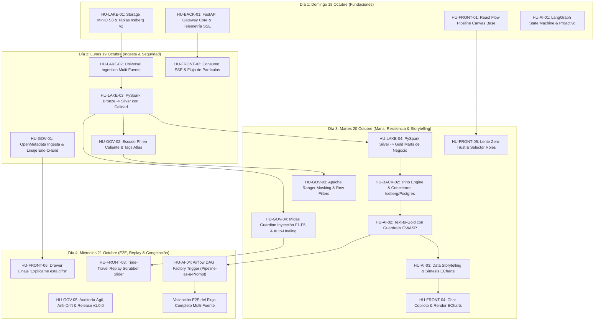

# Midas — Product Backlog Oficial & Plan de Sprint
## Enterprise Active Lakehouse & Conversational Intelligence Platform

> **Líder de Proyecto & Backend Lead:** Daniel Echeverría  
> **Co-Líder, Scrum Master & Governance Lead:** Sebastian Castiblanco  
> **Data Engineering Lead & Backend Partner:** Edgar Corzo  
> **Frontend Lead & Canvas Architect:** Dilan Chávez  
> **UI/UX Specialist & Frontend Partner:** Joshua Gonzales  
> **AI & Intelligent Systems Lead:** Elian Rivera  
> **Fecha de Inicio del Sprint:** Domingo 18 de Octubre de 2026  
> **Fecha Límite de Congelación y Entrega:** Miércoles 21 de Octubre de 2026 (23:59)  
> **Presentación en Vivo (Pitch 30 min):** Jueves 22 de Octubre de 2026  
> **Estado:** Aprobado e Inmutable según `rules/01_anti_code_drift_policy.md`

---

## 1. Visión General del Sprint y Células de Trabajo (Squads)

Este backlog rige la ejecución técnica de 4 días intensivos para construir el **MVP Dorado de Midas**. Cada Historia de Usuario cuenta con una rama oficial delimitada por módulo (`Single-Area Ownership`), criterios de aceptación matemáticos y de observabilidad, y un registro mandatorio de completitud bajo `documentation/done/[area]/`.

### Matriz de Distribución de Células:

| Squad | Área Técnica | Líder | Acompañante / Soporte | Módulo de Código (`Single-Area Ownership`) |
| :--- | :--- | :--- | :--- | :--- |
| **Squad 1** | **Backend & Lakehouse Core** | Daniel Echeverría | Edgar Corzo | `src/lakehouse/`, `src/core/`, `src/api/` |
| **Squad 2** | **Frontend & Real-Time Canvas**| Dilan Chávez | Joshua Gonzales | `src/frontend/` |
| **Squad 3** | **Agentic AI & Capa Semántica**| Elian Rivera | Daniel Echeverría | `src/agent/` |
| **Squad 4** | **Gobernanza & Midas Guardian**| Sebastian Castiblanco | Equipo Midas | `src/security_governance/`, `rules/`, `documentation/done/` |

---

## 2. Mapa de Dependencias y Cronograma de Entrega (18 al 21 de Octubre)

---

## 3. Historias de Usuario Detalladas por Squad

---

### 🛡️ SQUAD 1: Backend & Data Lakehouse Core
**Líder:** Daniel Echeverría  
**Acompañante:** Edgar Corzo

#### HU-LAKE-01: Storage MinIO S3 & Configuración de Tablas Iceberg v2
- **ID:** `HU-LAKE-01`
- **Responsable:** Edgar Corzo (Data Eng) / Revisión: Daniel Echeverría
- **Rama Oficial:** `feature/lakehouse-storage-minio-iceberg`
- **Módulo de Código:** `src/lakehouse/storage/`, `docker/minio/`
- **Fecha Límite:** Domingo 18 de Octubre (20:00)
- **Historia de Usuario:**  
  *Como Data Engineer, quiero aprovisionar los buckets de MinIO y el catálogo Iceberg REST en Docker, para garantizar almacenamiento transaccional ACID inmutable en capas Bronze, Silver y Gold.*
- **Criterios de Aceptación:**
  1. Buckets de MinIO creados: `midas-bronze`, `midas-silver`, `midas-gold`, `midas-quarantine`, `midas-governance`.
  2. Catálogo Apache Iceberg REST operativo en puerto 8181 persistiendo metadatos contra PostgreSQL.
  3. Soporte de operaciones ACID: Snapshot isolation, Time-Travel queries (`FOR SYSTEM_TIME AS OF`), y evolución de esquemas sin reescritura.
  4. Healthcheck automatizado en script Python `tests/verify_storage_iceberg.py` pasando con código de salida 0.
- **Entregable en Documentación:**  
  `documentation/done/lakehouse/lakehouse-storage-minio-iceberg-01.md`

---

#### HU-LAKE-02: Universal Ingestion Engine Multi-Fuente (Postgres, Excel, REST API)
- **ID:** `HU-LAKE-02`
- **Responsable:** Edgar Corzo / Daniel Echeverría
- **Rama Oficial:** `feature/lakehouse-universal-ingestion`
- **Módulo de Código:** `src/lakehouse/ingestion/`
- **Fecha Límite:** Lunes 19 de Octubre (14:00)
- **Historia de Usuario:**  
  *Como Data Engineer, quiero un motor de ingesta universal desacoplado de esquemas rígidos, para capturar datos simultáneamente desde PostgreSQL (JDBC), hojas de cálculo Excel multi-hoja y feeds de API REST.*
- **Criterios de Aceptación:**
  1. Ingesta JDBC desde PostgreSQL leyendo tablas operacionales y generando snapshots Bronze con envoltura de auditoría (`_ingested_at`, `_source_type: "JDBC_POSTGRES"`, `_raw_payload_hash`).
  2. Conector Excel (`openpyxl` / PySpark) capaz de procesar archivos multi-hoja con cabeceras en filas variables, espacios en blanco y celdas combinadas.
  3. Conector REST API con paginación basada en cursor y reintentos exponenciales.
  4. Inyección del huella digital del esquema (`_schema_fingerprint: SHA256`) en cada lote Bronze para auditar deriva de columnas.
- **Entregable en Documentación:**  
  `documentation/done/lakehouse/lakehouse-universal-ingestion-02.md`

---

#### HU-LAKE-03: PySpark Bronze $\rightarrow$ Silver Cleansing & Quality Gate
- **ID:** `HU-LAKE-03`
- **Responsable:** Edgar Corzo (Data Eng) / Revisión: Daniel Echeverría
- **Rama Oficial:** `feature/lakehouse-spark-bronze-silver`
- **Módulo de Código:** `src/lakehouse/transforms/bronze_to_silver.py`
- **Fecha Límite:** Lunes 19 de Octubre (22:00)
- **Historia de Usuario:**  
  *Como Data Engineer, quiero estandarizar y validar los datos de Bronze hacia Silver con PySpark, para asegurar tipado fuerte, deduplicación y desvío de anomalías.*
- **Criterios de Aceptación:**
  1. Tipado estricto de fechas (ISO 8601 UTC) y normalización de montos monetarios (eliminación de símbolos `$` y comas, conversión a `DECIMAL(18,2)`).
  2. Deduplicación determinística basada en clave de negocio (`id_orden` o `id_registro` más fecha de actualización).
  3. Desvío de registros corruptos (precios negativos, IDs nulos) hacia el bucket `midas-quarantine` emitiendo evento de telemetría a Midas Guardian.
  4. Registro de estadísticas de lote: `total_read`, `valid_count`, `quarantined_count`, `processing_ms`.
- **Entregable en Documentación:**  
  `documentation/done/lakehouse/lakehouse-spark-bronze-silver-03.md`

---

#### HU-LAKE-04: PySpark Silver $\rightarrow$ Gold Business Marts & KPI Aggregations
- **ID:** `HU-LAKE-04`
- **Responsable:** Edgar Corzo / Daniel Echeverría
- **Rama Oficial:** `feature/lakehouse-spark-silver-gold`
- **Módulo de Código:** `src/lakehouse/transforms/silver_to_gold.py`
- **Fecha Límite:** Martes 20 de Octubre (16:00)
- **Historia de Usuario:**  
  *Como Data Engineer, quiero construir los marts analíticos en capa Gold siguiendo el modelado dimensional canónico, para alimentar consultas de alto rendimiento del Copiloto y tableros.*
- **Criterios de Aceptación:**
  1. Materialización del mart `gold.fct_ventas_diarias` y `gold.dim_tiendas_regiones`.
  2. Implementación de las métricas canónicas oficiales estipuladas en `documentation/canonical/04_logica_de_negocio_y_resiliencia_guardian.md`:
     $$\text{Venta Neta} = \sum (\text{precio\_unitario} \times \text{cantidad} \times (1 - \text{descuento}))$$
     $$\text{Ticket Promedio} = \frac{\text{Venta Neta}}{\text{Conteo de Pedidos Válidos}}$$
  3. Particionado por año y mes (`partition_by: ["anio", "mes"]`) con z-ordering en IDs de clientes y regiones.
  4. Generación de firmas de metadatos para registro automático en OpenMetadata.
- **Entregable en Documentación:**  
  `documentation/done/lakehouse/lakehouse-spark-silver-gold-04.md`

---

#### HU-BACK-01: FastAPI Gateway Core & Telemetry Server-Sent Events (SSE) Hub
- **ID:** `HU-BACK-01`
- **Responsable:** Daniel Echeverría (Backend Lead)
- **Rama Oficial:** `feature/backend-api-gateway-sse`
- **Módulo de Código:** `src/api/`, `src/core/telemetry/`
- **Fecha Límite:** Domingo 18 de Octubre (22:00)
- **Historia de Usuario:**  
  *Como Backend Lead, quiero un API Gateway de alto rendimiento con FastAPI y un hub de eventos SSE, para transmitir el estado de los pipelines en tiempo real al Canvas y coordinar el sistema.*
- **Criterios de Aceptación:**
  1. Endpoint `/api/v1/telemetry/stream` emitiendo eventos SSE continuos estructurados:
     `{"pipeline_id": "...", "node_id": "silver_cleansing", "status": "RUNNING", "records_in": 1200, "records_out": 1186, "latency_ms": 42}`.
  2. Soporte de reconexión transparente con cabecera `Last-Event-ID` y buffer de últimos 100 eventos en memoria Redis/Postgres.
  3. Middleware de trazabilidad de peticiones con `X-Correlation-ID` propagado entre microservicios.
  4. Documentación interactiva Swagger/OpenAPI generada y validada en `/docs`.
- **Entregable en Documentación:**  
  `documentation/done/backend/backend-api-gateway-sse-01.md`

---

#### HU-BACK-02: Query Engine Integration Trino / Postgres & Dynamic Catalog
- **ID:** `HU-BACK-02`
- **Responsable:** Daniel Echeverría (Backend Lead)
- **Rama Oficial:** `feature/backend-trino-query-engine`
- **Módulo de Código:** `src/core/query_engine/`, `docker/trino/`
- **Fecha Límite:** Martes 20 de Octubre (14:00)
- **Historia de Usuario:**  
  *Como Backend Lead, quiero integrar Trino como motor de consultas federadas sobre Iceberg y PostgreSQL, para que el Copiloto ejecute queries analíticas con baja latencia y alta concurrencia.*
- **Criterios de Aceptación:**
  1. Trino conectado al catálogo Iceberg REST (`iceberg.gold.*`, `iceberg.silver.*`) y al catálogo PostgreSQL (`postgresql.public.*`).
  2. Implementación de pool de conexiones asíncrono con timeout máximo de 10 segundos y límite forzado de filas (`LIMIT 1000`).
  3. Exposición de endpoint `/api/v1/query/execute` con validación de sintaxis previa y estimación de costo.
  4. Cero fugas de credenciales en logs de ejecución.
- **Entregable en Documentación:**  
  `documentation/done/backend/backend-trino-query-engine-02.md`

---

### 🎨 SQUAD 2: Frontend & Real-Time Canvas
**Líder:** Dilan Chávez  
**Acompañante:** Joshua Gonzales

#### HU-FRONT-01: React Flow Interactive Pipeline Canvas & Live Node Topologies
- **ID:** `HU-FRONT-01`
- **Responsable:** Dilan Chávez (Frontend Lead)
- **Rama Oficial:** `feature/frontend-reactflow-canvas`
- **Módulo de Código:** `src/frontend/components/canvas/`
- **Fecha Límite:** Domingo 18 de Octubre (23:00)
- **Historia de Usuario:**  
  *Como Frontend Lead, quiero un Canvas interactivo con React Flow que represente los nodos de ingesta, Bronze, Silver, Gold y Guardian, para visualizar la arquitectura activa del sistema.*
- **Criterios de Aceptación:**
  1. Topología interactiva con nodos customizados: Fuentes (`PostgreSQL`, `Excel`, `API`), `Bronze`, `Silver Cleanse`, `Midas Guardian`, `Gold Marts`.
  2. Indicadores visuales de estado: Verde (`HEALTHY`), Ámbar (`DEGRADED / AUTO-HEALING`), Rojo (`ERROR`), Azul (`IN_PROGRESS`).
  3. Conexiones visuales animadas (edges) con partículas de flujo según el tráfico de datos.
  4. Minimapa, controles de zoom, fit-view y selección de nodo para inspeccionar métricas detalladas en un panel lateral.
- **Entregable en Documentación:**  
  `documentation/done/frontend/frontend-reactflow-canvas-01.md`

---

#### HU-FRONT-02: Real-Time SSE Telemetry Consumer & Smooth Particle Flow Animations
- **ID:** `HU-FRONT-02`
- **Responsable:** Dilan Chávez (Frontend Lead)
- **Rama Oficial:** `feature/frontend-sse-telemetry`
- **Módulo de Código:** `src/frontend/hooks/useTelemetryStream.ts`
- **Fecha Límite:** Lunes 19 de Octubre (18:00)
- **Historia de Usuario:**  
  *Como Frontend Lead, quiero conectar el Canvas a la transmisión SSE del backend, para actualizar en caliente las métricas de nodos y la velocidad de partículas sin refrescar la página.*
- **Criterios de Aceptación:**
  1. Hook `useTelemetryStream` que abre conexión `EventSource` hacia `/api/v1/telemetry/stream` con auto-reconexión y backoff exponencial.
  2. Actualización de contadores de registros en vivo en la cabecera de cada nodo con transiciones suaves (60 FPS).
  3. Modulación de velocidad de partículas de los edges proporcional a la tasa de registros/segundo reportada por Spark y Airflow.
  4. Manejo elegante de desconexión con banner discreto de estado en la UI.
- **Entregable en Documentación:**  
  `documentation/done/frontend/frontend-sse-telemetry-02.md`

---

#### HU-FRONT-03: Time-Travel Replay Scrubber & Operational Historical Slider
- **ID:** `HU-FRONT-03`
- **Responsable:** Dilan Chávez (Frontend Lead)
- **Rama Oficial:** `feature/frontend-time-travel-replay`
- **Módulo de Código:** `src/frontend/components/canvas/TimeTravelScrubber.tsx`
- **Fecha Límite:** Miércoles 21 de Octubre (14:00)
- **Historia de Usuario:**  
  *Como Operador de Datos, quiero una barra de deslizamiento temporal en el Canvas, para rebobinar el estado del pipeline e inspeccionar cómo ocurrió un incidente histórico como una película.*
- **Criterios de Aceptación:**
  1. Barra de reproducción con controles: `Play`, `Pause`, `Speed (1x, 2x, 5x)` y slider continuo de las últimas 24 horas.
  2. Modo `LIVE` activo por defecto que sincroniza con la telemetría en tiempo real.
  3. Al arrastrar el slider a una hora pasada (ej. 02:00 AM), el Canvas actualiza los colores de nodos, contadores de registros y alertas al snapshot de ese instante.
  4. Badge visual destacado `[MODO REPLAY HISTÓRICO - T-XXm]` para evitar confusiones operacionales.
- **Entregable en Documentación:**  
  `documentation/done/frontend/frontend-time-travel-replay-03.md`

---

#### HU-FRONT-04: Conversational Copilot Chat Interface & Rich ECharts Component
- **ID:** `HU-FRONT-04`
- **Responsable:** Joshua Gonzales (UI/UX & Frontend Partner)
- **Rama Oficial:** `feature/frontend-copilot-chat-echarts`
- **Módulo de Código:** `src/frontend/components/copilot/`
- **Fecha Límite:** Martes 20 de Octubre (18:00)
- **Historia de Usuario:**  
  *Como UI/UX Specialist, quiero una interfaz de chat conversacional integrada con Apache ECharts, para que el usuario consulte datos en lenguaje natural y reciba respuestas con gráficos interactivos y narrativa.*
- **Criterios de Aceptación:**
  1. Widget flotante y drawer expandible con historial de mensajes, estado de escritura (*thinking / querying*) y sugerencias rápidas ("Pills").
  2. Componente de visualización con **Apache ECharts** adaptable: renderizado dinámico de barras, líneas temporales y mapas de calor a partir del JSON devuelto por el agente.
  3. Tooltips enriquecidos, exportación de gráfico en PNG y alternador a vista de tabla de datos crudos.
  4. Botón de acción `[Aprobar y Crear Pipeline en Airflow]` cuando el agente proponga una vista Text-to-Gold.
- **Entregable en Documentación:**  
  `documentation/done/frontend/frontend-copilot-chat-echarts-04.md`

---

#### HU-FRONT-05: Zero-Trust Security Lens & Interactive Role Switcher UI
- **ID:** `HU-FRONT-05`
- **Responsable:** Joshua Gonzales (UI/UX & Frontend Partner)
- **Rama Oficial:** `feature/frontend-zero-trust-lens`
- **Módulo de Código:** `src/frontend/components/security/ZeroTrustLens.tsx`
- **Fecha Límite:** Martes 20 de Octubre (22:00)
- **Historia de Usuario:**  
  *Como UI/UX Specialist, quiero un conmutador de roles en la cabecera que transforme la UI en caliente, para que el jurado aprecie visualmente cómo las restricciones de seguridad y enmascaramiento alteran la plataforma.*
- **Criterios de Aceptación:**
  1. Selector de perfiles en cabecera: `Director General (Admin)`, `Gerente Regional Norte (RBAC)`, `Auditor de Cumplimiento (Compliance)`.
  2. Efecto visual en Canvas: Los nodos no autorizados para el rol seleccionado se atenúan con opacidad del 30% y muestran un candado de seguridad.
  3. En las tablas y gráficas: Datos PII como correos y salarios aparecen con máscara (`u****@riwi.io`, `****`) de forma reactiva inmediata.
  4. Banner superior informativo: *"Simulando sesión bajo perfil: [Nombre de Rol] · Políticas Ranger activas"*.
- **Entregable en Documentación:**  
  `documentation/done/frontend/frontend-zero-trust-lens-05.md`

---

#### HU-FRONT-06: Data Lineage & "Explain This Number" Drawer
- **ID:** `HU-FRONT-06`
- **Responsable:** Joshua Gonzales (UI/UX) / Dilan Chávez
- **Rama Oficial:** `feature/frontend-lineage-drawer`
- **Módulo de Código:** `src/frontend/components/lineage/ExplainNumberDrawer.tsx`
- **Fecha Límite:** Miércoles 21 de Octubre (18:00)
- **Historia de Usuario:**  
  *Como Usuario de Negocio, quiero hacer clic en cualquier cifra del chat para abrir el drawer "Explícame esta cifra", para auditar la fórmula exacta, el linaje de tablas y la certificación de calidad detrás de ese valor.*
- **Criterios de Aceptación:**
  1. Toda cifra destacada en los mensajes del Copiloto es clickable con efecto hover sutil.
  2. Drawer lateral deslizante mostrando:
     - **Fórmula matemática canónica aplicada** (renderizada con LaTeX).
     - **Árbol de linaje visual:** `Fuente Original` $\rightarrow$ `Bronze Parquet` $\rightarrow$ `Silver Cleanse` $\rightarrow$ `Gold Mart`.
     - **Metadatos de frescura y certificación:** Fecha de última sincronización, porcentaje de calidad (100%) y hash de auditoría.
  3. Cierre accesible con tecla `Escape` o clic fuera del panel.
- **Entregable en Documentación:**  
  `documentation/done/frontend/frontend-lineage-drawer-06.md`

---

### 🤖 SQUAD 3: Agentic AI & Semantic Intelligence
**Líder:** Elian Rivera  
**Acompañante:** Daniel Echeverría

#### HU-AI-01: LangGraph Conversational State Machine & Proactive Dialogic Mode
- **ID:** `HU-AI-01`
- **Responsable:** Elian Rivera (AI Lead)
- **Rama Oficial:** `feature/agent-langgraph-state-machine`
- **Módulo de Código:** `src/agent/graph/`, `src/agent/state.py`
- **Fecha Límite:** Domingo 18 de Octubre (23:00)
- **Historia de Usuario:**  
  *Como AI Lead, quiero una máquina de estados conversacional con LangGraph, para que el agente entable un diálogo proactivo y guíe al usuario preguntando qué fuentes o esquemas desea analizar.*
- **Criterios de Aceptación:**
  1. Grafo de estados estructurado: `route_intent` $\rightarrow$ `introspect_schema` $\rightarrow$ `proactive_suggest` $\rightarrow$ `generate_sql` $\rightarrow$ `validate_guardrails` $\rightarrow$ `execute_query` $\rightarrow$ `synthesize_storytelling`.
  2. Modo Dialógico Proactivo ante saludos o preguntas genéricas (*"¿Qué puedo consultar?"*): El agente responde listando las fuentes activas conectadas (PostgreSQL, Excel, API REST) y propone 3 análisis de alto impacto.
  3. Memoria conversacional por sesión (`thread_id`) con persistencia en PostgreSQL o Redis.
  4. Manejo de ambigüedades: Si el usuario pide *"ventas"* sin especificar año, el agente repregunta proactivamente ofreciendo opciones.
- **Entregable en Documentación:**  
  `documentation/done/agent/agent-langgraph-state-machine-01.md`

---

#### HU-AI-02: Text-to-Gold Query Generation & OWASP Top 10 Guardrails
- **ID:** `HU-AI-02`
- **Responsable:** Elian Rivera (AI Lead) / Daniel Echeverría
- **Rama Oficial:** `feature/agent-text-to-gold-guardrails`
- **Módulo de Código:** `src/agent/tools/text_to_sql.py`, `src/agent/guardrails/`
- **Fecha Límite:** Martes 20 de Octubre (14:00)
- **Historia de Usuario:**  
  *Como AI Lead, quiero un motor de generación SQL para Trino con guardrails de seguridad estrictos, para responder consultas complejas sin riesgos de inyección, sobrecosto o alucinaciones.*
- **Criterios de Aceptación:**
  1. Generación de SQL sintácticamente válido para Trino Iceberg sobre las tablas Gold y Silver canónicas.
  2. Guardrails de Seguridad Infranqueables:
     - Bloqueo total de comandos de modificación o definición (`DROP`, `DELETE`, `TRUNCATE`, `ALTER`, `INSERT`).
     - Inyección obligatoria de `LIMIT 1000` si la query no incluye límite.
     - Detección de intentos de Prompt Injection o evasión de restricciones.
  3. Zero-Hallucination Schema Validator: Las columnas y tablas en el SQL generado deben existir rigurosamente en el catálogo introspeccionado de Trino.
  4. Suite de pruebas con 20 ataques sintéticos y queries maliciosas bloqueadas al 100%.
- **Entregable en Documentación:**  
  `documentation/done/agent/agent-text-to-gold-guardrails-02.md`

---

#### HU-AI-03: Executive Data Storytelling Engine & Automated ECharts Option Synthesis
- **ID:** `HU-AI-03`
- **Responsable:** Elian Rivera (AI Lead)
- **Rama Oficial:** `feature/agent-storytelling-echarts`
- **Módulo de Código:** `src/agent/storytelling/`
- **Fecha Límite:** Martes 20 de Octubre (20:00)
- **Historia de Usuario:**  
  *Como AI Lead, quiero un motor de síntesis que traduzca resultados de datos crudos en narrativa ejecutiva y opciones de gráficos ECharts, para ofrecer insights orientados a la toma de decisiones.*
- **Criterios de Aceptación:**
  1. Salida estructurada JSON que incluye:
     - `narrative`: Resumen ejecutivo en markdown con hallazgos clave, viñetas y recomendaciones de negocio.
     - `echarts_option`: Objeto de configuración válido para Apache ECharts (título, ejes, leyendas, tooltip, paleta corporativa Midas).
     - `metrics_summary`: Cifras clave con etiquetas para el drawer de linaje.
  2. Inferencia automática del mejor tipo de visualización según la tipología de datos:
     - Datos temporales $\rightarrow$ Gráfico de líneas / área.
     - Categorías discretas $\rightarrow$ Gráfico de barras horizontales o verticales.
     - Correlaciones numéricas $\rightarrow$ Gráfico de dispersión.
  3. Cero alucinación de cifras: Todos los números de la narrativa deben coincidir exactamente con el dataset retornado por Trino.
- **Entregable en Documentación:**  
  `documentation/done/agent/agent-storytelling-echarts-03.md`

---

#### HU-AI-04: Airflow DAG Materialization Trigger ("Pipeline-as-a-Prompt")
- **ID:** `HU-AI-04`
- **Responsable:** Elian Rivera (AI Lead) / Daniel Echeverría
- **Rama Oficial:** `feature/agent-pipeline-as-a-prompt`
- **Módulo de Código:** `src/agent/tools/dag_generator.py`
- **Fecha Límite:** Miércoles 21 de Octubre (16:00)
- **Historia de Usuario:**  
  *Como AI Lead, quiero que el agente sea capaz de materializar nuevas vistas Gold mediante especificaciones declarativas para Airflow, para transformar solicitudes en lenguaje natural en pipelines productivos.*
- **Criterios de Aceptación:**
  1. Cuando el usuario confirma *"Materializa este reporte como tabla Gold diaria"*, el agente genera un archivo YAML de especificación validado:
     `s3://midas-governance/airflow-specs/dag_gold_[nombre_reporte].yaml`.
  2. La especificación incluye: query SQL validada, frecuencia de ejecución cron, políticas de calidad y nombre de tabla de destino.
  3. El Airflow DAG Factory detecta el nuevo YAML y despliega el DAG dinámico automáticamente sin necesidad de reiniciar contenedores.
  4. Se emite evento SSE de nuevo nodo disponible hacia el Canvas de Frontend.
- **Entregable en Documentación:**  
  `documentation/done/agent/agent-pipeline-as-a-prompt-04.md`

---

### 🏛️ SQUAD 4: Governance, Midas Guardian & Agile Management
**Líder:** Sebastian Castiblanco (Co-Líder & Scrum Master)  
**Soporte:** Todo el Equipo

#### HU-GOV-01: OpenMetadata Catalog Ingestion & Automated End-to-End Lineage
- **ID:** `HU-GOV-01`
- **Responsable:** Sebastian Castiblanco (Governance Lead)
- **Rama Oficial:** `feature/governance-openmetadata-catalog`
- **Módulo de Código:** `src/security_governance/openmetadata/`
- **Fecha Límite:** Lunes 19 de Octubre (20:00)
- **Historia de Usuario:**  
  *Como Governance Lead, quiero desplegar OpenMetadata y automatizar la ingesta de metadatos desde MinIO, Trino y Spark, para auditar el catálogo central y visualizar el linaje de extremo a extremo.*
- **Criterios de Aceptación:**
  1. Despliegue de OpenMetadata Server y OpenSearch operativo en Docker.
  2. Conectores configurados para extraer metadatos de las tablas Iceberg (`bronze`, `silver`, `gold`) y PostgreSQL operacional.
  3. Extracción de linaje automatizado: OpenMetadata dibuja la relación de dependencia entre fuentes, transformaciones PySpark y tablas de consumo Gold.
  4. Exposición de API REST para que el drawer "Explícame esta cifra" de Frontend consulte el linaje en caliente.
- **Entregable en Documentación:**  
  `documentation/done/security/governance-openmetadata-catalog-01.md`

---

#### HU-GOV-02: PII Detection Shield & Dynamic Tagging via Apache Atlas API
- **ID:** `HU-GOV-02`
- **Responsable:** Sebastian Castiblanco (Governance Lead)
- **Rama Oficial:** `feature/governance-atlas-pii-shield`
- **Módulo de Código:** `src/security_governance/atlas/`
- **Fecha Límite:** Lunes 19 de Octubre (23:00)
- **Historia de Usuario:**  
  *Como Governance Lead, quiero un escudo de detección de datos sensibles (PII) durante la transición Bronze $\rightarrow$ Silver, para clasificar columnas automáticamente en Apache Atlas con etiquetas vinculantes.*
- **Criterios de Aceptación:**
  1. Clasificador basado en expresiones regulares y nombres de columnas que detecta: correos electrónicos, números de identificación/cédula, tarjetas de crédito, salarios/montos personales.
  2. Llamada asíncrona a la API REST de Apache Atlas para registrar la clasificación `PII_CONFIDENCIAL` sobre la columna detectada.
  3. Sincronización automática de clasificaciones hacia Apache Ranger mediante TagSync en menos de 5 segundos.
  4. Log de auditoría inmutable con fecha, lote, tabla y columnas clasificadas.
- **Entregable en Documentación:**  
  `documentation/done/security/governance-atlas-pii-shield-02.md`

---

#### HU-GOV-03: Apache Ranger Dynamic Masking & Row-Level Filtering Policies
- **ID:** `HU-GOV-03`
- **Responsable:** Sebastian Castiblanco (Governance Lead)
- **Rama Oficial:** `feature/governance-ranger-security-policies`
- **Módulo de Código:** `src/security_governance/ranger/`
- **Fecha Límite:** Martes 20 de Octubre (18:00)
- **Historia de Usuario:**  
  *Como Governance Lead, quiero configurar políticas de enmascaramiento dinámico y filtrado por filas en Apache Ranger, para restringir los datos en Trino de acuerdo con el rol del usuario.*
- **Criterios de Aceptación:**
  1. Política de Enmascaramiento Dinámico para columnas con tag `PII_CONFIDENCIAL`:
     - Rol `Analista`: Enmascaramiento por hash o sustitución parcial (`u****@riwi.io`).
     - Rol `Auditor` / `Admin`: Acceso a texto completo previa auditoría.
  2. Política de Filtrado de Filas (Row-Level Security):
     - Rol `Gerente Regional Norte`: Trino agrega automáticamente `WHERE region = 'NORTE'` de manera transparente en cada consulta.
  3. Plugin de Apache Ranger para Trino validando las consultas sin degradar la latencia por más de 15 ms.
- **Entregable en Documentación:**  
  `documentation/done/security/governance-ranger-security-policies-03.md`

---

#### HU-GOV-04: Midas Guardian Failure Injector & Auto-Healing Playbooks F1-F5
- **ID:** `HU-GOV-04`
- **Responsable:** Sebastian Castiblanco (Co-Líder & Reliability)
- **Rama Oficial:** `feature/governance-guardian-auto-healing`
- **Módulo de Código:** `src/security_governance/guardian/`, `scripts/inject_fault.py`
- **Fecha Límite:** Martes 20 de Octubre (22:00)
- **Historia de Usuario:**  
  *Como Reliability Lead, quiero un subsistema de auto-recuperación activa con script de inyección de fallos, para demostrar en vivo que Midas contiene anomalías y se auto-cura sin corromper la capa Gold.*
- **Criterios de Aceptación:**
  1. Script ejecutable de inyección de fallos `scripts/inject_fault.py --fault [F1|F2|F3|F4|F5]`:
     - `F1`: Inyección de montos negativos y nulos en lote Silver.
     - `F2`: Deriva de esquema (*schema drift* con columnas faltantes o renombradas).
     - `F3`: Duplicados masivos en tabla dimensional.
     - `F4`: Caída simulada de contenedor de ingesta.
     - `F5`: Corrupción de archivo Parquet en MinIO.
  2. Clasificador de errores de Guardian detectando el tipo de anomalía y disparando el playbook correspondiente en menos de 2 segundos.
  3. Ejecución demostrable del playbook `QUARANTINE_INVALID_ROWS_V1`: Aislamiento de filas corruptas en `midas-quarantine` y continuación del 99.8% de datos limpios hacia Gold.
  4. Emisión de evento SSE de alerta y auto-sanación hacia el Canvas de Frontend (nodo Midas Guardian activado en ámbar y luego verde).
- **Entregable en Documentación:**  
  `documentation/done/security/governance-guardian-auto-healing-04.md`

---

#### HU-GOV-05: Agile Delivery Audit, Code-Drift Verification & PR Gatekeeper
- **ID:** `HU-GOV-05`
- **Responsable:** Sebastian Castiblanco (Scrum Master) / Daniel Echeverría
- **Rama Oficial:** `feature/governance-scrum-anti-drift-audit`
- **Módulo de Código:** `.github/workflows/`, `rules/`, `documentation/done/`
- **Fecha Límite:** Miércoles 21 de Octubre (20:00)
- **Historia de Usuario:**  
  *Como Scrum Master, quiero auditar la cadencia diaria del sprint y bloquear cualquier PR con Code Drift, para garantizar que el 100% de las entregas cumplan la política Document-First antes de la congelación final.*
- **Criterios de Aceptación:**
  1. Verificación diaria de entregas en `documentation/done/[area]/`: Ninguna HU se considera cerrada sin su archivo de evidencias y tests pasando.
  2. Cumplimiento estricto del protocolo `team-concurrency-guard`: Cero modificaciones cruzadas entre áreas (`Single-Area Ownership`).
  3. Auditoría de fórmulas matemáticas y contratos: Comprobar que ningún código en `src/` altere las fórmulas canónicas de `documentation/canonical/04_logica_de_negocio_...md`.
  4. Preparación de la versión final v1.0.0 y ensayo general de la demostración de 30 minutos con los 6 integrantes.
- **Entregable en Documentación:**  
  `documentation/done/other/governance-scrum-anti-drift-audit-05.md`

---

## 4. Definición de Hecho (Definition of Done - DoD) Global

Para que cualquier Historia de Usuario sea aceptada y fusionada en `develop` y posteriormente en `main`, debe satisfacer:

1. **Document-First Cumplido:** La funcionalidad corresponde a una HU de este backlog y a las especificaciones de `documentation/canonical/`.
2. **Pruebas Automatizadas Verificadas:** Suite de tests unitarios o de integración pasando exitosamente en terminal local o CI.
3. **Cero Conflictos de Fusión:** La rama fue actualizada previamente con `develop` antes de abrir el PR.
4. **Archivo de Entrega en `documentation/done/`:** Creado con la nomenclatura canónica:  
   `documentation/done/[area]/[area]-[nombre_epica]-[nombre_hu]-[numero].md`
5. **Aprobación del Líder:** Revisado y aprobado por Daniel Echeverría (y Sebastian Castiblanco para aspectos de gobernanza y proceso).
