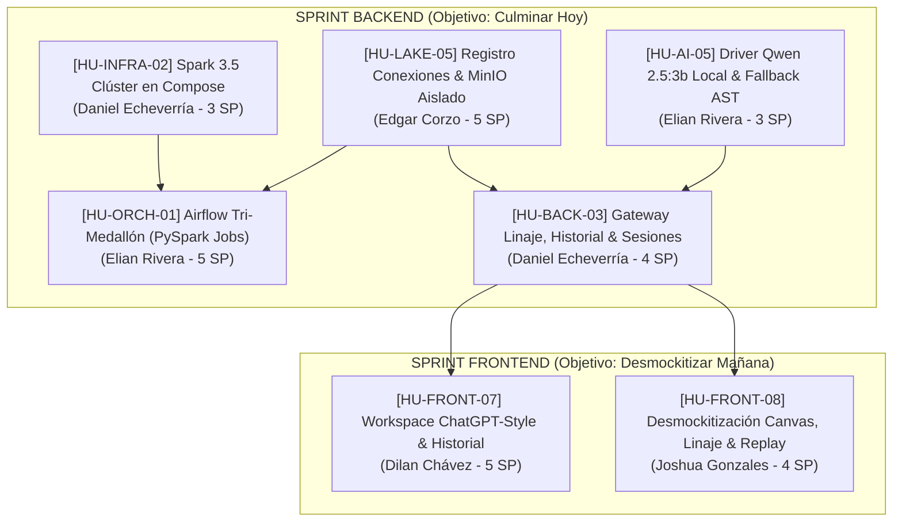

# 06. Nuevo Backlog Integral y Ejecución del MVP Dorado

## 1. Visión y Propósito
Este documento formaliza el nuevo Backlog complementario de Midas basado en el informe de auditoría ([auditoria_integral_arquitectura_y_mvp_dorado.md](reviews/auditoria_integral_arquitectura_y_mvp_dorado.md)) y los registros de arquitectura [ADR-008](adr/ADR-008-adopcion-modelo-local-qwen-2-5-3b-zero-trust.md), [ADR-009](adr/ADR-009-orquestacion-tri-medallon-airflow-y-aislamiento-minio.md) y [ADR-010](adr/ADR-010-workspace-conversacional-multi-sesion-frontend.md).

El objetivo operacional inmediato es **completar el 100% del Backend hoy mismo**, eliminando cuellos de botella mediante asignaciones de **responsabilidad única (cero historias compartidas)** entre Daniel Echeverría, Edgar Corzo y Elian Rivera. Esto dejará todas las APIs, catálogos, orquestaciones de Airflow y clústeres listos para que mañana el equipo de frontend (Joshua Gonzales y Dilan Chávez) se dedique exclusivamente a desmockitizar la interfaz y habilitar el Workspace ChatGPT-Style.

---

## 2. Asignación Antibloqueo y Gobernanza

> [!IMPORTANT]
> **Culminación del Backend Hoy:** Las 5 historias de backend (`HU-INFRA-02`, `HU-LAKE-05`, `HU-BACK-03`, `HU-AI-05`, `HU-ORCH-01`) suman 20 Story Points y están diseñadas para ejecutarse en paralelo sin colisión de ramas ni dependencias circulares.

> [!WARNING]
> **Zero-Trust Estricto (Cero Cloud Fallback):** La integración de Qwen 2.5 (3B) en `HU-AI-05` rechaza categóricamente APIs de terceros (OpenAI/Gemini). Si Ollama local no está levantado, el sistema recurrirá exclusivamente al fallback determinístico AST de SQLGlot para garantizar que la suite de pruebas pase en <15s y que ningún dato salga del perímetro local.

> [!NOTE]
> **Matriz de Responsabilidad Única:**
> - **Daniel Echeverría (Backend Lead & Infra):** `HU-INFRA-02` (Spark Clúster) + `HU-BACK-03` (Gateway Linaje, Telemetría Histórica y Sesiones).
> - **Edgar Corzo (Data Eng Lead):** `HU-LAKE-05` (Conexiones MinIO aisladas).
> - **Elian Rivera (AI & Orchestration):** `HU-AI-05` (Driver Qwen 2.5:3b) + `HU-ORCH-01` (Fábrica Airflow Tri-Medallón).
> - **Dilan Chávez (Frontend Lead):** `HU-FRONT-07` (Workspace ChatGPT-Style y Sesiones).
> - **Joshua Gonzales (Frontend Lead):** `HU-FRONT-08` (Desmockitización Canvas, Linaje y Replay con aislamiento estricto).

---

## 3. Estructura del Nuevo Backlog Complementario



---

## 4. Definición Detallada de las Historias de Usuario

### 1. [HU-INFRA-02] Clúster Apache Spark 3.5 en Monodocker y Cliente Airflow
- **Issue Oficial en GitHub:** [#39](https://github.com/Dan18eP/Midas/issues/39)
- **Responsable Único:** Daniel Echeverría (`Dan18eP`)
- **Story Points:** 3 SP | **Prioridad:** P0 (Bloqueante)
- **Alcance Técnico:**
  - Agregar `midas-spark-master` (`bitnami/spark:3.5.1`) con puertos 7077 (RPC) y 8080 (UI).
  - Agregar `midas-spark-worker` (`bitnami/spark:3.5.1`) con puerto 8081.
  - Montar volumen de extensiones Iceberg: `iceberg-spark-runtime-3.5_2.12-1.5.0.jar` y `bundle-2.20.18.jar`.
  - Actualizar `docker/airflow/Dockerfile` para incluir `openjdk-17-jre-headless` y binarios Spark.
  - Actualizar `docker/airflow/init.sh` para registrar la conexión `spark_default` apuntando a `spark://midas-spark-master:7077`.
- **Criterios de Aceptación:**
  - `docker compose config` es válido.
  - Airflow inicializa con la conexión `spark_default` activa.
  - Script de validación `tests/infra/test_spark_cluster.py` verifica la conectividad RPC al puerto 7077.

---

### 2. [HU-LAKE-05] Registro Dinámico de Conexiones Multi-Fuente y Aislamiento en MinIO S3
- **Issue Oficial en GitHub:** [#40](https://github.com/Dan18eP/Midas/issues/40)
- **Responsable Único:** Edgar Corzo (`EdgarCorzo777`)
- **Story Points:** 5 SP | **Prioridad:** P0
- **Alcance Técnico:**
  - Crear tabla operacional `midas_operational.source_connections` (PostgreSQL) con columnas: `connection_id`, `name`, `source_type` (POSTGRES, EXCEL, CSV, REST), `config_payload`, `status`, `created_at`.
  - Endpoints REST en FastAPI:
    - `POST /api/v1/connections/register`: Valida y almacena una nueva conexión.
    - `GET /api/v1/connections`: Lista todas las fuentes conectadas.
  - Refactorizar `UniversalIngestionEngine` ([universal_engine.py](../src/lakehouse/ingestion/universal_engine.py)):
    - Escribir en formato **Parquet** inmutable con compresión Snappy.
    - Rutas aisladas por conexión: `s3://midas-bronze/sources/<connection_id>/<dataset>/year=%Y/month=%m/day=%d/<batch_id>.parquet`.
    - Rutas de cuarentena aisladas: `s3://midas-quarantine/incidents/<connection_id>/<date>/incident_<id>.json`.
- **Criterios de Aceptación:**
  - Múltiples fuentes inyectadas no colisionan en prefijos de MinIO.
  - Pruebas unitarias en `tests/lakehouse/test_source_connections.py` verifican registro, listado y particionamiento sin requerir MinIO levantado.

---

### 3. [HU-AI-05] Inferencia Local Zero-Trust con Qwen 2.5 (3B) y Fallback AST Determinístico
- **Issue Oficial en GitHub:** [#41](https://github.com/Dan18eP/Midas/issues/41)
- **Responsable Único:** Elian Rivera (`aZian10`)
- **Story Points:** 3 SP | **Prioridad:** P0
- **Alcance Técnico:**
  - Implementar `ModelRouter` en `src/agent/models/model_router.py`:
    - Proveedor primario: Ollama (`http://midas-ollama:11434` o `http://host.docker.internal:11434`) con modelo `qwen2.5:3b`.
    - CERO Cloud Fallback (prohibido OpenAI/Gemini por [ADR-008](adr/ADR-008-adopcion-modelo-local-qwen-2-5-3b-zero-trust.md)).
    - Proveedor fallback: **Motor Determinístico AST** basado en SQLGlot que resuelve analíticas estándar a partir de intenciones y plantillas precertificadas si Ollama está apagado.
  - Adaptar los prompts de Text-to-Gold ([src/agent/prompts/](../src/agent/)) a las capacidades de Qwen 2.5 (3B).
  - Mantener la validación estricta de `QueryGuardrail` (`SELECT`, solo `silver`/`gold`, inyección de `LIMIT 1000`).
- **Criterios de Aceptación:**
  - 100% pruebas de agente pasan sin internet y sin API keys externas.
  - La latencia del fallback AST es <10ms.

---

### 4. [HU-ORCH-01] Motor de Orquestación Tri-Medallón en Airflow (Mandato Jesús Noguera)
- **Issue Oficial en GitHub:** [#42](https://github.com/Dan18eP/Midas/issues/42)
- **Responsable Único:** Elian Rivera (`aZian10`)
- **Story Points:** 5 SP | **Prioridad:** P0
- **Alcance Técnico:**
  - Rediseñar `src/orchestration/dag_factory.py` para generar dinámicamente 3 clases de DAGs desde especificaciones YAML en `midas-governance/`:
    1. `dag_ingest_<conn_id>`: Ingesta periódica de la fuente a Bronze Parquet.
    2. `dag_clean_<conn_id>`: Limpieza PySpark Bronze $\rightarrow$ Silver Iceberg con Quality Gate.
    3. `dag_gold_<pipeline_id>`: Materialización PySpark Silver $\rightarrow$ Gold Marts con WAP.
  - Implementar los ejecutores PySpark en `jobs/`:
    - `jobs/ingest_bronze.py`: Ejecuta la extracción gobernada por conexión.
    - `jobs/transform_silver.py`: Aplica normalización ISO 8601, redondeo monetario `DECIMAL(18,2)` y desvío de registros corruptos (monto negativo F3) a cuarentena.
    - `jobs/materialize_gold.py`: Refactorizado para escribir en catálogo Iceberg REST.
  - Cada tarea emite eventos a `POST /api/v1/telemetry/publish` al iniciar y finalizar.
- **Criterios de Aceptación:**
  - En Airflow aparecen los pipelines organizados por conexión.
  - Pruebas unitarias en `tests/orchestration/test_tri_medallion_factory.py` validan que los 3 DAGs se instancian correctamente con cron schedules válidos.

---

### 5. [HU-BACK-03] Gateway de Linaje Activo, Telemetría Histórica y Gestión de Sesiones
- **Issue Oficial en GitHub:** [#43](https://github.com/Dan18eP/Midas/issues/43)
- **Responsable Único:** Daniel Echeverría (`Dan18eP`)
- **Story Points:** 4 SP | **Prioridad:** P0
- **Alcance Técnico:**
  - **Gateway de Linaje:** Implementar `src/api/routes/lineage.py` con endpoint `GET /api/v1/lineage/table/{table}`:
    - Retorna el esquema de 4 capas: `source -> bronze -> silver -> gold` consultando metadatos de Iceberg/Postgres con cálculo de hash SHA-256 de certificación y fórmula KaTeX.
  - **Historial de Telemetría:** Implementar endpoint `GET /api/v1/telemetry/history?window=24h`:
    - Consulta los eventos registrados en `midas_operational.telemetry_events` para hidratar el Time-Travel scrubber del frontend con datos reales.
  - **Gestión de Sesiones (Preparación para Frontend ChatGPT-Style):**
    - Tabla `midas_operational.chat_sessions` (`session_id`, `user_id`, `title`, `created_at`, `updated_at`).
    - Tabla `midas_operational.session_messages` (`message_id`, `session_id`, `sender`, `content_json`, `created_at`).
    - Endpoints: `POST /api/v1/sessions`, `GET /api/v1/sessions`, `GET /api/v1/sessions/{session_id}`.
- **Criterios de Aceptación:**
  - `GET /api/v1/lineage/table/{table}` responde con HTTP 200 y el payload canónico esperado por `lineageApi.ts`.
  - `GET /api/v1/sessions` lista las sesiones cronológicamente.
  - Pruebas de integración en `tests/api/test_lineage_and_sessions.py` pasando al 100%.

---

## 5. Historias de Usuario para Mañana (Frontend)

### 6. [HU-FRONT-07] Workspace ChatGPT-Style, Conexiones Rápidas y Navegación de Sesiones
- **Issue Oficial en GitHub:** [#44](https://github.com/Dan18eP/Midas/issues/44)
- **Responsable Único:** Dilan Chávez (`dilandcv`)
- **Story Points:** 5 SP | **Prioridad:** P1 (Mañana)
- **Alcance:**
  - Implementar componente `WelcomeHero.tsx` con saludo `"Hola, {usuario}. ¿Qué tienes en mente hoy?"`.
  - Botones de conexión rápida: Excel, CSV, API REST, Base de Datos.
  - Barra lateral colapsable `SessionHistorySidebar.tsx` con historial cronológico (*Hoy*, *Ayer*, *Anteriores*) consumiendo `GET /api/v1/sessions`.
  - Transición fluida entre modo bienvenida y modo canvas activo.

---

### 7. [HU-FRONT-08] Desmockitización Total del Canvas, Linaje y Time-Travel Replay
- **Issue Oficial en GitHub:** [#45](https://github.com/Dan18eP/Midas/issues/45)
- **Responsable Único:** Joshua Gonzales (`Jgonzalez-2005`)
- **Story Points:** 4 SP | **Prioridad:** P1 (Mañana)
- **Alcance:**
  - `PipelineCanvas.tsx`: Permitir la adición dinámica de nuevos nodos recibidos vía SSE (`NEW_GOLD_NODE_AVAILABLE` o nuevas conexiones) en lugar de limitarse a los 7 nodos fijos.
  - `historicalTelemetryService.ts`: Reemplazar `createCanonicalSnapshots()` por llamadas a `GET /api/v1/telemetry/history`.
  - `resolveLineage.ts`: Erradicar `LAYER_FALLBACK` y conectar con `GET /api/v1/lineage/table/{table}`.
  - `ZeroTrustLens.tsx`: Eliminar strings estáticos (`pepe@riwi.io`) y reflejar el enmascaramiento real de Trino vía roles.
- **Criterios de Aceptación:**
  - [ ] Nuevos nodos creados en caliente se renderizan en el Canvas sin recargar.
  - [ ] Scrubber de Time-Travel consume eventos reales de FastAPI.
  - [ ] Drawer "Explícame esta cifra" muestra el linaje certificado retornado por el backend.
  - [ ] **Aislamiento Estricto y No-Interferencia:** Demostrar que los cambios se circunscriben quirúrgicamente al alcance de la tarea, con la suite completa de frontend (78 tests vitest) pasando al 100% sin romper ni alterar componentes ajenos.

---

## 6. Plan de Ejecución Inmediata de Backend (Cronograma de Hoy)

| Orden | Historia | Responsable | Archivos Clave a Crear / Modificar |
| :---: | :--- | :--- | :--- |
| **1** | **`HU-INFRA-02`** | Daniel Echeverría (`Dan18eP`) | `docker-compose.yml`, `docker/airflow/Dockerfile`, `docker/airflow/init.sh`, `tests/infra/test_spark_cluster.py` |
| **2** | **`HU-LAKE-05`** | Edgar Corzo (`EdgarCorzo777`) | `src/lakehouse/ingestion/universal_engine.py`, `src/api/routes/connections.py`, `tests/lakehouse/test_source_connections.py` |
| **3** | **`HU-AI-05`** | Elian Rivera (`aZian10`) | `src/agent/models/model_router.py`, `src/agent/prompts/qwen_prompts.py`, `tests/agent/test_qwen_inference.py` |
| **4** | **`HU-ORCH-01`** | Elian Rivera (`aZian10`) | `src/orchestration/dag_factory.py`, `jobs/ingest_bronze.py`, `jobs/transform_silver.py`, `tests/orchestration/test_tri_medallion.py` |
| **5** | **`HU-BACK-03`** | Daniel Echeverría (`Dan18eP`) | `src/api/routes/lineage.py`, `src/api/routes/sessions.py`, `src/api/main.py`, `tests/api/test_lineage_and_sessions.py` |

---

## 7. Plan de Verificación

### Pruebas Automatizadas
1. **Verificación Global de Python (Target: >150 tests PASS):**
   ```bash
   python -m pytest tests/ -v
   ```
2. **Validación de Infraestructura Docker Compose:**
   ```bash
   docker compose config --quiet
   ```
3. **Verificación de Linaje y Sesiones:**
   ```bash
   python -m pytest tests/api/test_lineage_and_sessions.py -v
   ```
4. **Verificación de Enrutador Qwen y Fallback AST:**
   ```bash
   python -m pytest tests/agent/test_qwen_inference.py -v
   ```
5. **Verificación de Fábrica Tri-Medallón:**
   ```bash
   python -m pytest tests/orchestration/test_tri_medallion.py -v
   ```
