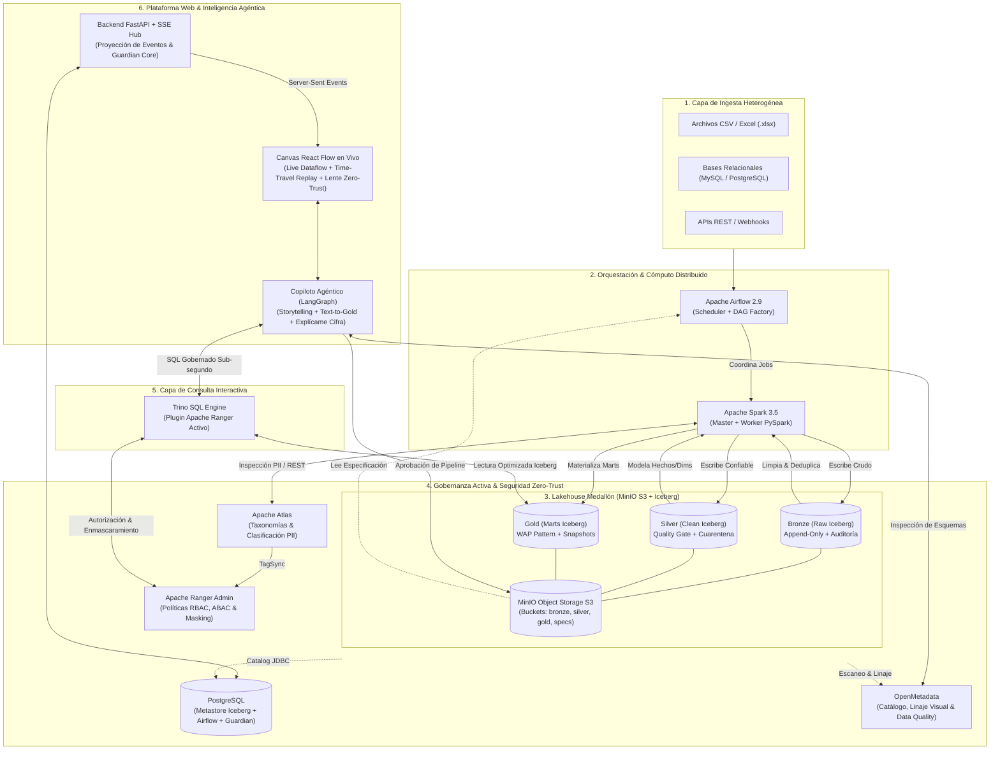

# Midas — Blueprint Arquitectónico del MVP Dorado
## Especificación Global del Sistema y Topología de Servicios

> **Proyecto:** Midas — Enterprise Active Lakehouse & Conversational Intelligence Platform  
> **Líder de Proyecto & Arquitecto:** Daniel Echeverría  
> **Fecha:** 17 de Octubre de 2026 · **Versión:** 1.0 (MVP Dorado Congelado)  
> **Repositorio Oficial:** [Dan18eP/Midas](https://github.com/Dan18eP/Midas)

---

## 1. Visión General del MVP Dorado

El **MVP Dorado** de Midas es una plataforma unificada que demuestra la convergencia de:
1. Un **Lakehouse Medallón** (MinIO S3 + Apache Iceberg + Apache Spark) con ingesta universal adaptable.
2. Un motor de **Gobernanza Zero-Trust Activa** (OpenMetadata, Apache Atlas y Apache Ranger) con auto-clasificación de datos sensibles y control de accesos en caliente.
3. Un subsistema de **Confiabilidad Operativa y Auto-Healing** (**Midas Guardian**) con máquina de estados, playbooks automáticos y aislamiento Write-Audit-Publish (WAP).
4. Un motor de **Consultas Interactivas Ultrarrápidas** (**Trino**) conectado con Ranger.
5. Una **Plataforma Web en Tiempo Real** (React Flow + Server-Sent Events) con visualización de flujos de datos, Time-Travel Replay de 4 estados y simulador de roles Lente Zero-Trust.
6. Un **Copiloto Agéntico** (FastAPI + LangGraph) que no solo responde preguntas con gráficos interactivos y narrativa de negocio (Data Storytelling), sino que permite transformar datos en vivo creando nuevos pipelines en **Apache Airflow** mediante lenguaje natural (**Pipeline-as-a-Prompt**).

---

## 2. Diagrama de Arquitectura Global de Servicios



---

## 3. Matriz de Puertos y Servicios de Red (`docker-compose`)

Todos los servicios conviven en una red interna dedicada de Docker (`midas-net`):

| Servicio | Contenedor | Puerto Interno | Puerto Host | Propósito Principal |
| :--- | :--- | :---: | :---: | :--- |
| **PostgreSQL** | `midas-postgres` | 5432 | `5432` | Metastore JDBC Iceberg, metadata de Airflow, Ranger y tabla de incidentes de Guardian |
| **MinIO S3** | `midas-minio` | 9000, 9001 | `9000`, `9001` | Almacenamiento S3 de tablas Iceberg y consola web de MinIO |
| **Spark Master** | `midas-spark-master` | 7077, 8080 | `7077`, `8080` | Coordinador de cómputo distribuido PySpark y UI de trabajos |
| **Spark Worker** | `midas-spark-worker` | - | `8081` | Ejecutor distribuido de transformaciones |
| **Airflow Web** | `midas-airflow-web` | 8080 | `8085` | Interfaz gráfica de Airflow y monitoreo de DAGs |
| **Trino** | `midas-trino` | 8080 | `8082` | Motor de consultas SQL ultrarrápidas con plugin de Ranger |
| **Ranger Admin**| `midas-ranger` | 6080 | `6080` | Consola de políticas de seguridad, RBAC/ABAC y auditoría |
| **OpenMetadata**| `midas-openmetadata`| 8585 | `8585` | Catálogo central de datos, linaje visual y tests de calidad |
| **FastAPI Backend**| `midas-api` | 8000 | `8000` | Endpoints REST, SSE Event Hub, Guardian Core y Copiloto LangGraph |
| **Frontend Web** | `midas-frontend` | 3000 | `3000` | Plataforma interactiva (Canvas React Flow, Lente Zero-Trust, Chat) |

---

## 4. El Recorrido End-to-End de una Demostración Típica

```
┌────────────────────────────────────────────────────────────────────────────────────────┐
│                          FLUJO DE LA DEMOSTRACIÓN (10 MINUTOS)                         │
├────────────────────────────────────────────────────────────────────────────────────────┤
│ 1. INGESTA: Arriba un lote con 10,000 pedidos (CSV/DB) a MinIO Bronze.                │
│ 2. DETECCIÓN PII: Spark procesa a Silver, detecta emails y los etiqueta en Atlas.     │
│ 3. ENMASCARAMIENTO: Ranger aplica TagSync; Trino oculta los correos inmediatamente.  │
│ 4. FALLO INYECTADO (F3/F4): Llega fila corrupta; Guardian la desvía a cuarentena       │
│    sin romper el lote sano y emite la alerta en tiempo real al Canvas vía SSE.         │
│ 5. CANVAS EN VIVO: El usuario ve el nodo en ámbar, activa el "Time-Travel Replay"      │
│    para revisar el incidente y aprueba la acción correctiva del playbook.              │
│ 6. TEXT-TO-GOLD: El usuario pide al Copiloto: "Crea un mart de ventas semanales".      │
│    El Copiloto valida el costo, genera el contrato y Airflow crea el DAG dinámico.     │
│ 7. LENTE ZERO-TRUST: Se cambia el selector de "Director" a "Gerente Regional Norte".   │
│    El Canvas bloquea nodos no autorizados y el Chatbot filtra datos automáticamente.   │
│ 8. STORYTELLING: El Copiloto entrega el análisis con ECharts, Sello de Certificación  │
│    y cada número tiene su drawer interactivo de "Explícame esta cifra".                │
└────────────────────────────────────────────────────────────────────────────────────────┘
```
