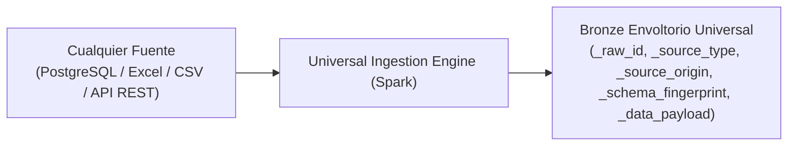

# Midas — Especificación de Base de Datos y Lakehouse Medallón Adaptativo
## Ingesta Universal Multi-Fuente, Esquemas Iceberg, Particionado y Tablas de Soporte

> **Proyecto:** Midas — Enterprise Active Lakehouse & Conversational Intelligence Platform  
> **Fecha:** 17 de Octubre de 2026 · **Versión:** 2.0 (Arquitectura Multi-Fuente Adaptativa)  
> **Estrategia:** Agnóstica a la Fuente (Bases Relacionales, Excel/CSV, APIs REST y Streaming)  

---

## 1. Arquitectura de Almacenamiento en MinIO S3

Los datos se organizan en buckets aislados dentro de MinIO siguiendo la arquitectura Medallón:

- `s3://midas-bronze/`: Depósito crudo e inmutable de ingesta multi-fuente. Tablas Iceberg en modo *append-only*.
- `s3://midas-silver/`: Tablas limpias, tipadas, deduplicadas y con *Quality Gates* aprobados. Incluye tablas de cuarentena.
- `s3://midas-gold/`: Modelos dimensionales (Hechos y Dimensiones Kimball) y Data Marts agregados para consumo ejecutivo.
- `s3://midas-governance/`: Archivos declarativos de contratos (`airflow-specs/`), backups y reportes de calidad.

---

## 2. Envoltura de Auditoría Universal en Capa Bronze

Para permitir que Midas reciba **cualquier archivo Excel, base de datos relacional o endpoint de API** sin romper esquemas, toda fuente entrante se registra en Bronze con un esquema de envoltorio estandarizado:



### Esquema Base Universal de Ingesta:
| Columna de Control | Tipo de Dato | Nulable | Descripción |
| :--- | :--- | :---: | :--- |
| `_raw_id` | `STRING` (UUID) | No | Identificador único del registro de ingesta |
| `_source_type` | `VARCHAR(30)` | No | `JDBC_POSTGRES`, `EXCEL_SPREADSHEET`, `REST_API_CRM`, `CSV_STORAGE` |
| `_source_origin` | `STRING` | No | Nombre de la tabla, endpoint o nombre de archivo de origen |
| `_ingested_at` | `TIMESTAMP` | No | Timestamp UTC de ingesta |
| `_batch_id` | `STRING` | No | ID de ejecución del DAG de Airflow |
| `_schema_fingerprint`| `STRING` | No | Hash SHA-256 de las columnas detectadas (detección de *Schema Drift*) |
| `_raw_payload` | `STRING` (JSON) | No | Registro completo preservado en formato JSON original |

---

## 3. Fuentes Oficiales Conectadas para la Demostración

Para demostrar la versatilidad multi-fuente en vivo sin atarse a un solo dataset, Midas cuenta con 3 fuentes heterogéneas activas:

### Fuente 1: Base de Datos Relacional (`crm_operaciones` vía JDBC PostgreSQL)
- **Tabla:** `bronze.crm_transacciones_raw` $\rightarrow$ `silver.crm_transacciones`
  - Columnas: `transaccion_id`, `cliente_id`, `monto`, `canal_venta` (`ONLINE`, `TIENDA`, `PARTNER`), `region`, `fecha_transaccion`.
- **Tabla:** `bronze.crm_clientes_raw` $\rightarrow$ `silver.crm_clientes`
  - Columnas: `cliente_id`, `nombre_completo` (Masked), `email` (PII Masked en Atlas/Ranger), `telefono` (PII Masked), `segmento`.

### Fuente 2: Hoja de Cálculo Excel (`Presupuesto_Corporativo_2026.xlsx` - Multi-pestaña)
- **Hoja 1: `Presupuesto_Metas`** $\rightarrow$ `silver.finanzas_metas_presupuesto`
  - Columnas: `año`, `mes`, `region`, `canal_venta`, `meta_ingreso_presupuestada`.
- **Hoja 2: `Costos_Operativos`** $\rightarrow$ `silver.finanzas_costos_fijos`
  - Columnas: `año`, `mes`, `region`, `costo_operativo_fijo`, `gasto_marketing`.

### Fuente 3: API REST Externa (`helpdesk_tickets_live` consumida por Airflow)
- **Endpoint:** `GET /api/v2/tickets` $\rightarrow$ `silver.soporte_tickets`
  - Columnas: `ticket_id`, `cliente_id`, `tiempo_respuesta_minutos`, `calificacion_satisfaccion` (CSAT 1-5), `estado` (`CERRADO`, `ABIERTO`).

---

## 4. Capa Silver: Estandarización, Calidad y Cuarentena

En la capa Silver, el motor de PySpark normaliza los nombres a minúsculas y snake_case, castea tipos estrictos y activa el **Escudo PII**:

### 4.1. Detección y Enmascaramiento PII (Atlas + Ranger)
Toda columna identificada con patrones de datos sensibles recibe la etiqueta `PII_CONFIDENCIAL` en Apache Atlas y se enmascara dinámicamente en Trino:
- `email`: `c****@empresa.com`
- `telefono`: `+57 *** *** 4210`

### 4.2. Tabla de Cuarentena Universal: `silver.quarantine_records`
Si un registro de cualquier fuente viola contratos esenciales (ej. transacciones con monto negativo, fechas futuras absurdas o claves primarias nulas), Guardian lo desvía a la tabla de cuarentena:

| Columna | Tipo de Dato | Descripción |
| :--- | :--- | :--- |
| `quarantine_id` | `BIGINT` (Identity) | ID de cuarentena |
| `_raw_id` | `STRING` | Referencia al UUID de Bronze |
| `source_name` | `VARCHAR(100)` | Nombre de la fuente de origen |
| `failure_reason` | `VARCHAR(50)` | Código: `NEGATIVE_AMOUNT`, `INVALID_DATE`, `CORRUPT_JSON` |
| `raw_data` | `STRING` (JSON) | Registro completo defectuoso |
| `quarantined_at`| `TIMESTAMP` | Timestamp de aislamiento |

---

## 5. Capa Gold: Modelado Dimensional y Marts Cruzados Multi-Fuente

La verdadera potencia del Lakehouse se evidencia en la capa Gold, donde se cruzan datos que venían de fuentes completamente distintas (PostgreSQL + Excel + API):

### 5.1. Mart de Cumplimiento Presupuestal: `gold.mart_ejecucion_presupuesto`
- **Cruza:** Transacciones reales de **PostgreSQL** con metas proyectadas del archivo **Excel**.
- **Métricas Oficiales:**
  - `ingreso_real`: Suma de transacciones efectivas.
  - `meta_presupuestada`: Meta leída desde el Excel corporativo.
  - `porcentaje_cumplimiento`: $\frac{\text{Ingreso Real}}{\text{Meta Presupuestada}} \times 100$.
  - `brecha_gap`: $\text{Ingreso Real} - \text{Meta Presupuestada}$.

### 5.2. Mart de Retención y Satisfacción: `gold.mart_cliente_360`
- **Cruza:** Clientes y transacciones de **PostgreSQL** con satisfacción y tiempos de respuesta de la **API REST**.
- Permite al Copiloto responder preguntas ejecutivas complejas: *"¿Los clientes de la región Norte con tickets de soporte abiertos tienen menor volumen de compra que el presupuesto del Excel?"*.

---

## 6. Tablas Operativas en PostgreSQL (`midas-postgres`)

### 6.1. Registro Dinámico de Conectores: `source_connectors_registry`
Permite registrar nuevas fuentes en caliente desde la UI o mediante el Copiloto:

```sql
CREATE TABLE source_connectors_registry (
    connector_id UUID PRIMARY KEY DEFAULT gen_random_uuid(),
    connector_name VARCHAR(100) NOT NULL UNIQUE,
    source_type VARCHAR(30) NOT NULL, -- 'JDBC', 'EXCEL', 'CSV', 'REST_API'
    connection_config JSONB NOT NULL,  -- Host, puerto, credenciales o ruta de archivo en MinIO
    active_schedule_cron VARCHAR(50),
    is_active BOOLEAN DEFAULT TRUE,
    created_at TIMESTAMP WITH TIME ZONE DEFAULT CURRENT_TIMESTAMP,
    last_sync_at TIMESTAMP WITH TIME ZONE
);
```

### 6.2. Máquina de Estados de Confiabilidad: `guardian_incidents`
```sql
CREATE TABLE guardian_incidents (
    incident_id UUID PRIMARY KEY DEFAULT gen_random_uuid(),
    source_name VARCHAR(100) NOT NULL,
    dataset_name VARCHAR(100) NOT NULL,
    root_cause_code VARCHAR(50) NOT NULL,
    state VARCHAR(30) NOT NULL, -- 'DETECTED', 'CONTAINED', 'RECOVERY_PREPARED', 'RESOLVED'
    affected_rows INT DEFAULT 0,
    playbook_applied VARCHAR(50),
    approved_by VARCHAR(100),
    created_at TIMESTAMP WITH TIME ZONE DEFAULT CURRENT_TIMESTAMP,
    resolved_at TIMESTAMP WITH TIME ZONE,
    diagnostic_narrative TEXT
);
```

### 6.3. Proyección de Telemetría para SSE y Replay: `pipeline_events`
```sql
CREATE TABLE pipeline_events (
    event_id BIGSERIAL PRIMARY KEY,
    stage VARCHAR(30) NOT NULL,      -- 'INGESTION', 'QUALITY', 'GOLD_PUBLISH', 'GUARDIAN'
    node_id VARCHAR(50) NOT NULL,    -- 'node-postgres', 'node-excel', 'node-silver', 'node-gold'
    event_type VARCHAR(50) NOT NULL, -- 'SYNC_STARTED', 'QUALITY_ALERT', 'ROWS_PROCESSED'
    status VARCHAR(20) NOT NULL,     -- 'RUNNING', 'SUCCESS', 'WARNING', 'ERROR'
    records_count INT DEFAULT 0,
    payload JSONB,
    created_at TIMESTAMP WITH TIME ZONE DEFAULT CURRENT_TIMESTAMP
);
CREATE INDEX idx_pipeline_events_ts ON pipeline_events(created_at);
```
