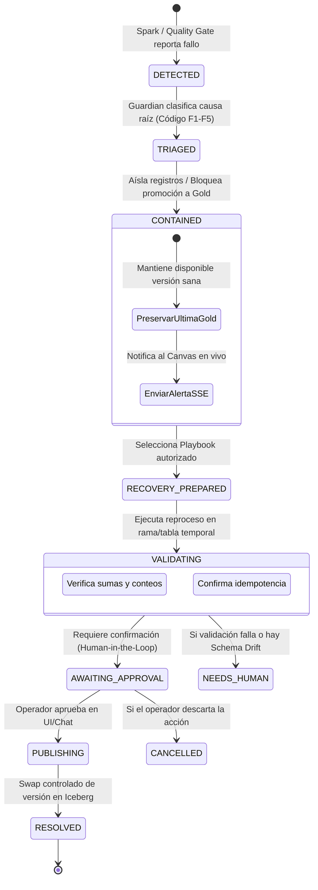

# Midas — Lógica de Negocio y Resiliencia con Midas Guardian
## Definiciones Canónicas, Máquina de Estados, Playbooks y Batería de Fallos Inyectados

> **Proyecto:** Midas — Enterprise Active Lakehouse & Conversational Intelligence Platform  
> **Fecha:** 17 de Octubre de 2026 · **Versión:** 1.0  

---

## 1. Definiciones Canónicas del Negocio (Sin Alucinaciones)

Para garantizar que el Copiloto Agéntico y los reportes de Trino nunca calculen métricas divergentes o alucinen fórmulas, el sistema opera con un **Diccionario Semántico Inmutable**:

| Métrica Oficial | Fórmula Canónica | Reglas de Reconocimiento |
| :--- | :--- | :--- |
| **Venta Bruta** | $\sum(\text{cantidad} \times \text{precio\_unitario})$ | Aplica sobre pedidos en estado `ENTREGADO` o `EN_TRANSITO`. |
| **Venta Neta** | $\sum(\text{monto\_bruto} - \text{descuento} - \text{devoluciones})$ | Es la cifra oficial para toda pregunta sobre "ventas" o "ingresos". |
| **Pedidos Válidos** | $\text{COUNT}(\text{DISTINCT } \text{pedido\_id})$ | Excluye cancelaciones previas al despacho. |
| **Ticket Promedio** | $\frac{\text{Venta Neta}}{\text{Pedidos Válidos}}$ | Si el denominador es 0, retorna $0.00$. |
| **Tasa de Devolución** | $\frac{\text{Pedidos Devueltos}}{\text{Total Pedidos Entregados}} \times 100$ | Calculado por cohorte mensual. |

---

## 2. El Ciclo de Vida de un Incidente en Midas Guardian

---

## 3. Especificación Técnica de los 5 Playbooks Operativos

### 1. `JOB_RETRY_V1` (Reintento de Tarea Transitoria)
- **Disparador:** Fallo de ejecutor de Spark por timeout de red, desconexión transitoria de MinIO o reinicio de contenedor.
- **Acción:** Reintento automático de la etapa con backoff exponencial ($2^n \times 1\text{ s}$, máx. 3 intentos).
- **Condición de Éxito:** La tarea finaliza exitosamente; la tabla de salida coincide en sumas y conteos sin doble aplicación de registros.

### 2. `QUARANTINE_INVALID_ROWS_V1` (Cuarentena de Registros Inválidos)
- **Disparador:** Detección de filas individuales que violan reglas de integridad no bloqueantes (ej. monto negativo, email malformado, precio unitario nulo).
- **Acción:** El trabajo en Spark filtra las filas defectuosas y las inserta en `silver.pedidos_quarantine` con su razón de fallo. El 98% sano del lote continúa hacia `silver.pedidos`.
- **Condición de Éxito:** Se procesa el lote principal; el Canvas refleja el porcentaje exacto desviado a cuarentena.

### 3. `REPLAY_WINDOW_V1` (Reproceso Idempotente de Ventana)
- **Disparador:** Procesamiento incompleto detectado por diferencia de conteos entre Bronze y Silver para una fecha específica.
- **Acción:** Guardian toma el snapshot original de Bronze y reejecuta la transformación para esa partición de fecha usando `MERGE INTO` de Iceberg.
- **Condición de Éxito:** Las particiones de Silver y Gold se reconcilian exactamente con el origen sin duplicar ventas.

### 4. `SCHEMA_DRIFT_V1` (Incompatibilidad Estructural — Supervisado)
- **Disparador:** Una columna crítica cambia de tipo (ej. `total_amount` decimal recibido como string alfanumérico) o desaparece una columna requerida.
- **Acción:** Guardian bloquea de inmediato la promoción a Gold. La capa Gold sigue sirviendo el snapshot anterior. Guardian genera un informe de diferencias y notifica al Copiloto para que presente el plan de acción al operador.
- **Condición de Éxito:** No se corrompe Gold; requiere intervención y aprobación humana para continuar.

### 5. `BUSINESS_ANOMALY_V1` (Anomalía de Negocio Narrada — Supervisado)
- **Disparador:** Caída de ventas $> 25\%$ frente al promedio móvil de 7 días sin fallos técnicos en los datos.
- **Acción:** El Copiloto emite una alerta diagnóstica explicando la anomalía y sugiriendo investigar factores externos (ej. caída de tráfico en canal web) sin alterar los datos.

---

## 4. Batería Oficial de los 5 Fallos Inyectados para el Demo Day

Para la presentación del proyecto, el sistema contará con un script de control (`scripts/inject_fault.py`) que permite simular cada fallo a demanda:

| ID | Falla Inyectada en Vivo | Comando de Activación | Comportamiento Esperado en la Plataforma |
| :-: | :--- | :--- | :--- |
| **F1** | **Caída forzada de tarea Spark** | `python inject_fault.py --fault task_kill` | El job de Spark se interrumpe; Guardian aplica `JOB_RETRY_V1`; reintenta y completa la carga sin registros duplicados. |
| **F2** | **Inyección de pedido duplicado** | `python inject_fault.py --fault duplicate_pk` | Spark detecta clave duplicada en Silver; aplica deduplicación por timestamp más reciente; Gold mantiene la cardinalidad exacta. |
| **F3** | **Fila con monto negativo** | `python inject_fault.py --fault negative_amount` | Guardian aplica `QUARANTINE_INVALID_ROWS_V1`; desvía el pedido corrupto a cuarentena; el Canvas muestra badge de cuarentena y procesa el resto. |
| **F4** | **Schema Drift incompatible** | `python inject_fault.py --fault type_mismatch` | `total_amount` se inyecta como texto `"ERROR_404"`; Guardian bloquea Gold; Canvas se pone en alerta roja; Copiloto explica el problema y sugiere plan. |
| **F5** | **Interrupción previa al Commit** | `python inject_fault.py --fault commit_abort` | Se cancela la sesión antes del swap de Iceberg; Guardian detecta transacción huérfana, hace rollback y mantiene la versión Gold anterior sana. |
