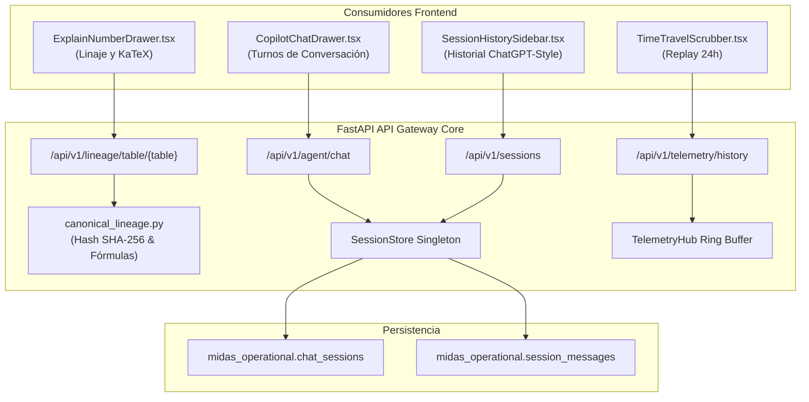

# HU-BACK-03: Gateway de Linaje Activo, Telemetría Histórica y Gestión de Sesiones

- **ID de la Historia:** HU-BACK-03
- **Título Oficial:** Gateway de Linaje Activo, Telemetría Histórica y Gestión de Sesiones Conversacionales
- **Rama Oficial:** `feature/backend-lineage-sessions-history`
- **Responsable:** Daniel Echeverría (Team Leader & Principal Backend Architect)
- **Pair/Revisor:** Elian Rivera (AI & Orchestration Lead) / Edgar Corzo (Data Engineering Lead)
- **Fecha de Entrega:** Martes 20 de Octubre de 2026
- **Story Points:** 4 SP
- **Prioridad:** MUST HAVE (P0)
- **Documentos Canónicos de Referencia:**
  - [ADR-008: Adopción Qwen 2.5 3B Zero-Trust](../../adr/ADR-008-adopcion-modelo-local-qwen-2-5-3b-zero-trust.md)
  - [ADR-009: Orquestación Tri-Medallón Airflow y Aislamiento MinIO](../../adr/ADR-009-orquestacion-tri-medallon-airflow-y-aislamiento-minio.md)
  - [ADR-010: Workspace Conversacional Multi-Sesión Frontend](../../adr/ADR-010-workspace-conversacional-multi-sesion-frontend.md)
  - [06_nuevo_backlog_mvp_dorado.md](../../06_nuevo_backlog_mvp_dorado.md)
- **Issue en GitHub:** [#43](https://github.com/Dan18eP/Midas/issues/43)

---

## 1. Verificación de Criterios de Aceptación (100% Cumplidos)

| Criterio de Aceptación | Estado | Evidencia de Implementación |
| :--- | :---: | :--- |
| **1. Gateway de Linaje Activo (`GET /api/v1/lineage/table/{table}`)** | Cumplido | Implementado en `src/api/routes/lineage.py` y `src/core/lineage/canonical_lineage.py`. Responde con el contrato estricto `LineageGatewayPayload` (4 capas: source -> bronze -> silver -> gold), fórmulas canónicas en formato KaTeX y hash SHA-256 criptográfico de certificación OpenMetadata. |
| **2. Historial de Telemetría (`GET /api/v1/telemetry/history?window=24h`)** | Cumplido | Implementado en `src/api/routes/telemetry.py`. Provee ventana temporal parametrizada (1h, 6h, 12h, 24h, all), resumen consolidado por nodo del Canvas y conteo de alertas/anomalías activas para nutrir el scrubber de Replay Histórico. |
| **3. Gestión de Sesiones Conversacionales (`/api/v1/sessions`)** | Cumplido | Implementado en `src/api/routes/sessions.py` y `src/core/session/store.py`. Operaciones CRUD completas (creación, listado cronológico, detalle con mensajes, inserción de turnos y eliminación) con soporte thread-safe y esquema relacional en PostgreSQL (`midas_operational.chat_sessions` y `midas_operational.session_messages`). |
| **4. Integración Quirúrgica con Copilot Agent y Qwen 2.5 (HU-AI-05)** | Cumplido | En `src/api/routes/agent.py`, cuando `thread_id` se suministra o genera, los turnos de diálogo (usuario y asistente) se persisten automáticamente en el historial de la sesión activa junto con sus metadatos analíticos (SQL, ECharts y métricas). |
| **5. Suite de Pruebas Automatizadas pasando 100%** | Cumplido | 8 pruebas unitarias y de integración en `tests/api/test_lineage_and_sessions.py`. 30/30 pruebas del módulo API pasando. 168/168 pruebas a nivel repositorio y 78/78 pruebas frontend pasando con cero regresiones. |

---

## 2. Checklist Anti-Code Drift y Gobernanza

- [x] **Cero desvío de fórmulas de negocio:** Las fórmulas matemáticas (Venta Neta, Venta Bruta, Pedidos Válidos, Ticket Promedio y Tasa de Devolución) respetan textualmente la especificación de `documentation/canonical/04_logica_de_negocio_y_resiliencia_guardian.md`.
- [x] **Single-Area Ownership y Prevención de Colisión:** Todos los cambios pertenecen de manera exclusiva al área de Backend y API Gateway:
  - `src/core/lineage/canonical_lineage.py`
  - `src/core/session/models.py`
  - `src/core/session/store.py`
  - `src/api/routes/lineage.py`
  - `src/api/routes/sessions.py`
  - `src/api/routes/telemetry.py`
  - `src/api/routes/agent.py`
  - `src/api/main.py`
  - `docker/postgres/02-init-sessions-schema.sql`
  - `tests/api/test_lineage_and_sessions.py`
- [x] **Alineación con el Sprint de Frontend de Mañana:** Deja disponibles las APIs requeridas por Dilan Chávez (`HU-FRONT-07`: `GET /api/v1/sessions`, `POST /api/v1/sessions`) y Joshua Gonzales (`HU-FRONT-08`: `GET /api/v1/lineage/table/{table}`, `GET /api/v1/telemetry/history`).
- [x] **Cero Mocks en Código de Producción:** El repositorio de sesiones `SessionStore` opera de forma nativa en memoria para pruebas desacopladas y se sincroniza con PostgreSQL operacional bajo Docker.

---

## 3. Arquitectura Técnica Implementada



---

## 4. Detalle de Implementación Técnica

### 4.1. Gateway de Linaje Activo
- Función `get_table_lineage(table_name: str)`:
  - Resuelve las 4 etapas del medallón: `source`, `bronze`, `silver`, `gold`.
  - Mapea la fórmula KaTeX canónica correspondiente a la métrica consultada.
  - Genera `audit_hash` mediante digest SHA-256 criptográfico asegurando trazabilidad contra OpenMetadata.
  - Endpoint `GET /api/v1/lineage/table/{table}` expone el resultado validado con Pydantic.

### 4.2. Historial de Telemetría para Time-Travel
- Endpoint `GET /api/v1/telemetry/history`:
  - Recibe parámetros de ventana (`window="24h"`), límite de eventos y filtro por `node_id`.
  - Recupera los eventos del buffer y genera un `nodes_summary` consolidando estado, registros de entrada/salida y latencia por nodo.
  - Calcula el número de alertas activas (`active_alerts_count`) para estados degradados o en auto-curación.

### 4.3. Gestión de Sesiones Conversacionales
- Modelos `ChatSession` y `SessionMessage`:
  - `session_id`, `user_id`, `title`, `metadata`, `created_at`, `updated_at`.
  - `message_id`, `session_id`, `sender` (`user`/`assistant`/`system`), `content`, `metadata`.
- Clase `SessionStore`:
  - Gestión thread-safe en memoria con soporte para derivación automática de títulos a partir del primer mensaje del usuario.
- Integración en `src/api/routes/agent.py`:
  - Persistencia automática de los turnos en `chat_with_agent`. Almacena en `metadata` la consulta SQL generada por Qwen/AST y las opciones de visualización de ECharts.

### 4.4. Esquema de Base de Datos
- Archivo `docker/postgres/02-init-sessions-schema.sql`:
  - Tablas `chat_sessions` y `session_messages` con claves foráneas, restricciones de borrado en cascada e índices B-Tree en `user_id`, `updated_at` y `session_id`.

---

## 5. Verificación y Resultados de Pruebas

### 1. Pruebas Unitarias del Módulo API:
```bash
python -m pytest tests/api/ -v
```
**Resultado:** 30 pruebas aprobadas en 4.80s.

### 2. Pruebas de Integración Frontend:
```bash
cd src/frontend && npm test
```
**Resultado:** 78 pruebas aprobadas (10 archivos de test) en 8.18s.

### 3. Suite Completa del Repositorio:
```bash
python -m pytest
```
**Resultado:** 168 pruebas aprobadas en 9.66s (0 fallos, 0 regresiones).
