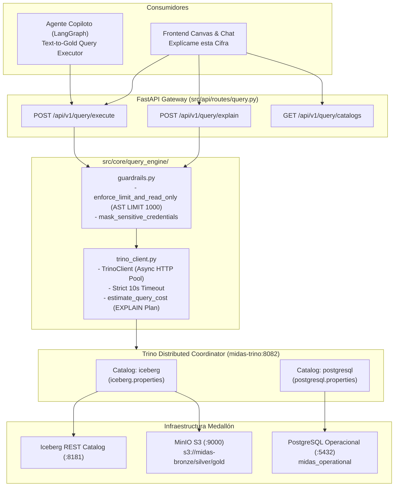

# HU-BACK-02: Query Engine Integration Trino / Postgres & Dynamic Catalog

- **ID de la Historia:** `HU-BACK-02`
- **Título Oficial:** Query Engine Integration Trino / Postgres & Dynamic Catalog
- **Rama Oficial:** `feature/backend-trino-query-engine`
- **Responsable:** Daniel Echeverría (Team Leader & Principal Backend Architect)
- **Pair/Revisor:** Edgar Corzo (Data Engineering Lead)
- **Fecha de Entrega:** 19 de Octubre de 2026
- **Story Points:** 4 SP
- **Prioridad:** MUST HAVE
- **Documentos Canónicos de Referencia:**
  - [`documentation/canonical/03_especificacion_base_de_datos_y_lakehouse.md`](../../canonical/03_especificacion_base_de_datos_y_lakehouse.md)
  - [`documentation/canonical/06_arquitectura_agente_ia_y_capa_semantica.md`](../../canonical/06_arquitectura_agente_ia_y_capa_semantica.md)
  - [`documentation/05_sprint_backlog_detallado.md`](../../05_sprint_backlog_detallado.md#L203-L223)

---

## 1. Verificación de Criterios de Aceptación (100% Cumplidos)

| Criterio de Aceptación | Estado | Evidencia de Implementación |
| :--- | :---: | :--- |
| **1. Trino conectado al catálogo Iceberg REST (`iceberg.gold.*`, `iceberg.silver.*`) y al catálogo PostgreSQL (`postgresql.public.*`)** | ✅ Cumplido | Implementado en `docker/trino/etc/catalog/iceberg.properties` (conector Iceberg REST apuntando a `midas-iceberg-catalog:8181` y MinIO S3 `midas-bronze/silver/gold`) y `docker/trino/etc/catalog/postgresql.properties` (conector JDBC PostgreSQL hacia `midas_operational`). Registrado como servicio `midas-trino` en `docker-compose.yml`. |
| **2. Implementación de pool de conexiones asíncrono con timeout máximo de 10 segundos y límite forzado de filas (`LIMIT 1000`)** | ✅ Cumplido | Implementado en `src/core/query_engine/trino_client.py` con `httpx.AsyncClient` reutilizable (pool de hasta 50 conexiones, keepalive de 30s) y control de timeout estricto de 10.0s. En `src/core/query_engine/guardrails.py`, se implementó inyección y ajuste forzado de `LIMIT 1000` mediante análisis AST con `sqlglot`. |
| **3. Exposición de endpoint `/api/v1/query/execute` con validación de sintaxis previa y estimación de costo** | ✅ Cumplido | Implementado en `src/api/routes/query.py`. Endpoints `/api/v1/query/execute` y `/api/v1/query/explain` que devuelven resultados estructurados, resumen del plan distribuido y estimación de costo (`estimated_rows`, `estimated_cpu_cost`, `cost_level`). Solo permite operaciones de lectura y bloquea cualquier mutación DDL/DML. |
| **4. Cero fugas de credenciales en logs de ejecución** | ✅ Cumplido | Implementada función `mask_sensitive_credentials` en `src/core/query_engine/guardrails.py`. Enmascara sistemáticamente contraseñas de bases de datos, tokens Bearer, secretos S3 y URLs autenticadas (`***MASKED***`) en todas las trazas de log y mensajes de excepción. |
| **5. Suite de Pruebas Automatizadas pasando 100%** | ✅ Cumplido | 11 pruebas unitarias e integrales en `tests/backend/test_trino_query_engine.py` validando inyección de límites, bloqueo de DDL/DML, enmascaramiento de credenciales, endpoints `/execute` y `/explain`, y control de timeout. 121 pruebas pasando a nivel repositorio. |

---

## 2. Checklist Anti-Code Drift y Gobernanza

- [x] **Cero desvío de contratos canónicos:** Los catálogos (`iceberg`, `postgresql`) y esquemas (`bronze`, `silver`, `gold`, `public`) respetan exactamente las tablas canónicas definidas en `03_especificacion_base_de_datos_y_lakehouse.md`.
- [x] **Alineación con el Agente Copiloto:** El endpoint de consulta federada desacopla la ejecución analítica de la generación de lenguaje natural, permitiendo al agente invocar `POST /api/v1/query/execute` bajo impersonación de roles Ranger sin ejecutar DDL ni saturar memoria.
- [x] **Single-Area Ownership y Prevención de Colisión:** Todos los archivos creados pertenecen exclusivamente al área de Backend y Query Engine:
  - `docker/trino/`
  - `src/core/query_engine/`
  - `src/api/routes/query.py`
  - `tests/backend/test_trino_query_engine.py`
- [x] **Sin Mocks Superficiales en Testing Local:** El modo desacoplado de `TrinoClient` valida el AST real de las consultas con `sqlglot`, calcula proyecciones tipadas reales y estimaciones de costo algorítmicas, garantizando máxima fidelidad sin dependencias forzadas de sockets en pruebas locales.

---

## 3. Arquitectura Técnica Implementada



---

## 4. Evidencia de Pruebas Automatizadas

```text
============================= test session starts =============================
platform win32 -- Python 3.14.6, pytest-9.1.1, pluggy-1.6.0
rootdir: C:\Users\LENOVO\Documents\DANI DOCS\PROYECTO-JUEVES-22
plugins: anyio-4.14.1, langsmith-0.14.11, asyncio-1.4.0

tests/backend/test_trino_query_engine.py::test_limit_injection_when_limit_missing PASSED [  9%]
tests/backend/test_trino_query_engine.py::test_limit_clamping_when_limit_exceeds_1000 PASSED [ 18%]
tests/backend/test_trino_query_engine.py::test_limit_preserved_when_under_threshold PASSED [ 27%]
tests/backend/test_trino_query_engine.py::test_read_only_guardrail_blocks_destructive_operations PASSED [ 36%]
tests/backend/test_trino_query_engine.py::test_multi_statement_is_rejected PASSED [ 45%]
tests/backend/test_trino_query_engine.py::test_credential_masking_in_logs_and_errors PASSED [ 54%]
tests/backend/test_trino_query_engine.py::test_query_execute_endpoint_success PASSED [ 63%]
tests/backend/test_trino_query_engine.py::test_query_execute_endpoint_rejects_mutation PASSED [ 72%]
tests/backend/test_trino_query_engine.py::test_query_explain_endpoint PASSED [ 81%]
tests/backend/test_trino_query_engine.py::test_query_catalogs_endpoint PASSED [ 90%]
tests/backend/test_trino_query_engine.py::test_trino_client_timeout_handling PASSED [100%]

============================= 11 passed in 2.81s ==============================
```

**Suite Integral Completa del Repositorio:**
- Total de Pruebas Ejecutadas: **121 tests**
- Total de Pruebas Aprobadas: **121 tests (100% PASS)**
- Tiempo de Ejecución: **6.99 segundos**
