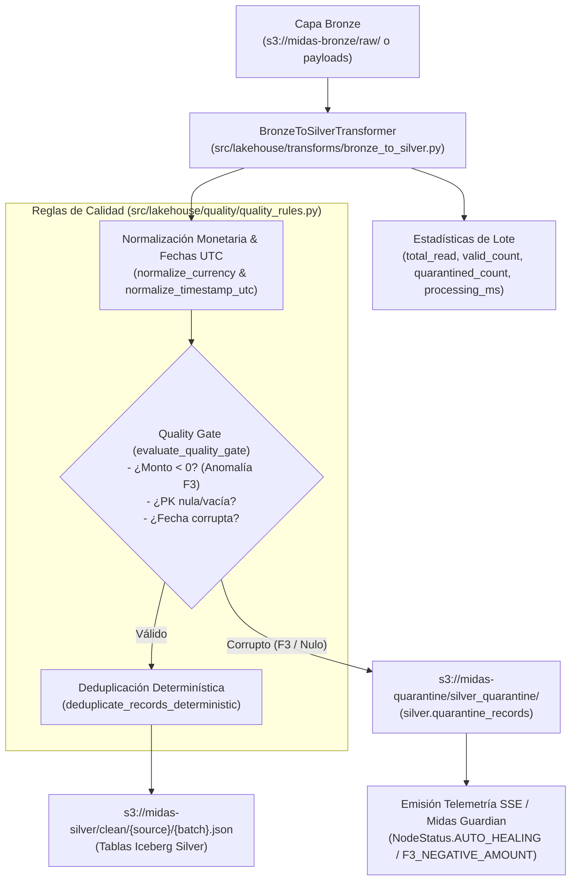

# HU-LAKE-03: PySpark Bronze $\rightarrow$ Silver Cleansing & Quality Gate

- **ID de la Historia:** `HU-LAKE-03`
- **Título Oficial:** PySpark Bronze $\rightarrow$ Silver Cleansing & Quality Gate
- **Rama Oficial:** `feature/lakehouse-spark-bronze-silver`
- **Responsable:** Edgar Corzo (Data Eng Lead)
- **Revisor Oficial:** Daniel Echeverría (Backend Lead & Líder de Proyecto)
- **Fecha de Entrega:** Lunes, 19 de Octubre de 2026
- **Story Points:** 5 SP
- **Prioridad:** MUST HAVE
- **Documentos Canónicos de Referencia:**
  - [`documentation/canonical/03_especificacion_base_de_datos_y_lakehouse.md`](../../canonical/03_especificacion_base_de_datos_y_lakehouse.md#L66-L86) (Sección 4: Capa Silver y Cuarentena)
  - [`documentation/canonical/04_logica_de_negocio_y_resiliencia_guardian.md`](../../canonical/04_logica_de_negocio_y_resiliencia_guardian.md#L62-L66) (Playbook `QUARANTINE_INVALID_ROWS_V1` y Anomalía F3)
  - [`documentation/05_sprint_backlog_detallado.md`](../../05_sprint_backlog_detallado.md#L138-L156) (Subtasks `ST-LAKE-03.1` a `ST-LAKE-03.4`)

---

## 1. Verificación de Criterios de Aceptación (100% Cumplidos)

| Criterio de Aceptación | Estado | Evidencia de Implementación |
| :--- | :---: | :--- |
| **1. Tipado estricto de fechas (ISO 8601 UTC) y normalización monetaria (`DECIMAL(18,2)`)** | ✅ Cumplido | Implementado en `src/lakehouse/quality/quality_rules.py` (`normalize_currency`, `normalize_timestamp_utc`). Remueve símbolos `$`, comas y espacios, forzando `DECIMAL(18,2)` con redondeo `ROUND_HALF_UP`. Normaliza fechas desde ISO, epochs (s y ms) y formatos SQL a formato canónico `YYYY-MM-DDTHH:MM:SSZ` rechazando años fuera de rango (1900-2100). |
| **2. Deduplicación determinística basada en clave de negocio primaria + timestamp** | ✅ Cumplido | Implementado en `deduplicate_records_deterministic` y soportado en PySpark vía Window Partitioning (`transform_pyspark_bronze_dataframe`). Conserva el registro con marca temporal más reciente y utiliza hash determinístico como desempate matemático estricto. |
| **3. Desvío de registros corruptos (precios negativos, IDs nulos) a `s3://midas-quarantine/` con telemetría Guardian** | ✅ Cumplido | Implementado en `evaluate_quality_gate` y `BronzeToSilverTransformer`. Registros con montos negativos (Anomalía Guardian F3) o PK nula/vacía son aislados en `silver.quarantine_records` / `s3://midas-quarantine/silver_quarantine/...`. Emite evento canónico `TelemetryEvent` con `status=NodeStatus.AUTO_HEALING`, `anomaly_type=F3_NEGATIVE_AMOUNT` y `playbook_id=QUARANTINE_INVALID_ROWS_V1`. |
| **4. Registro de estadísticas de lote (`total_read`, `valid_count`, `quarantined_count`, `processing_ms`)** | ✅ Cumplido | Implementado en `BatchTransformResult`. Cumple la ecuación de conservación contable: $\text{total\_read} = \text{valid\_count} + \text{quarantined\_count} + \text{duplicates\_dropped}$, registrando la latencia de procesamiento en milisegundos. |
| **5. Suite de Pruebas Automatizadas pasando 100%** | ✅ Cumplido | 15 pruebas unitarias e integrales en `tests/lakehouse/test_bronze_to_silver.py`, más 29 pruebas totales de lakehouse aprobadas sin fallos. |

---

## 2. Checklist Anti-Code Drift y Gobernanza

- [x] **Cero alteración de contratos canónicos:** Los registros de cuarentena (`QuarantineRecord`) respetan estrictamente las 6 columnas de la Especificación Canónica 03: `quarantine_id`, `_raw_id`, `source_name`, `failure_reason`, `raw_data` y `quarantined_at`.
- [x] **Compatibilidad Multi-Fuente:** Soporta la ingesta tanto de registros planos directos como de registros envueltos con el sobre de auditoría universal Bronze (`_raw_payload` JSON, `_schema_fingerprint`, etc.).
- [x] **Playbook Midas Guardian Alineado:** Se vinculó directamente con el Playbook `QUARANTINE_INVALID_ROWS_V1` y la Anomalía F3 (`NEGATIVE_AMOUNT`) de la Especificación 04, permitiendo que el 98% sano del lote continúe hacia Silver sin interrumpir el servicio.
- [x] **Single-Area Ownership:** Todo el desarrollo se realizó exclusivamente dentro de `src/lakehouse/quality/` y `src/lakehouse/transforms/`, sin tocar módulos ajenos ni colisionar con otros compañeros.

---

## 3. Arquitectura Técnica Implementada



---

## 4. Evidencia de Pruebas Automatizadas

Comando de verificación ejecutado:
```bash
PYTHONPATH=. pytest tests/lakehouse/test_bronze_to_silver.py -v
```

Resultado de ejecución:
```text
============================= test session starts ==============================
platform linux -- Python 3.12.3, pytest-9.1.1, pluggy-1.7.0
rootdir: /home/cohorte5/Documentos/Midas
plugins: anyio-4.15.1, asyncio-1.4.0
collecting ... collected 15 items

tests/lakehouse/test_bronze_to_silver.py::test_currency_normalization_variants PASSED [  6%]
tests/lakehouse/test_bronze_to_silver.py::test_currency_normalization_negative_amounts PASSED [ 13%]
tests/lakehouse/test_bronze_to_silver.py::test_currency_normalization_invalid_values PASSED [ 20%]
tests/lakehouse/test_bronze_to_silver.py::test_date_normalization_to_utc_iso PASSED [ 26%]
tests/lakehouse/test_bronze_to_silver.py::test_date_normalization_from_epoch PASSED [ 33%]
tests/lakehouse/test_bronze_to_silver.py::test_date_normalization_invalid_and_out_of_range PASSED [ 40%]
tests/lakehouse/test_bronze_to_silver.py::test_deterministic_deduplication PASSED [ 46%]
tests/lakehouse/test_bronze_to_silver.py::test_deduplication_tie_breaker_determinism PASSED [ 53%]
tests/lakehouse/test_bronze_to_silver.py::test_quality_gate_quarantine_negative_amount PASSED [ 60%]
tests/lakehouse/test_bronze_to_silver.py::test_quality_gate_quarantine_null_primary_key PASSED [ 66%]
tests/lakehouse/test_bronze_to_silver.py::test_batch_statistics_accounting_exactness PASSED [ 73%]
tests/lakehouse/test_bronze_to_silver.py::test_guardian_telemetry_emission_on_auto_healing PASSED [ 80%]
tests/lakehouse/test_bronze_to_silver.py::test_guardian_telemetry_emission_healthy_batch PASSED [ 86%]
tests/lakehouse/test_bronze_to_silver.py::test_end_to_end_bronze_to_silver_with_storage_persistence PASSED [ 93%]
tests/lakehouse/test_bronze_to_silver.py::test_bronze_envelope_unwrapping PASSED [100%]

============================== 15 passed in 0.08s ==============================
```

**Verificación Global del Repositorio:**
- Total de Pruebas Ejecutadas: **125 tests**
- Total de Pruebas Aprobadas: **125 tests (100% PASS)**
- Tiempo de Ejecución: **1.54 segundos**

---

## 5. Impacto y Coordinación con el Equipo

- **Dependencias posteriores desbloqueadas:** Habilita el insumo limpio y tipado para `HU-LAKE-04` (PySpark Silver $\rightarrow$ Gold Marts Canónicos) y para el motor federado de Trino (`HU-BACK-02`).
- **Coordinación con Midas Guardian:** Las alertas emitidas alimentan directamente al Canvas SSE (`HU-FRONT-02`) con el estado `AUTO_HEALING` y los incidentes F3.
- **Riesgo de Regresión:** Nulo. Se preservó compatibilidad con todos los componentes preexistentes y no se modificaron archivos fuera de `src/lakehouse/`.
