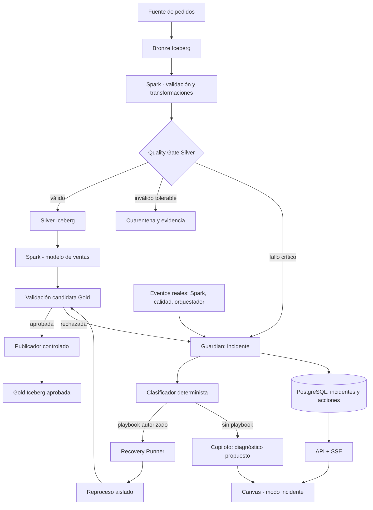

# Midas Guardian — Propuesta técnica y MVP verificable

**Proyecto:** Midas — Enterprise Active Lakehouse & Conversational Intelligence Platform  
**Tipo:** Tercera propuesta del equipo / investigación previa a implementación  
**Fecha:** 16 de octubre de 2026  
**Estado:** Diseño propuesto; no implementado ni validado en un entorno real

## 1. Resumen ejecutivo

Propongo incorporar **Midas Guardian**, una capacidad de *Data Reliability Engineering* que detecta incidentes en el flujo Bronze → Silver → Gold, protege las últimas versiones válidas, ejecuta recuperaciones **predefinidas, verificables y autorizadas** y utiliza un copiloto de IA para ayudar a diagnosticar problemas que no se pueden reparar automáticamente.

El objetivo **no** es prometer una IA que resuelve cualquier fallo. Es construir un **MVP de auto-recuperación controlada** demostrable en laboratorio, con auditoría, permisos y criterios explícitos de éxito.

**Diferenciación:** el reporte arquitectónico previo define la base confiable del Lakehouse; la segunda propuesta incorpora replay, explicaciones, simulaciones y anomalías narradas. Guardian incorpora **respuesta operativa ante incidentes y recuperación segura**, sin duplicar el módulo de detección narrativa.

## 2. Problema que resuelve

En un pipeline tradicional, una caída del motor, un registro incorrecto, una duplicación o un cambio de esquema pueden dejar productos Gold desactualizados o, peor, publicar indicadores incorrectos. La detección por sí sola no restaura el servicio: un operador debe clasificar el incidente, determinar el impacto, decidir si puede reprocesar y comprobar la corrección.

Guardian coordina ese ciclo con un historial reproducible: **detectar → clasificar → contener → recuperar en aislamiento → validar → aprobar/publicar → documentar**.

## 3. Alcance del MVP

### Incluido

1. Un dominio piloto de **pedidos y ventas sintéticos** (supuesto de laboratorio, a validar con el equipo).
2. Tablas Bronze, Silver y Gold basadas en Spark + Iceberg sobre el almacenamiento S3 compatible seleccionado para el laboratorio.
3. Contratos sencillos de datos: tipos, clave primaria, unicidad, reglas de monto, estados permitidos y controles de conteos/totales.
4. Una **máquina de estados de incidentes** con historial y correlación entre ejecución, dataset, causa y decisión.
5. Tres playbooks automáticos permitidos: reintento de job transitorio, cuarentena de registros inválidos cuando el contrato lo admite y reproceso idempotente del rango afectado.
6. **Bloqueo de publicación Gold** ante errores críticos; continuar sirviendo explícitamente la última versión aprobada, si existe.
7. Validación aislada del resultado candidato y publicación solo cuando se cumplen controles y permisos.
8. Vista de incidente dentro del Canvas, alimentada por eventos reales del backend.
9. Copiloto **solo en modo diagnóstico y propuesta** para fallos no cubiertos por playbooks. No ejecuta SQL, Python o comandos arbitrarios.
10. Auditoría de todas las decisiones y acciones.

### Fuera del MVP

- Reparación autónoma de cualquier cambio de esquema o error semántico.
- Recuperación de datos no preservados en Bronze, logs de origen o backups.
- Escalado empresarial, HA o SLA garantizado sin pruebas de infraestructura.
- Cambios automáticos de reglas de negocio, permisos Ranger o estructuras productivas.
- Recuperación de múltiples tablas con atomicidad distribuida implícita.
- Aprendizaje autónomo de playbooks no aprobados.

## 4. Arquitectura propuesta



**Integración gradual con el stack general:** utilizar OpenLineage para eventos de ejecución, OpenMetadata para linaje y propietarios, Atlas para clasificaciones y Ranger para permisos donde las integraciones estén realmente configuradas. El MVP **no** dependerá de que toda esa sincronización esté terminada para demostrar detección, cuarentena y reproceso. Es indispensable evitar que Spark o el servicio de recuperación accedan a información fuera de sus identidades autorizadas.

## 5. Estados de un incidente

`DETECTED → TRIAGED → CONTAINED → RECOVERY_PREPARED → VALIDATING → AWAITING_APPROVAL / PUBLISHING → RESOLVED`

Estados adicionales: `NEEDS_HUMAN`, `RECOVERY_FAILED`, `CANCELLED`.

Cada transición registra `incident_id`, `dataset`, `job_run_id`, `root_cause_code`, `timestamp`, `actor`, `playbook_version`, `input_snapshot_ids`, `candidate_snapshot_id`, `validation_report`, `approval_id` y `publication_id` cuando apliquen.

**Regla de seguridad:** el Canvas representa el estado confirmado por el backend; nunca se animan recuperaciones ficticias ni se marca “resuelto” antes de verificar el resultado publicado.

## 6. Biblioteca inicial de playbooks

| Código | Disparador | Acción | ¿Auto? | Validación obligatoria |
|---|---|---|---|---|
| `JOB_RETRY_V1` | Error transitorio clasificado de ejecución | Reintento acotado con backoff e idempotencia | Sí | Ejecución completa y sin doble aplicación |
| `QUARANTINE_INVALID_ROWS_V1` | Filas que violan regla **no bloqueante** | Preservar filas rechazadas, razón y ejecución | Sí, si lo permite el contrato | Rechazos contabilizados, umbral permitido y Gold coherente |
| `REPLAY_WINDOW_V1` | Procesamiento incompleto con Bronze intacta | Reprocesar ventana/rango o particiones afectadas | Sí, si el alcance es comprobable | Conteos, sumas, secuencias y ausencia de duplicados |
| `SCHEMA_DRIFT_V1` | Esquema incompatible | Bloquear publicación, registrar diferencias y proponer migración | No | Revisión humana y pruebas de contrato |
| `BUSINESS_ANOMALY_V1` | Ventas inusuales sin evidencia de error técnico | Señalar hallazgo y recomendar investigación | No | No modificar ventas ni asumir causalidad |

**Nota:** la cuarentena automática solo es aceptable para defectos que el contrato permite excluir. Rechazar líneas de venta críticas no autoriza publicar automáticamente una métrica incompleta.

### Ejemplo de contrato declarativo (ilustrativo)

```yaml
playbook_id: REPLAY_WINDOW_V1
version: 1
trigger: INCOMPLETE_SILVER_WINDOW
dataset: silver.orders
preconditions:
  bronze_events_available: true
  upstream_sequence_available: true
  authorized_service_identity: guardian-recovery
  affected_scope_resolvable: true
limits:
  max_attempts: 2
  max_runtime_minutes: 15
  concurrent_runs_per_dataset: 1
actions:
  - create_isolated_candidate
  - replay_source_events_idempotently
  - validate_counts_and_amounts
  - request_controlled_publication
publication:
  policy: preapproved_only
  require_unchanged_contract: true
  require_passed_quality_gate: true
on_failure: keep_last_approved_gold
```

## 7. Aislamiento y publicación

Iceberg soporta snapshots y **branches** para flujos Write-Audit-Publish (WAP), incluyendo validación previa y promoción mediante `fast_forward` cuando corresponda. Sin embargo:

- Los branches **no** son copias independientes del esquema: la definición de esquema de la tabla se comparte; cambios incompatibles deben probarse en una **tabla candidata separada** o entorno aislado.
- `fast_forward` exige una relación de historial compatible; una actualización concurrente puede impedirlo. El publicador debe comparar versiones y resolver conflictos, sin forzar la promoción.
- Proteger la última referencia aprobada y retener sus archivos/snapshots durante una ventana explícita. El rollback depende de esa retención.
- La publicación de varias tablas no se presupone atómica de extremo a extremo; comenzar con un Gold y un punto de publicación controlado.
- Una branch de Iceberg no sustituye controles de acceso, ni implica aislamiento de credenciales o de cómputo.

## 8. Caso demostrativo: cinco fallos inyectados

| ID | Falla introducida deliberadamente | Comportamiento esperado | Evidencia de aprobación |
|---|---|---|---|
| F1 | Reinicio/fallo temporal de Spark durante una tarea | Reintento con límite; sin doble conteo | Reejecución produce mismo total Gold |
| F2 | Evento de pedido duplicado | Identificación y deduplicación según identidad de evento | Cardinalidad y sumas iguales al dataset esperado |
| F3 | Monto inválido en una fila | Cuarentena y bloqueo o continuación **según el contrato** | Fila y motivo trazables; sin publicación de métrica incompleta |
| F4 | `total_amount` pasa de decimal a texto incompatible | Bloqueo de publicación y plan de reparación **supervisado** | Última Gold aprobada sigue accesible; no hay conversión inventada |
| F5 | Interrupción entre validación y publicación | Reconciliación de estado y reintento idempotente | Exactamente una publicación lógica; historial coherente |

**Importante:** que un cambio de esquema desencadene error depende de las versiones, conectores, política de evolución y transformación concreta. Se inyectará deliberadamente una incompatibilidad verificable en el laboratorio; no se supone que todo cambio de tipo provoque automáticamente el mismo fallo.

## 9. Demostración de punta a punta

**Historia de la demo:** los pedidos llegan a Bronze, Spark construye Silver y `gold.sales_daily`, y el Canvas muestra el pipeline saludable. Se inyecta una fila inválida y luego un fallo temporal de job. Guardian registra el incidente y su alcance, aplica el playbook autorizado, conserva la última Gold válida mientras valida, reprocesa los datos, reconcilia resultados y publica una versión aprobada. Finalmente se introduce un cambio incompatible de esquema: esta vez **no** se autorepara; presenta las diferencias y una propuesta al operador.

**Vista de Canvas:** nodos afectados, etapa actual, causa clasificada, dataset/ejecución, recuento de registros en cuarentena, duración real, versión Gold vigente y enlaces a evidencia de recuperación. La latencia del Canvas se mide desde la recepción del evento hasta su representación; la frescura de Gold se mide por separado.

**Copiloto:** “El flujo de ventas quedó detenido por un cambio incompatible en `total_amount`. Se conserva la versión Gold aprobada del corte anterior. El plan recomendado requiere aprobación porque altera el contrato de datos”. Cualquier cifra generada en la demo provendrá del dataset y de métricas calculadas, no de texto improvisado.

## 10. Fases de implementación y puertas de salida

| Fase | Construcción | Condición para avanzar |
|---|---|---|
| 0. Contratos | Dataset sintético, definiciones de venta, matriz de riesgos y decisiones de almacenamiento/catalogación | Totales esperados definidos y reproducibles |
| 1. Núcleo Medallón | Bronze → Silver → Gold con Spark, Iceberg y quality gates | Procesamiento base correcto e idempotente |
| 2. Guardian Core | Registro de incidentes, clasificador, bloqueo de publicación y auditoría | Fallos F3 y F4 detectados; última Gold segura |
| 3. Playbooks | `JOB_RETRY_V1`, `QUARANTINE_INVALID_ROWS_V1`, `REPLAY_WINDOW_V1` | F1–F3 recuperables cuando aplica; sin duplicación |
| 4. Publicación segura | Resultado candidato, validaciones, autorización, reconciliación y recuperación tras interrupción | F5 demuestra consistencia e idempotencia |
| 5. Canvas + copiloto | Eventos reales, SSE, vista de incidente y diagnóstico supervisado | Demo íntegra; no acciones arbitrarias de IA |
| 6. Endurecimiento | Matriz de permisos, pruebas negativas, backups/restauración y observabilidad | Pruebas de seguridad y recuperación documentadas |

Las fases son secuenciales en capacidad, pero algunas tareas pueden avanzar en paralelo. **No se dan fechas ni costos** hasta conocer disponibilidad del equipo y hardware.

## 11. Criterios cuantificables de aceptación (metas de piloto, no resultados)

- **Correctitud:** 100 % de los cinco casos F1–F5 producen la respuesta esperada en las pruebas controladas; “respuesta esperada” puede ser bloqueo y escalamiento, no reparación automática.
- **Idempotencia:** repetir la misma ventana o evento no altera las métricas esperadas ni produce duplicados lógicos.
- **Seguridad:** 0 publicaciones de un Gold con quality gate bloqueante fallido.
- **Trazabilidad:** 100 % de los intentos de recuperación registran incidente, versión del playbook, actor, dataset, validaciones y resultado.
- **Aislamiento:** un servicio o usuario sin autorización no puede leer datos protegidos ni publicar candidatos.
- **Disponibilidad funcional:** ante una publicación fallida, el consumidor sigue pudiendo consultar la última referencia válida disponible y etiquetada con su antigüedad; no se promete disponibilidad ante caída global del almacenamiento.
- **Presentación:** eventos del Canvas respaldados por telemetría observada; medir p95 en pruebas y definir objetivo después de la primera línea base.

## 12. Riesgos, mitigaciones y decisiones abiertas

| Riesgo | Mitigación |
|---|---|
| Interpretación incorrecta del contenido de una columna | Sin reparación semántica automática; contrato y aprobación humana |
| Doble procesamiento tras reintento | Claves de evento del origen, versión y merges idempotentes; test F1/F2 |
| Permisos saltados por acceso Spark/S3 directo | Identidad de servicio con mínimo privilegio; probar todas las rutas de acceso |
| Promoción de branch con snapshots divergentes | Comprobación de cabeza/versiones y publicación serializada; nunca asumir fast-forward universal |
| Gold incompleto pese a cuarentena | Política bloqueante según criticidad; comparar totales antes de publicar |
| Dependencia de MinIO sin soporte resuelto | Decisión de edición/soporte antes de producción; laboratorio reproducible |
| Exceso de complejidad operativa | No desplegar todos los subsistemas hasta que un caso los necesite |
| Resultados del LLM incorrectos o instrucciones maliciosas en metadatos | IA sin acceso privilegiado y validación determinista independiente |

**Decisiones pendientes:** fuente piloto definitiva; infraestructura disponible; stack/versiones congeladas; política de almacenamiento MinIO para producción; umbrales de calidad; roles de aprobación; retención de Bronze/snapshots; definición de Gold aprobada y mecanismo de publicación compatible con catálogo.

## 13. Qué haría primero el equipo

1. Definir una tabla de `orders` sintética y un Gold `sales_daily` con importes esperados conocidos.
2. Documentar los cinco fallos inyectados antes de escribir el servicio Guardian.
3. Implementar la ruta mínima Spark → Iceberg y probar manualmente idempotencia, cuarentena y conservación de una Gold válida.
4. Solo después crear el coordinador Guardian que automatiza las mismas operaciones comprobadas.
5. Integrar Canvas y Copiloto tras asegurar que las operaciones se registran y pueden auditarse.

### Definición final de la propuesta

> **Midas Guardian es un subsistema de resiliencia operativa para el Lakehouse Activo: observa, contiene y recupera fallos de datos conocidos mediante playbooks autorizados; cuando el problema requiere criterio de negocio o cambio de contrato, proporciona evidencia y un plan supervisado, sin comprometer los productos Gold vigentes.**

## 14. Referencias para validar al implementar

Fuentes técnicas primarias; la documentación confirma capacidades de componentes, **no** constituye una prueba de que la arquitectura integrada ya funciona.

- [Apache Iceberg — Branching and Tagging](https://iceberg.apache.org/docs/latest/branching/): refs, branches y ejemplo WAP con validación y `fast_forward`.
- [Apache Iceberg — Spark Writes](https://iceberg.apache.org/docs/latest/spark-writes/): escritura a branches y validación contra el esquema de tabla.
- [Apache Iceberg — Spark Procedures](https://iceberg.apache.org/docs/latest/spark-procedures/): procedimientos para snapshots y recuperación.
- [OpenLineage — Object Model](https://openlineage.io/docs/spec/object-model/): diferencia entre eventos de ejecución y metadatos de diseño.
- [Apache Spark — Structured Streaming](https://spark.apache.org/docs/latest/streaming/index.html): modelo de procesamiento y consideraciones de checkpoints/reintentos.
- [NIST SP 800-207 — Zero Trust Architecture](https://csrc.nist.gov/pubs/sp/800/207/final): referencia de principios de verificación de acceso.

---

**Nota de validación:** todos los escenarios, criterios y gráficos del presente documento son propuestas de diseño para Midas. No se afirma que hayan sido desarrollados, medidos o desplegados.
