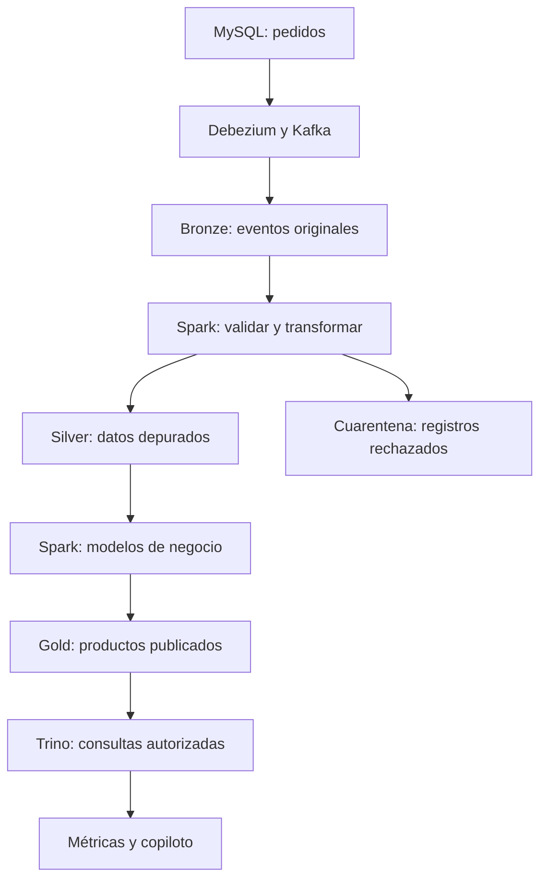

# Midas — Reporte de Investigación y Propuestas Técnicas

**Enterprise Active Lakehouse & Conversational Intelligence Platform**  
**Fecha:** 16 de octubre de 2026 · **Versión:** 0.1 · **Estado:** propuesta para revisión técnica  
**Repositorio indicado:** [Dan18eP/Midas](https://github.com/Dan18eP/Midas)

> Este reporte propone qué construir, por qué y cómo validarlo antes de implementar. No presenta resultados de rendimiento, integraciones probadas ni una plataforma empresarial ya terminada.

## 1. Recomendación principal

Construir primero un recorrido completo y verificable: un cambio en un pedido entra al Lakehouse, supera controles de calidad, actualiza una métrica Gold, aparece en el Canvas y puede explicarse mediante el copiloto con evidencia.

La propuesta conserva MinIO, Spark, OpenMetadata, Atlas y Ranger, con cinco decisiones centrales:

1. **Agregar Apache Iceberg y un catálogo técnico.** MinIO almacena objetos; Spark procesa datos; Iceberg organiza tablas y snapshots. OpenMetadata y Atlas no reemplazan el catálogo que usa el motor para operar esas tablas.[S2][S3]
2. **Separar las responsabilidades de gobernanza.** OpenMetadata para descubrimiento y contexto de negocio; Atlas para clasificaciones de seguridad; Ranger para políticas aplicadas mediante integraciones verificadas.
3. **Mostrar actividad real.** El Canvas combinará relaciones entre datos con eventos de ejecución. Su velocidad de actualización será distinta de la frescura de Gold.
4. **Limitar la autonomía por permisos y contratos.** El copiloto propondrá y probará transformaciones; un servicio separado publicará los productos aprobados.
5. **Construir por fases con criterios de salida.** La etiqueta «empresarial» exigirá demostrar aislamiento, recuperación, trazabilidad y operación bajo carga.

### Hallazgo que requiere una decisión temprana: MinIO

El repositorio comunitario oficial de MinIO aparece archivado desde el **25 de abril de 2026** y declara que ya no tiene mantenimiento. Su README describe distribución comunitaria desde código fuente, licencia AGPLv3 y binarios históricos sin mantenimiento; remite a AIStor Free y AIStor Enterprise.[S1]

**Propuesta:** mantener MinIO en el laboratorio con versión y origen reproducibles. Antes de producción, resolver una decisión de arquitectura sobre edición, actualizaciones, soporte y obligaciones de licencia. Evaluar AIStor con soporte y, si no encaja, una alternativa S3 como Ceph RGW. No se propone sustituir el requisito sin una decisión del equipo. Compilar una versión archivada no resuelve por sí solo su mantenimiento futuro.

## 2. Alcance y supuestos

**Confirmado por el encargo:** arquitectura Medallón sobre MinIO y Spark, gobernanza con OpenMetadata/Atlas/Ranger, Canvas en vivo y copiloto para productos Gold y storytelling ejecutivo.

**Limitación de esta revisión:** no fue posible verificar el contenido del repositorio indicado desde esta sesión. No se inspeccionaron README, ramas, código, licencias ni configuraciones. Las rutas y componentes de este documento son propuestas, no una descripción del repositorio actual.

**Supuestos de trabajo:** primer dominio de pedidos y ventas, fuente MySQL, datos sintéticos para el laboratorio y despliegue local inicial. No son requisitos confirmados.

**Pendiente de definir:** volumen diario, tamaño histórico, concurrencia, hardware, presupuesto, fuentes reales, datos sensibles, número de organizaciones usuarias y objetivos de recuperación. Sin estos datos no corresponde prometer capacidad, costos ni plazos cerrados.

## 3. Arquitectura propuesta

### Flujo de datos

Bronze, Silver y Gold serían tablas Iceberg almacenadas en MinIO. Un catálogo REST persistente mantiene su registro técnico. Las flechas representan dependencias; no significan que todos los pasos operen con la misma latencia.

### Responsabilidades del stack

| Necesidad | Propuesta | Motivo y condición |
| --- | --- | --- |
| Almacenamiento | MinIO; edición por decidir | Mantener el requisito, con decisión de soporte antes de producción. |
| Tablas | Iceberg, formato v2 como punto de partida | Base conservadora para la prueba entre motores; confirmar funciones y versiones.[S2] |
| Catálogo técnico | Apache Polaris con PostgreSQL | Candidato REST persistente; validar permisos, backup y acceso S3.[S3][S4] |
| Procesamiento | Spark SQL/PySpark | Un motor inicial para limpieza, actualizaciones y agregaciones. |
| Cambios del origen | Debezium sobre Kafka Connect y Kafka | Capturar inserciones, actualizaciones y borrados de MySQL.[S5] |
| Consulta | Trino con Ranger | Punto de acceso SQL gobernado para analistas y copiloto.[S9] |
| Orquestación | Airflow, incorporado en la fase de integración | Coordinar trabajos finitos, reprocesos y mantenimiento; no usarlo como motor de streaming.[S15] |
| Metadatos y seguridad | OpenMetadata, Atlas y Ranger | Responsabilidades definidas en la sección 5. |
| Plataforma | API FastAPI, interfaz React y biblioteca de grafos por validar | Separar consultas, comandos y actualizaciones del Canvas. |
| Estado operativo | PostgreSQL | Solicitudes, aprobaciones, publicaciones y proyección de eventos; bases/roles separados por servicio. |

No desplegar todas las herramientas desde el primer día. Tampoco incorporar un segundo motor de streaming, una base vectorial o un framework multiagente sin una necesidad demostrada. Para el primer dominio, la búsqueda autorizada de metadatos puede empezar sin embeddings.

**Puerta de compatibilidad:** fijar versiones de Spark, Scala, Java, runtime Iceberg, conector Kafka, Polaris, Trino y almacenamiento. Registrar también versiones de Atlas, TagSync, Ranger y conectores de OpenMetadata. Usar versiones y digests explícitos, no `latest`; verificar que los artefactos de Iceberg correspondan al motor elegido.[S2]

## 4. Medallón, calidad y procesamiento de cambios

| Capa | Contenido propuesto | Condición para avanzar |
| --- | --- | --- |
| Bronze | Evento original, operación CDC, clave, posición de origen, fecha de ingesta y coordenadas Kafka | Evento recuperable, formato identificable y procedencia conservada. |
| Silver | Tipos corregidos, claves consistentes, duplicados resueltos y cambios ordenados | Contrato de esquema, integridad y reglas de calidad aprobadas. |
| Gold | Tablas de negocio con granularidad y métricas documentadas | Conciliación, autorización, propietario y versión de publicación. |
| Cuarentena | Registros rechazados con razón y ejecución de origen | Corrección y reproceso explícito, sin pérdida silenciosa. |

CDC significa captura de cambios: Debezium observa el registro de MySQL y emite eventos de inserción, actualización y eliminación. La carga inicial y los cambios posteriores deben formar una secuencia consistente.[S5]

### Reglas propuestas de confiabilidad

- Bronze será de solo anexado durante su uso normal. La retención y eliminación autorizada de información sensible seguirán un procedimiento aparte; «inmutable» no significa conservar todo para siempre.
- Conservar una identidad del cambio en el origen. El offset de Kafka identifica una entrega, pero no basta si un mismo cambio se vuelve a publicar con otro offset.
- Resolver varias modificaciones de una misma clave antes del `MERGE`, usando la secuencia del origen. Iceberg exige evitar que varias filas fuente actualicen la misma fila destino.[S6]
- Silver conservará la versión aplicada y un marcador de borrado cuando corresponda, para que un evento antiguo no reactive un registro eliminado.
- Hacer los reprocesos idempotentes: repetir una ejecución debe producir el mismo estado de negocio, sin duplicar ventas.
- Proteger checkpoints, offsets e historial de esquema. Alinear retención de binlogs, Kafka y Bronze con la ventana máxima de recuperación.
- No afirmar entrega «exactamente una vez» de extremo a extremo sin demostrarla. `foreachBatch` de Spark ofrece por defecto escritura al menos una vez; la deduplicación depende del diseño.[S16]

### Silver actualizable y Gold incremental

El lector streaming de Iceberg procesa snapshots de anexado; las sobrescrituras y eliminaciones tienen restricciones. Ignorarlas puede dejar Gold desactualizado. La documentación también recomienda controlar la frecuencia de commits y mantener archivos y snapshots.[S7]

**Propuesta:** Bronze recibe eventos; Silver aplica cambios; Gold se recalcula mediante trabajos incrementales sobre particiones afectadas. Registrar claves y particiones anteriores y nuevas cuando una actualización cambie fecha, categoría o región. Un cambio en una dimensión puede afectar varias particiones históricas. Si no se puede demostrar el alcance, usar una recomputación controlada del modelo pequeño.

Para un producto que necesite consistencia entre tablas, registrar los snapshots exactos de entrada y una marca de avance del origen. No mezclar sin control versiones de pedidos y líneas. Los commits de distintas tablas o capas no forman automáticamente una transacción global.

### Contratos y controles mínimos

Cada dataset tendrá propietario, clave, esquema, versión, clasificación, frecuencia esperada y política de cambios. Para pedidos y líneas se probarán:

- Nulos en claves, claves duplicadas y referencias a pedidos inexistentes.
- Tipos, moneda, zona horaria y estados permitidos.
- Montos y cantidades válidos según la operación; devoluciones separadas de ventas normales.
- Duplicados, borrados, cambios tardíos y modificaciones incompatibles del esquema.
- Conciliación de conteos y sumas entre origen, Silver y Gold con el mismo corte temporal.

Los errores bloqueantes impedirán publicar Gold. El último producto válido seguirá disponible con su fecha de actualización; no se presentará como recién actualizado.

## 5. Gobernanza Zero-Trust

Zero-Trust significa que estar dentro de la red no concede confianza automática: la identidad y la autorización deben verificarse para acceder a recursos.[S8]

### Una autoridad por responsabilidad

| Componente | Autoridad propuesta | Lo que no debe asumirse |
| --- | --- | --- |
| OpenMetadata | Propietarios, glosario, descripciones, descubrimiento y calidad visible | Sus permisos de catálogo no bloquean automáticamente consultas ni archivos. |
| Atlas | Clasificaciones de seguridad y entidades necesarias para sincronizarlas | Un tag no es por sí solo una denegación de acceso. |
| Ranger | Políticas de consulta y auditoría mediante plugins | El plugin de Trino no protege automáticamente Spark ni S3. |
| Polaris | Registro técnico y permisos de operación sobre tablas | Sus permisos de catálogo no equivalen a filtros por fila. |
| MinIO | Acceso a objetos mediante identidades y políticas de almacenamiento | Autorizar un archivo no reproduce máscaras SQL sobre sus columnas. |

Existe un conector oficial Atlas → OpenMetadata. Su existencia no demuestra cobertura completa de todos los tipos Trino/Iceberg ni sincronización bidireccional.[S10] Ranger ofrece TagSync para recibir clasificaciones de Atlas; esa propagación necesita configuración y puede tener demora.[S11]

**Flujo propuesto:** editar clasificaciones de seguridad en Atlas mediante un proceso autorizado; reflejarlas en OpenMetadata y distribuirlas hacia Ranger. Editar el contexto de negocio en OpenMetadata. Definir identificadores estables y correspondencias entre entidades, tablas y columnas. Probar renombres, borrados y reconciliación; evitar dos fuentes que sobrescriban el mismo campo.

El plugin oficial de Ranger para Trino documenta filtros por fila, máscaras de columna y auditoría. Ranger 2.5 o posterior incluye la definición de servicio Trino, pero esto no prueba toda la cadena Atlas → TagSync → Trino.[S9] El trabajo específico sobre tipos Trino en TagSync confirma que esa compatibilidad requiere atención; una versión indicada en una incidencia no equivale a un despliegue probado.[S12]

### Evitar accesos que salten las políticas

1. Analistas y copiloto consultan mediante Trino con identidad efectiva verificable del usuario. No se entrega una credencial S3 compartida.
2. Los pipelines de ingeniería usan identidades separadas por dominio y trabajo, con permisos mínimos. No se habilita una sesión Spark privilegiada para consultas arbitrarias.
3. Para transformar datos sujetos a filtros por fila, el copiloto obtiene una entrada autorizada mediante Trino y la materializa en un área temporal aislada. Spark procesa únicamente esa entrada. Esta ruta añade costo y debe medirse, pero evita asumir que Ranger filtra lecturas directas de Parquet.
4. Los productos derivados conservan restricciones de sus fuentes. Ampliar su audiencia exige revisión explícita; una agregación no elimina automáticamente la sensibilidad.
5. API, eventos, muestras, conversaciones, cachés y metadatos respetan los mismos límites de acceso.

Proponer un proveedor de identidad con OIDC, TLS entre servicios, gestión de secretos fuera del repositorio y credenciales de corta duración donde la combinación lo permita. Polaris documenta que la entrega de credenciales S3 temporales depende de STS; validar esa capacidad en la edición elegida de MinIO.[S4]

Definir también el comportamiento ante políticas vencidas o servicios de seguridad caídos. Medir revocación y cachés; no prometer revocación instantánea. El criterio empresarial debe impedir nuevas operaciones cuando no pueda garantizarse una autorización válida.

## 6. Canvas en tiempo real

El Canvas debe responder: **qué se está ejecutando, con qué datos, qué falló y qué versión quedó disponible**.

| Información | Fuente propuesta | Presentación |
| --- | --- | --- |
| Tablas y dependencias | Catálogo y linaje | Nodos y conexiones estables. |
| Estado de ejecución | OpenLineage y orquestador | Pendiente, ejecutando, completado o fallido. |
| Progreso | Telemetría real de Spark y Kafka | Filas, retraso y duración cuando existan. |
| Calidad y publicación | Validadores y servicio publicador | Rechazos, controles y snapshot disponible. |

OpenLineage distingue eventos de ejecución de metadatos de diseño; no garantiza por sí mismo progreso continuo ni seguimiento por fila.[S13]

**Implementación propuesta:** eventos operativos en un topic separado de Kafka; consumidor que registra eventos y actualiza una proyección en PostgreSQL; API que envía cambios mediante SSE al navegador. Los comandos viajan por REST. Evaluar WebSocket si aparece colaboración bidireccional.

SSE contempla identificadores y reconexión con `Last-Event-ID`; Midas debe implementar retención, replay y deduplicación.[S14] Cada evento tendrá identificador, ejecución, intento, dataset, dominio, instante de origen y recepción; incluirá snapshot cuando corresponda.

El Canvas mostrará «sin telemetría» cuando pierda visibilidad. Un evento antiguo no podrá cambiar un trabajo completado a «ejecutando». Un reintento tendrá identidad propia. Si el cursor de reconexión expiró, se descargará el estado completo.

La animación representará actividad observada de trabajos o lotes. No se simulará movimiento de registros. «Trabajo terminado» y «producto Gold publicado» serán estados distintos.

## 7. Copiloto agéntico con ejecución controlada

### Alcance inicial

Interpretar «cualquier Gold» como **productos Gold dentro de fuentes, dominios y operaciones autorizados**. Empezar con filtros, agregaciones y joins definidos. Las transformaciones no soportadas se convertirán en propuestas de ingeniería.

Ejemplo de solicitud: «Crea ventas netas por categoría y mes, excluye cancelados y explica el cambio frente al mes anterior».

Antes de ejecutarla se debe resolver qué significa venta neta, cuándo se reconoce una venta, cómo se tratan devoluciones y cuál es la moneda. Esas decisiones no las inventa el modelo.

### Flujo propuesto

1. **Contexto autorizado:** recuperar esquemas, relaciones y métricas que el usuario puede consultar.
2. **Especificación:** definir fuentes, filtros, joins, granularidad, métrica, destino y controles.
3. **Plan:** generar SQL del subconjunto permitido y explicar su efecto.
4. **Validación independiente:** analizar estructura SQL, nombres, tipos, permisos, joins y límites de recursos. No confiar solo en otro LLM.
5. **Preview:** ejecutar sobre entradas autorizadas en un entorno aislado, con tiempo y recursos limitados. Un `LIMIT` no basta para controlar el costo de lectura.
6. **Revisión:** mostrar plan, muestra permitida, calidad, cambios de esquema e impacto sobre consumidores. Una muestra no prueba la calidad del dataset completo.
7. **Aprobación:** para una publicación puntual, vincularla al hash del plan, destino, versión del contrato y snapshots de entrada. Una actualización recurrente requiere aprobar por separado su definición y reglas de ejecución.
8. **Publicación:** un servicio con identidad separada verifica nuevamente permisos y controles sobre el resultado completo, publica y registra evidencia.

El ejecutor no admitirá shell, Python arbitrario, instalación de paquetes, lecturas por rutas libres ni funciones con acceso a red o archivos fuera del área autorizada. El modelo no recibirá secretos.

Comentarios de tablas, documentos y celdas son entradas no confiables: pueden contener instrucciones maliciosas. OWASP señala que RAG y las instrucciones del modelo no eliminan la inyección de prompts. Por ello los límites deben existir también en permisos y código de ejecución.[S17]

### Publicación, reintentos y reversión

Proponer una tabla candidata versionada y, tras validarla, cambiar la referencia de consumo mediante una operación controlada. Comenzar con una tabla por publicación. Validar el mecanismo concreto de referencia antes de comprometer atomicidad.

Registrar `publication_id`, usuario, plan, versión del modelo, commit de transformación, snapshots de entrada/salida, pruebas y aprobación. Usar claves de idempotencia; reconciliar operaciones interrumpidas consultando el estado real, sin asumir una transacción entre PostgreSQL y el catálogo.

Iceberg ofrece reversión de snapshots por tabla, condicionada a que sigan disponibles.[S18] Conservar la versión anterior durante la ventana acordada. La reversión no deshace automáticamente exportaciones ni otras acciones externas. Si cambia el plan o el esquema, la aprobación anterior deja de ser válida.

### Qué hace activo al Lakehouse

Después de aprobar la definición recurrente de un producto —plan, contrato, destino, alcance de permisos y reglas—, un nuevo commit de Silver puede disparar su actualización. Cada ejecución registra sus propios snapshots y vuelve a comprobar permisos y calidad antes de publicar. Esta autorización recurrente es distinta de aprobar una publicación puntual sobre snapshots específicos.

Deben existir deduplicación de disparadores, límites de concurrencia, prevención de ciclos y alertas por calidad. Las actualizaciones rutinarias de la definición aprobada pueden automatizarse; cambiar su significado, esquema o alcance requiere revisión.

## 8. Métricas y storytelling verificable

Crear primero un registro de métricas versionado: nombre, definición, fórmula, granularidad, dimensiones, filtros, moneda, zona horaria, responsable y fuentes. Podría mantenerse inicialmente en Git, sin añadir otro servicio.

| Métrica propuesta para el piloto | Definición que debe aprobar negocio |
| --- | --- |
| Ventas netas | Importe bruto menos descuentos y devoluciones reconocidas; explicitar impuestos y envíos. |
| Pedidos válidos | Pedidos distintos que cumplen los estados y el período definidos. |
| Ticket promedio | Ventas netas divididas por pedidos válidos de la misma población; tratar denominador cero. |
| Tasa de cancelación | Pedidos cancelados entre pedidos creados en la misma cohorte; definir fecha de corte. |

Validar que los joins no multipliquen importes al combinar pedidos con sus líneas. No sumar monedas diferentes sin una política de conversión. No llamar «rentabilidad» a una métrica que carece de costos.

**El motor calcula y el LLM redacta.** Cada cifra de la narrativa debe vincularse con métrica, consulta, filtros, período, snapshot y momento de cálculo. La respuesta distinguirá hallazgo, comparación, hipótesis y acción sugerida. La contribución matemática de una categoría a una caída no demuestra su causa.

Si faltan datos o falla una validación, la respuesta deberá indicarlo. No se incluyen cifras ilustrativas de resultados en este reporte porque todavía no existe un dataset validado.

## 9. Operación y costos

Docker Compose puede servir para el laboratorio por perfiles. No demuestra alta disponibilidad. La fase empresarial deberá resolver despliegue distribuido, recursos reservados, aislamiento, actualización y recuperación; Kubernetes se evaluará según las capacidades del equipo.

Respaldar objetos y metadatos de Iceberg, catálogo, bases de gobernanza, estado de publicaciones y configuración. La replicación del almacenamiento no sustituye un backup independiente. Probar restauración en un entorno separado y documentar cuánto dato puede perderse y cuánto tarda la recuperación.

Programar compactación, expiración de snapshots y limpieza de archivos huérfanos con márgenes que protejan trabajos activos, auditoría y reversión. Medir espacio por capa, cola Kafka, duración de trabajos, fallos, frescura y consumo del copiloto. Incluir inventario de dependencias, revisión de vulnerabilidades y rotación de secretos.

**Modelo de costo propuesto:** almacenamiento de datos y versiones + cómputo Spark/Trino + servicios de metadatos + backups + llamadas al modelo + operación y soporte. No asignar montos hasta conocer hardware, volumen y proveedor. Comparar el costo por actualización Gold y por solicitud aceptada, además del gasto total.

## 10. Fases y criterios de aceptación

No se fija un calendario sin conocer equipo y recursos. Cada fase debe cerrar con una demostración y evidencia reproducible.

| Fase | Entregable | Criterio de salida |
| --- | --- | --- |
| 0. Diseño | Decisiones de arquitectura, caso de negocio, contratos y matriz de versiones | Alcance, responsables y riesgos principales revisados antes del código. |
| 1. Recorrido Medallón | Carga controlada de pedidos hasta una Gold | Calidad y métricas concilian contra resultados esperados. |
| 2. Cambios y recuperación | CDC, reintentos, deletes y reproceso | Una interrupción no duplica efectos ni pierde cambios dentro de la retención acordada. |
| 3. Gobernanza | OpenMetadata, Atlas, Ranger e identidades integrados | Filtrado, máscaras, revocación y bloqueo de accesos alternos demostrados. |
| 4. Canvas | Topología, estados y replay de eventos | Refleja fallos y publicaciones sin inventar actividad. |
| 5. Copiloto | Plan, preview, publicación y narrativa | Resultados correctos, permisos preservados y reversión demostrada. |
| 6. Operación empresarial | Pruebas de carga, restauración, seguridad y soporte | Objetivos de servicio acordados y medidos; manuales de operación completos. |

### Pruebas que deciden si continuar

| Prueba | Resultado exigido |
| --- | --- |
| Repetir eventos y reiniciar tras un commit | Mismo estado Silver y mismas métricas Gold; sin duplicar publicaciones. |
| Update, delete y llegada de una versión antigua | Prevalece la secuencia correcta; no reaparece el registro borrado. |
| Cambio de región/fecha o dimensión | Se corrigen todas las particiones Gold afectadas, incluidas las anteriores. |
| Error de esquema o calidad | Cuarentena o bloqueo; motivo visible y última Gold válida identificada. |
| Usuario sin permiso por Trino, S3, Spark y catálogo | No obtiene datos ni metadatos restringidos por ninguna ruta. |
| Etiqueta Atlas y revocación | Propagación medida y comportamiento de cachés documentado. |
| Reconexión y eventos desordenados | Canvas recupera estado sin regresiones ni duplicados. |
| Instrucción maliciosa dentro de metadatos | No eleva permisos ni ejecuta herramientas fuera del alcance. |
| Plan aprobado que luego cambia | No se publica con la aprobación anterior. |
| Narrativa con dataset de referencia | Todas las cifras coinciden con el cálculo independiente. |
| Caída durante publicación y restauración | Estado reconciliado y recuperación comprobada, no solo backup creado. |

**Objetivos iniciales propuestos, no resultados ni SLA:** Canvas p95 ≤ 5 segundos desde recepción del evento en la API hasta su visualización; frescura Gold p95 ≤ 5 minutos desde un cambio confirmado en el origen hasta su publicación, para el piloto. El percentil 95 significa que el 95 % de las observaciones queda dentro del límite. Aprobarlos únicamente con una carga documentada: volumen, tamaño de fila, concurrencia, infraestructura y duración. Medir por separado el tiempo que tarda la telemetría en llegar a la API.

## 11. Decisiones pendientes y riesgos prioritarios

| Decisión | Riesgo si se omite | Acción propuesta |
| --- | --- | --- |
| Edición y soporte de MinIO | Producción sobre un componente sin mantenimiento previsto | Resolver antes de comprometer la infraestructura. |
| Catálogo y credenciales | Acceso directo que elude políticas o catálogo no recuperable | PoC Polaris–MinIO, STS, permisos y restauración. |
| Conectores Atlas/OM/Ranger | Etiquetas divergentes o políticas que no llegan | Probar tipos reales y fijar una autoridad por campo. |
| Semántica CDC y joins | Duplicación o distorsión de indicadores | Contratos, identidad de cambios y conciliación independiente. |
| Autonomía del copiloto | Exposición de datos o publicación incorrecta | Entradas autorizadas, validación determinista y publicador separado. |
| Latencia y costo | Compromisos inviables o demasiados archivos pequeños | Benchmark representativo y presupuesto por trabajo. |
| Complejidad del stack | Más tiempo operando herramientas que resolviendo el caso | Incorporación por fases; retirar componentes sin función justificada. |

Registrar estas decisiones como ADR: documentos breves con contexto, opciones, decisión, consecuencias y evidencia. Las alternativas que modifiquen requisitos del encargo quedan para revisión del equipo.

## 12. Entrega y siguiente paso

Ruta sugerida al incorporar este reporte al repositorio: `docs/research/Midas_Reporte_Investigacion_Propuestas_Tecnicas.md`. La estructura deberá ajustarse a las convenciones reales del proyecto cuando puedan revisarse. Este documento no se ha subido ni integrado al repositorio remoto.

Antes de empezar la implementación, cerrar cuatro puntos: primer caso de negocio, fuente y contratos; edición de almacenamiento; matriz de compatibilidad; y prueba de autorización entre Trino, Spark y S3. Después, construir únicamente el recorrido de la fase 1 y revisarlo antes de ampliar el alcance.

## 13. Fuentes primarias

Consultadas el **16 de octubre de 2026**. Las páginas `latest`, `current` y `stable` cambian; guardar la versión exacta utilizada al aprobar la arquitectura. La documentación describe capacidades, no demuestra que la combinación propuesta ya funcione. La página del conector Atlas se verificó mediante resultados de búsqueda de su documentación oficial; su apertura directa fue intermitente.

- **[S1]** [MinIO — repositorio oficial y estado de mantenimiento](https://github.com/minio/minio).
- **[S2]** [Apache Iceberg — soporte entre motores y dependencias](https://iceberg.apache.org/multi-engine-support/) y [configuración de catálogos Spark](https://iceberg.apache.org/docs/latest/spark-configuration/).
- **[S3]** [Apache Polaris — catálogo Iceberg REST](https://polaris.apache.org/) y [persistencia JDBC](https://polaris.apache.org/releases/1.8.0/metastores/relational-jdbc/).
- **[S4]** [Apache Polaris — configuración S3, MinIO y credenciales temporales](https://polaris.apache.org/releases/1.8.0/configuration/configuring-polaris-for-production/configuring-aws-s3-cloud-storage-specific/).
- **[S5]** [Debezium — conector MySQL](https://debezium.io/documentation/reference/stable/connectors/mysql.html).
- **[S6]** [Apache Iceberg — escrituras y MERGE con Spark](https://iceberg.apache.org/docs/latest/spark-writes/).
- **[S7]** [Apache Iceberg — Structured Streaming y mantenimiento](https://iceberg.apache.org/docs/latest/spark-structured-streaming/).
- **[S8]** [NIST SP 800-207 — Zero Trust Architecture](https://csrc.nist.gov/pubs/sp/800/207/final).
- **[S9]** [Trino — Ranger access control](https://trino.io/docs/current/security/ranger-access-control.html).
- **[S10]** [OpenMetadata — conector Atlas](https://docs.open-metadata.org/v2.0.x/connectors/metadata/atlas).
- **[S11]** [Apache Ranger — políticas por etiquetas y TagSync](https://cwiki.apache.org/confluence/spaces/RANGER/pages/61322361/Tag%2BBased%2BPolicies). Referencia conceptual histórica; no copiar sus instrucciones antiguas de despliegue.
- **[S12]** [Apache Ranger — RANGER-5522, tipos Trino en TagSync](https://issues.apache.org/jira/browse/RANGER-5522).
- **[S13]** [OpenLineage — modelo de objetos y eventos](https://openlineage.io/docs/spec/object-model/).
- **[S14]** [WHATWG — Server-sent events](https://html.spec.whatwg.org/multipage/server-sent-events.html).
- **[S15]** [Apache Airflow — propósito y flujos por lotes](https://airflow.apache.org/docs/apache-airflow/stable/index.html).
- **[S16]** [Apache Spark — Structured Streaming y garantías de foreachBatch](https://spark.apache.org/docs/3.5.8/structured-streaming-programming-guide.html). Fuente de la semántica; no es una recomendación de versión para Midas.
- **[S17]** [OWASP — LLM01: Prompt Injection](https://genai.owasp.org/llmrisk/llm01-prompt-injection/).
- **[S18]** [Apache Iceberg — procedimientos de snapshots y reversión](https://iceberg.apache.org/docs/latest/spark-procedures/).
