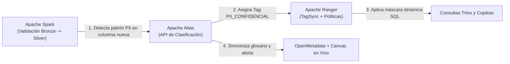
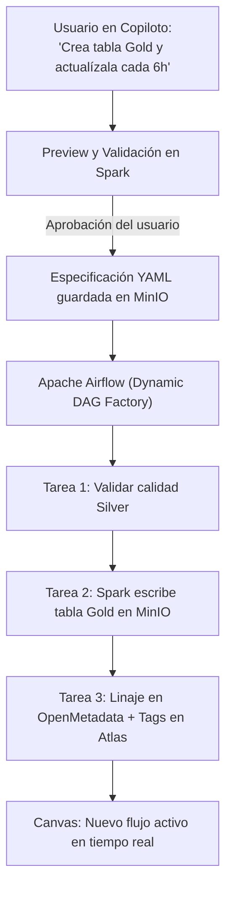

# Midas — Reporte de Investigación y Propuestas Técnicas

**Proyecto:** Midas — Enterprise Active Lakehouse & Conversational Intelligence Platform  
**Fecha:** 16 de octubre de 2026 · **Versión:** 1.0  
**Stack Oficial Base:** MinIO · Apache Spark · Apache Airflow · OpenMetadata · Apache Atlas · Apache Ranger (con soporte de tablas Apache Iceberg y consultas en Trino)  
**Repositorio oficial:** [Dan18eP/Midas](https://github.com/Dan18eP/Midas)

---

## 1. Resumen Ejecutivo y Posicionamiento en el Equipo

Este reporte presenta cinco propuestas técnicas innovadoras diseñadas **exclusivamente sobre las tecnologías oficiales seleccionadas para Midas** (**MinIO, Apache Spark, Apache Airflow, OpenMetadata, Apache Atlas y Apache Ranger**). 

El objetivo es complementar y potenciar el trabajo ya estructurado por el resto del equipo sin duplicar ninguna de sus propuestas:

1. **Complemento al Reporte 1 (Arquitectura Base):** Parte de la arquitectura Medallón definida sobre **MinIO** y **Apache Spark** con tablas Iceberg, orquestación en **Apache Airflow** y seguridad en **OpenMetadata, Apache Atlas y Apache Ranger**, proponiendo automatizaciones que conectan estas herramientas entre sí.
2. **Complemento al Reporte 2 (*Midas Guardian* — Auto-Healing):** Mientras *Guardian* gestiona incidentes operativos y fallos de ejecución con *playbooks* de recuperación, este reporte cubre la **automatización preventiva de seguridad Zero-Trust, el despliegue automático de pipelines en Airflow desde el Copiloto y la optimización física/de costos en Spark y MinIO**.
3. **Complemento al Reporte 3 (Experiencia en Canvas y Copiloto — Dilan):** Mientras las propuestas de experiencia cubren el *Rebobinado del flujo*, *Explícame esta cifra*, *Modo What-If*, *Briefing ejecutivo* y *Anomalías narradas*, este reporte aporta cinco capacidades donde **Airflow, Atlas, Ranger, Spark, OpenMetadata y MinIO** se vuelven protagonistas visibles durante una demostración ejecutiva.

### Resumen de las 5 Propuestas Técnicas

| # | Propuesta | Tecnologías del Stack que Conecta | Complejidad | Impacto en Demo |
|---|---|---|---|---|
| **P1** | **Escudo PII Activo (Auto-Tagging Zero-Trust en Ingesta)** | Spark + OpenMetadata + Atlas + Ranger | Media | Muy Alto |
| **P2** | **Pipeline-as-a-Prompt (De Lenguaje Natural a DAG en Airflow)** | Copiloto + Airflow + Spark + MinIO + OpenMetadata | Media-Alta | Muy Alto |
| **P3** | **Lente Zero-Trust en Vivo (Simulador de Roles en Canvas y Copiloto)** | Ranger + Atlas + Trino + Canvas + Copiloto | Media | Muy Alto |
| **P4** | **Semáforo de Costo en Spark y Auto-Compactación en MinIO** | Spark + Airflow + MinIO + Iceberg Metadata | Media | Alto |
| **P5** | **Sello de Certificación Ejecutiva y Detector de Tablas Gold "Zombi"** | OpenMetadata + Ranger Audits + Airflow + Copiloto | Baja-Media | Alto |

---

## 2. Propuesta 1: Escudo PII Activo (Auto-Tagging Zero-Trust en Ingesta)

### Problema que resuelve
Contar con **Apache Atlas** para clasificaciones de seguridad y **Apache Ranger** para control de acceso es un diferenciador empresarial clave. Sin embargo, en un flujo tradicional, un administrador debe etiquetar manualmente cada columna nueva en Atlas. Si ingresa una columna nueva a Bronze/Silver o si un usuario crea una nueva tabla Gold con el Copiloto que incluye datos sensibles (correos electrónicos, documentos de identidad, teléfonos, salarios), existe una ventana de exposición ($T_{\text{exposición}} > 0$) en la que el dato puede ser consultado sin máscara antes de que alguien lo clasifique.

### Arquitectura e implementación con nuestro stack
1. **Inspector de Sensibilidad en Apache Spark:** Durante la ejecución del trabajo de Spark que transforma datos de Bronze a Silver (y en el paso previo a publicar cualquier tabla Gold del Copiloto), una función de validación en PySpark analiza una muestra de cada columna nueva o sin clasificar utilizando reglas del glosario de **OpenMetadata**, expresiones regulares y cálculo de entropía de Shannon:
   $$H(X) = -\sum_{i=1}^{n} P(x_i) \log_2 P(x_i)$$
2. **Clasificación automática vía API REST de Apache Atlas:** Cuando Spark detecta que una columna supera el umbral de probabilidad de información confidencial (ej. `email`, `telefono`, `nit_cliente` o `costo_proveedor`), el propio trabajo de Spark invoca el endpoint de entidades de **Apache Atlas** y le asigna automáticamente el tag de seguridad correspondiente (`PII_CONFIDENCIAL`, `FINANCIERO_SENSIBLE`) antes de confirmar la escritura en **MinIO**.
3. **Aplicación inmediata de políticas en Apache Ranger:** Gracias a la sincronización de etiquetas entre Atlas y **Apache Ranger** (*TagSync*), las políticas basadas en etiquetas ya configuradas en Ranger aplican enmascaramiento dinámico (ej. `c****@empresa.com`) o restricción de acceso de forma automática desde la primera consulta.

### Demostración en vivo
Se inyecta un lote de pedidos que trae una columna nueva con correos y teléfonos de clientes. En el **Canvas**, el nodo de la tabla muestra una insignia de escudo activándose en tiempo real: *"Spark detectó PII $\rightarrow$ Etiquetado en Atlas $\rightarrow$ Protegido por Ranger"*. Inmediatamente se consulta la tabla desde el Copiloto y se comprueba que los correos ya aparecen enmascarados sin intervención manual.

---

## 3. Propuesta 2: *Pipeline-as-a-Prompt* (De Lenguaje Natural a DAG Dinámico en Apache Airflow)

### Problema que resuelve
Uno de los objetivos principales de Midas es que el Copiloto Agéntico transforme datos hacia la capa Gold mediante lenguaje natural. Si un usuario solicita crear un nuevo indicador Gold en el Copiloto, ejecutar una consulta puntual no es suficiente para un Lakehouse Activo: esa nueva tabla Gold debe quedar programada, gobernada y orquestada en **Apache Airflow** para seguir actualizándose automáticamente cuando lleguen nuevos datos a **MinIO**, sin requerir que un ingeniero escriba código manualmente.

### Arquitectura e implementación con nuestro stack
1. **Generación de Contrato de Pipeline desde el Copiloto:** Cuando un usuario pide al Copiloto *"Crea una tabla Gold con las ventas netas semanales por categoría excluyendo devoluciones y actualízala cada 6 horas"* y aprueba la vista previa ejecutada en **Spark**, el servicio publicador guarda una especificación declarativa (archivo JSON/YAML firmado) en un bucket dedicado de contratos dentro de **MinIO** (`s3://midas-governance/airflow-specs/`).
2. **Fábrica Dinámica de DAGs (*DAG Factory*) en Apache Airflow:** En **Airflow**, un script maestro lee las especificaciones aprobadas y construye dinámicamente un DAG estandarizado para cada producto Gold aprobado, compuesto por cuatro tareas encadenadas:
   * `sensor_silver_ready`: Verifica que las tablas Silver de entrada tengan un snapshot válido y hayan superado las pruebas de calidad.
   * `spark_submit_gold_transform`: Lanza el trabajo de **Apache Spark** con una identidad de servicio acotada para materializar la tabla Gold en **MinIO**.
   * `openmetadata_register_lineage`: Registra en **OpenMetadata** el linaje exacto (qué columnas de Silver alimentan qué columnas de Gold) y el propietario del indicador.
   * `atlas_propagate_classifications`: Verifica en **Apache Atlas** que si alguna columna fuente tenía etiquetas de seguridad, la nueva tabla Gold herede dichas clasificaciones.
3. **Visualización en el Canvas:** Apenas **Airflow** registra el nuevo DAG, emite un evento que dibuja el nuevo nodo Gold en el Canvas conectado a sus tablas Silver de origen.

### Demostración en vivo
Durante la presentación, se pide al Copiloto un nuevo reporte Gold. Al hacer clic en *"Aprobar y Automatizar"*, se abre **Apache Airflow** y el **Canvas**, mostrando cómo el DAG se ha creado solo, ejecuta su primera corrida en **Spark**, guarda la tabla en **MinIO** y documenta su linaje en **OpenMetadata**.

---

## 4. Propuesta 3: Lente Zero-Trust en Vivo ("Simulador de Roles" en Canvas y Copiloto)

### Problema que resuelve
La seguridad con **Apache Ranger** y **Apache Atlas** suele ser invisible para los espectadores de una demostración porque ocurre en el motor de consultas. Si no se visualiza en la interfaz, es difícil demostrar cómo el modelo Zero-Trust protege el Lakehouse frente a distintos perfiles de usuario y cómo impide que el Copiloto filtre información no autorizada.

### Arquitectura e implementación con nuestro stack
1. **Selector de Perspectiva Zero-Trust en la Interfaz:** Añadir en la barra superior del Canvas y del Copiloto un selector de simulación de identidad para auditoría (ejemplo: *Vista Director General*, *Vista Gerente Región Norte*, *Vista Analista Externo*).
2. **Superposición de Políticas de Apache Ranger sobre el Canvas:** Al alternar entre roles, el backend consulta las políticas activas de **Apache Ranger** y las etiquetas de **Apache Atlas**:
   * Los nodos del Canvas correspondientes a tablas en **MinIO** bloqueadas para ese rol cambian su estado visual a **Bloqueado (Rojo)** indicando la política de Ranger que impide el acceso.
   * Los nodos donde el rol tiene acceso parcial se muestran en **Acceso Filtrado (Ámbar)** y despliegan una etiqueta flotante con las restricciones exactas aplicadas por Ranger (ej. `Row Filter: region = 'NORTE'` | `Column Mask: email_cliente`).
3. **Storytelling Ejecutivo Gobernado por Rol:** Si el usuario hace exactamente la misma pregunta al Copiloto (*"Hazme un resumen ejecutivo del desempeño de ventas y clientes principales"*) cambiando el rol activo:
   * La consulta se ejecuta impersonando ese rol ante **Apache Ranger**.
   * El Copiloto genera el *storytelling* únicamente con el subconjunto de datos permitido y añade automáticamente una nota de transparencia auditable: *"Alcance Zero-Trust: Narrativa calculada bajo políticas de Apache Ranger para el rol [Gerente Región Norte]. Se aplicó filtro territorial y enmascaramiento de 2 columnas con etiqueta PII en Apache Atlas"*.

### Demostración en vivo
Permite demostrar en menos de un minuto que el Copiloto Agéntico es 100 % seguro para uso empresarial: al cambiar de rol en vivo, tanto el grafo del **Canvas** como las cifras y explicaciones del **Copiloto** se adaptan instantáneamente a las reglas de **Apache Ranger y Atlas**.

---

## 5. Propuesta 4: Semáforo de Costo en Spark y Auto-Compactación Inteligente en MinIO

### Problema que resuelve
Un Lakehouse activo que recibe cambios continuos en **MinIO** y permite a los usuarios generar transformaciones con **Spark** mediante lenguaje natural enfrenta dos riesgos técnicos críticos:
1. Un usuario puede pedir en lenguaje natural un cruce mal filtrado que obligue a **Spark** a leer millones de registros innecesarios desde **MinIO**.
2. Las escrituras frecuentes van dejando cientos de archivos Parquet pequeños en **MinIO** (*Small Files Problem*), haciendo que las consultas del Copiloto y la actualización del Canvas se vuelvan cada vez más lentas.

### Arquitectura e implementación con nuestro stack
1. **Semáforo Pre-Vuelo con el Optimizador Catalyst de Spark:** Antes de que el Copiloto ejecute una transformación pesada hacia Gold, el validador solicita a **Apache Spark** el plan lógico y físico con estimación de estadísticas (`EXPLAIN COST`) y consulta las tablas de metadatos de Iceberg en **MinIO** (`tabla$files` y `tabla$manifests`). Con esos datos calcula la proporción de archivos y megabytes que se escanearán:
   $$\text{Ratio de Escaneo} = \frac{\text{Bytes estimados a leer por Spark}}{\text{Bytes totales de la tabla en MinIO}}$$
   * **Semáforo Verde ($\le 15\%$):** Consulta bien particionada; se ejecuta de inmediato.
   * **Semáforo Amarillo ($15\% - 60\%$):** El Copiloto sugiere agregar un filtro de partición (ej. rango de fechas) antes de correr el trabajo en Spark.
   * **Semáforo Rojo ($> 60\%$ o `CROSS JOIN`):** Se bloquea la ejecución directa y se solicita confirmación o ajuste para proteger el clúster.
2. **DAG de Auto-Compactación en Airflow guiado por uso real:** Un DAG programado en **Apache Airflow** inspecciona periódicamente la fragmentación de archivos en **MinIO** (cantidad de archivos menores a $32\text{ MB}$ por tabla) y la cruza con los registros de auditoría de **Apache Ranger** (para identificar cuáles son las tablas más consultadas por los ejecutivos y el Copiloto). Cuando una tabla crítica acumula fragmentación, Airflow dispara automáticamente un job de **Spark** que ejecuta el procedimiento de compactación (`rewrite_data_files` y limpieza de snapshots vencidos) y muestra en el Canvas el evento *"Mantenimiento activo de almacenamiento en MinIO"*.

### Demostración en vivo
Muestra en el **Canvas** un indicador de salud del almacenamiento en **MinIO** (cantidad de archivos y tamaño promedio) y cómo **Airflow + Spark** compactan automáticamente una tabla fragmentada, reduciendo el tiempo de respuesta de las consultas posteriores del Copiloto.

---

## 6. Propuesta 5: Sello de Certificación Ejecutiva y Detector de Tablas Gold "Zombi"

### Problema que resuelve
1. Cuando un directivo lee una narrativa con métricas generada por el Copiloto, necesita saber con certeza si los datos están actualizados, si pasaron los controles de calidad y quién es el responsable de esa métrica.
2. Con el tiempo, la facilidad de crear tablas Gold desde el Copiloto provoca que se acumulen en **MinIO** y **Airflow** pipelines que siguen ejecutándose todos los días en **Spark**, pero que ya nadie consulta (*tablas zombi*).

### Arquitectura e implementación con nuestro stack
1. **Sello de Certificación Automático ("Etiqueta Nutricional del Dato"):** Cada reporte narrativo o métrica entregada por el Copiloto incluye una tarjeta verificable construida en tiempo real consultando las APIs del stack:
   * **Frescura en MinIO:** Minutos transcurridos desde el último commit de la tabla Gold.
   * **Calidad en OpenMetadata:** Estado de los tests del contrato de datos en la última corrida de Spark (ej. `100% reglas aprobadas`).
   * **Estado en Airflow:** Resultado de la última ejecución del DAG que alimenta esa métrica.
   * **Gobernanza en Atlas/Ranger:** Clasificación de confidencialidad y propietario del dominio.
2. **Detector de Activos "Zombi" (Airflow + Auditoría de Ranger + OpenMetadata):** Un trabajo analítico en **Apache Airflow** cruza semanalmente:
   * El costo de ejecución de cada DAG en **Spark** y el espacio ocupado en **MinIO**.
   * La cantidad de accesos registrados en los logs de auditoría de **Apache Ranger** durante los últimos $30$ días.
   Si una tabla Gold creada por el Copiloto tiene alta frecuencia de actualización en Airflow/Spark pero $0$ lecturas registradas en Ranger, el sistema la marca con la etiqueta `CANDIDATO_DEPRECACION` en **OpenMetadata** y el Copiloto sugiere al propietario pausar su DAG en Airflow para optimizar recursos.

---

## 7. Matriz de Sinergia con las Propuestas de los Compañeros

Esta tabla resume cómo nuestras cinco propuestas se integran limpiamente con el trabajo del resto del grupo sin solaparse:

| Propuesta de este Reporte | Cómo se integra con el Reporte 1 (Arquitectura Base) | Cómo se integra con el Reporte 2 (*Midas Guardian* — Resiliencia) | Cómo se integra con el Reporte 3 (*Ideas Dilan* — Copiloto y Canvas) |
|---|---|---|---|
| **P1. Escudo PII Activo (Spark $\rightarrow$ Atlas $\rightarrow$ Ranger)** | Automatiza el etiquetado en Atlas y Ranger definido en la arquitectura de seguridad. | Si detecta una aparición masiva e inusual de PII en una tabla pública, alerta a *Guardian*. | Asegura que las muestras de *Explícame esta cifra* y el *Briefing* nunca expongan PII nueva. |
| **P2. Pipeline-as-a-Prompt (Copiloto $\rightarrow$ Airflow DAG)** | Usa a Airflow como orquestador oficial para productivizar lo que aprueba el servicio publicador. | Los nuevos DAGs generados heredan automáticamente el monitoreo de incidentes de *Guardian*. | Permite que un análisis exitoso creado en el *Modo What-If* se convierta en un DAG permanente. |
| **P3. Lente Zero-Trust (Simulador de Roles)** | Visibiliza en la interfaz las políticas por fila y máscaras configuradas en Ranger y Atlas. | Permite verificar qué roles están afectados cuando *Guardian* pone una tabla en cuarentena. | Permite probar el *Briefing Ejecutivo* y las consultas del Copiloto desde distintos niveles jerárquicos. |
| **P4. Semáforo de Costo Spark y Compactación MinIO** | Automatiza en Airflow el mantenimiento de archivos pequeños en MinIO advertido en el Reporte 1. | Evita que la degradación por miles de archivos pequeños cause fallos por *timeout* en los jobs. | Mantiene rápidas las lecturas en MinIO para que el *Canvas* y el *Copiloto* respondan sin demora. |
| **P5. Sello de Certificación y Detector de Tablas Zombi** | Aprovecha los registros de OpenMetadata, Airflow y auditorías de Ranger. | El Sello de Certificación muestra de inmediato si una métrica está usando una versión retenida por *Guardian*. | Complementa a *Explícame esta cifra* añadiendo un sello ejecutivo de frescura, calidad y seguridad. |

---

## 8. Criterios de Validación para el Laboratorio (Pruebas de Aceptación)

Para validar estas propuestas de forma incremental durante el desarrollo del MVP:

| Prueba de Laboratorio | Resultado Exigido |
|---|---|
| **Prueba P1 (Auto-Tagging PII):** Ingerir en Bronze una tabla con una columna `correo_contacto` no catalogada previamente. | El job de **Spark** detecta el patrón, registra el tag en **Apache Atlas** vía API y **Apache Ranger** aplica la máscara al consultar desde Trino sin intervención manual. |
| **Prueba P2 (DAG Dinámico en Airflow):** Aprobar en el Copiloto la creación de una tabla Gold recurrente. | Se genera el archivo de contrato en **MinIO** y **Apache Airflow** registra y ejecuta el nuevo DAG sin modificar código fuente manualmente. |
| **Prueba P3 (Lente Zero-Trust):** Cambiar en la interfaz del rol *Director* al rol *Gerente Regional* y repetir la misma pregunta al Copiloto. | El **Canvas** resalta los nodos restringidos según **Ranger** y el **Copiloto** recalcula las cifras únicamente con los registros permitidos para esa región. |
| **Prueba P4 (Semáforo y Compactación):** Provocar múltiples escrituras pequeñas en una tabla en **MinIO** y lanzar el DAG de optimización en **Airflow**. | El trabajo de **Spark** reduce el conteo de archivos Parquet pequeños en **MinIO** y el estimador pre-vuelo clasifica correctamente las consultas según su costo de escaneo. |
| **Prueba P5 (Sello y Activos Zombi):** Consultar una métrica en el Copiloto y simular una tabla Gold sin lecturas en los logs de **Ranger**. | El Copiloto adjunta el Sello de Certificación con datos reales de **OpenMetadata/Airflow/MinIO** e identifica la tabla sin uso proponiendo pausar su DAG. |

---

## 9. Referencias Técnicas Oficiales del Stack

1. **Apache Atlas — REST API & Classifications:** [Documentación oficial para creación programática de entidades y etiquetas de seguridad](https://atlas.apache.org/#/RestApi).
2. **Apache Ranger — Tag-Based Policies & Dynamic Masking:** [Control de acceso basado en etiquetas sincronizadas desde Atlas y enmascaramiento SQL](https://ranger.apache.org/).
3. **Apache Airflow — Dynamic DAG Generation:** [Patrones oficiales para generación dinámica de pipelines a partir de metadatos y contratos](https://airflow.apache.org/docs/apache-airflow/stable/howto/dynamic-dag-generation.html).
4. **OpenMetadata — Lineage & Data Quality APIs:** [Integración de linaje a nivel de columna y contratos de calidad con Spark y Airflow](https://docs.open-metadata.org/).
5. **Apache Spark & Iceberg Maintenance on MinIO:** [Procedimientos de compactación (`rewrite_data_files`) e inspección de metadatos físicos](https://iceberg.apache.org/docs/latest/spark-procedures/).