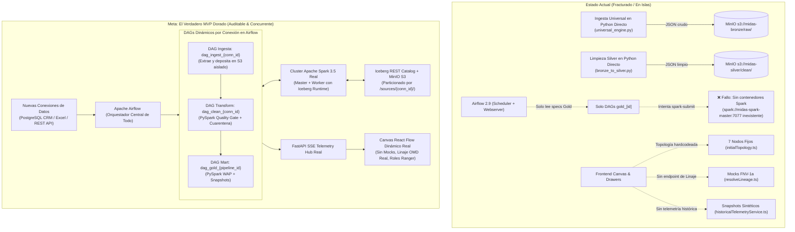
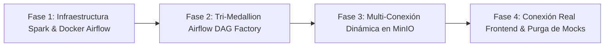

# Auditoría Arquitectónica Integral y Hoja de Ruta: El Verdadero MVP Dorado de Midas

> **Auditoría Técnica Superior & Diagnóstico de Desviaciones**  
> **Destinatarios:** Daniel Echeverría (Backend Lead & Arquitecto Principal), Jesús Noguera (Team Leader & Director de Proyecto)  
> **Fecha:** 20 de Octubre de 2026 · **Entorno de Evaluación:** Rama `develop`  
> **Línea Base Canónica:** [02_mvp_dorado_blueprint_global.md](../canonical/02_mvp_dorado_blueprint_global.md) y [03_especificacion_base_de_datos_y_lakehouse.md](../canonical/03_especificacion_base_de_datos_y_lakehouse.md)

---

## 1. Resumen Ejecutivo y Diagnóstico Global

Midas ha construido componentes individuales de gran solidez técnica:
- Una batería de pruebas robusta con **136 tests unitarios/integración en Python** y **78 tests en Frontend** (100% aprobados).
- Almacenamiento S3 y creación de buckets estructurados en MinIO ([init_buckets.sh](../../docker/minio/init_buckets.sh)).
- Conectores funcionales para PostgreSQL, Excel y APIs REST con sobre de auditoría canónico de 8 columnas y fingerprint SHA-256 ([universal_engine.py](../../src/lakehouse/ingestion/universal_engine.py)).
- Catálogo federado y cliente Trino con guardrails AST ([query.py](../../src/api/routes/query.py)).
- Generación declarativa de especificaciones Airflow para tablas Gold ([dag_factory.py](../../src/orchestration/dag_factory.py)).
- Interfaz gráfica moderna en Next.js con React Flow, chat copiloto con ECharts y componentes de linaje.

Sin embargo, la auditoría revela **cuatro fracturas críticas de arquitectura y gobierno (Code Drift)** que impiden que el sistema funcione como el verdadero MVP Dorado prometido:



---

## 2. Auditoría de Infraestructura y Orquestación: La Brecha Spark / Airflow

### 2.1. Diagnóstico del Clúster Spark en `docker-compose.yml`
El archivo [docker-compose.yml](../../docker-compose.yml) define 9 servicios:
1. `midas-postgres` (Metastore y bases operacionales)
2. `midas-minio` (Almacenamiento S3)
3. `midas-minio-init` (Bucket initializer)
4. `midas-iceberg-catalog` (Iceberg REST)
5. `midas-trino` (Motor de consultas)
6. `midas-api` (FastAPI + SSE)
7. `midas-airflow-init` (Inicializador Airflow)
8. `midas-airflow-webserver` (UI Airflow)
9. `midas-airflow-scheduler` (Planificador Airflow)

> [!CAUTION]
> **Ausencia total de Apache Spark en Docker Compose:**  
> Los servicios `midas-spark-master` y `midas-spark-worker` **no existen en la configuración de Compose**. Sin embargo, la variable `AIRFLOW_CONN_SPARK_DEFAULT` en las líneas 193 del compose apunta a `spark://midas-spark-master:7077`. Si Airflow intenta disparar una tarea `SparkSubmitOperator`, el scheduler fallará inmediatamente con un error de resolución DNS (`Name or service not known`).

### 2.2. Confirmación Documental en Entregables Anteriores
En el archivo de entrega de HU-AI-04 ([agent-pipeline-as-a-prompt-04.md](../done/agent/agent-pipeline-as-a-prompt-04.md#L30)), el equipo reconoció explícitamente:
> *"Prueba de ejecución: no realizada. El repositorio no define un servicio Spark; antes de ejecutar un DAG generado, configura un clúster Spark accesible y su catálogo Iceberg. Este cambio no incluyó una prueba de inicio de Airflow ni de consulta a MinIO."*

### 2.3. Carencias en la Imagen Docker de Airflow
El Dockerfile de Airflow ([docker/airflow/Dockerfile](../../docker/airflow/Dockerfile)) está basado en `apache/airflow:2.9.3-python3.11`.
- **Falta el entorno Java (JRE/JDK):** Para que `SparkSubmitOperator` pueda invocar localmente el binario `spark-submit`, el contenedor requiere Java 11/17 instalado.
- **Falta el cliente Spark:** No se descargan los binarios de Apache Spark 3.5.x ni los JARs de integración (`iceberg-spark-runtime-3.5_2.12-1.5.0.jar` y `bundle-2.20.18.jar`).
- **Falta la conexión en `init.sh`:** El script de inicialización [docker/airflow/init.sh](../../docker/airflow/init.sh) crea el usuario administrador pero omite el comando `airflow connections add spark_default --conn-type spark --conn-host spark://midas-spark-master --conn-port 7077`.

---

## 3. Auditoría del Mandato de Jesús Noguera: Inversión de Capas Medallón

Jesús Noguera estableció un requerimiento no negociable: **todas las capas del Lakehouse, desde Bronze hasta Gold, deben ser orquestadas y monitoreadas mediante Apache Airflow, eliminando ejecuciones ad-hoc de scripts Python en caliente.**

### 3.1. Diagnóstico del Desvío Actual (Code Drift)
1. **Bronze Ingestion:**  
   [UniversalIngestionEngine](../../src/lakehouse/ingestion/universal_engine.py) procesa en caliente desde llamadas Python locales (`ingest_from_postgres`, `ingest_from_excel`, `ingest_from_rest`). Escribe archivos `.json` crudos en `midas-bronze/raw/...`. **Airflow tiene cero visibilidad de este proceso.**
2. **Bronze $\rightarrow$ Silver Transformation:**  
   [BronzeToSilverTransformer](../../src/lakehouse/transforms/bronze_to_silver.py) es una clase Python en memoria. Procesa listas de diccionarios `records: List[Dict[str, Any]]` y escribe archivos `.json` limpios en `midas-silver/clean/...`. No utiliza PySpark distribuido ni escribe tablas Iceberg gestionadas por catálogo REST. **Airflow tiene cero visibilidad de este proceso.**
3. **Fábrica de DAGs Asimétrica:**  
   [dag_factory.py](../../src/orchestration/dag_factory.py) únicamente lee `midas-governance/airflow-specs/*.yaml` y solo valida IDs con regex `r"gold_[a-z0-9_]+"`. No existe ningún generador de DAGs para las fases de Ingesta (Bronze) ni de Calidad/Estandarización (Silver).

```
ESTADO ACTUAL (Inversión de Capas):
[Fuentes] ──(Python script directo)──> [Bronze JSON] ──(Python script directo)──> [Silver JSON]
                                                                                        │
                                                                         [Airflow solo orquesta Gold]
                                                                                        ↓
                                                                                   [Gold Iceberg]
```

### 3.2. Violación del Principio de Auditabilidad y Trazabilidad Humana
La visión de Midas es automatizar la ingeniería de datos simulando las acciones de un ingeniero experto humano:
- Si un auditor o ingeniero entra a la UI de Airflow hoy, **no encuentra tareas ni grafos de ejecución para la ingesta ni para la limpieza**.
- Si un lote falla en la capa Bronze, Airflow no genera alertas, retries, SLAs ni registros de ejecución (`TaskInstances`).
- Si MinIO se inspecciona, los datos de Bronze y Silver están en formato `.json` arbitrario en lugar de tablas Iceberg v2 con linaje de snapshots auditables.

---

## 4. Multi-Conexión Dinámica y Particionamiento en MinIO S3

El usuario plantea la necesidad imperativa de desacoplar las fuentes de datos: si hoy se conecta una base de datos PostgreSQL de clientes y mañana una API REST de tickets de soporte o un Excel de presupuestos, cada conexión debe ser un proceso independiente y aislado.

### 4.1. Estructura de Particionamiento Canónica Propuesta para MinIO

Actualmente, [universal_engine.py](../../src/lakehouse/ingestion/universal_engine.py#L118-L120) utiliza una ruta plana:
`raw/{source_type.lower()}/{safe_origin}/{date_partition}/{batch_id}.json`

Para garantizar el aislamiento multi-conexión, proponemos la siguiente jerarquía canónica estricta en MinIO:

```
s3://midas-bronze/
  └── sources/
      ├── conn_crm_postgres_01/               <-- Conexión de base de datos operacional
      │   └── pedidos/
      │       └── year=2026/month=10/day=20/
      │           └── batch_pg_1729440000_a1b2c3.parquet
      ├── conn_tickets_rest_api_02/           <-- Conexión API independiente
      │   └── support_events/
      │       └── year=2026/month=10/day=20/
      │           └── batch_api_1729443600_d4e5f6.parquet
      └── conn_presupuesto_excel_03/          <-- Archivo Excel / CSV
          └── metas_regionales/
              └── year=2026/month=10/day=20/
                  └── batch_xls_1729447200_g7h8i9.parquet

s3://midas-silver/
  └── tables/
      ├── crm/
      │   └── pedidos/                        <-- Tabla Iceberg v2 particionada
      │       ├── metadata/
      │       └── data/
      └── support/
          └── tickets/                        <-- Tabla Iceberg v2 particionada

s3://midas-quarantine/
  └── incidents/
      └── conn_crm_postgres_01/
          └── 2026-10-20/
              └── incident_f3_neg_amount_1729440120.json

s3://midas-gold/
  └── marts/
      └── fact_ventas_mensuales/              <-- Tabla Iceberg v2 con snapshots WAP
```

### 4.2. Registro Dinámico de Conexiones (`Source Connection Registry`)
Para evitar código manual o acoplamientos, el sistema requiere un **Registro Central de Conexiones**:
- Una tabla en PostgreSQL (`midas_operational.source_connections`) o contratos declarativos en `midas-governance/source-contracts/<connection_id>.yaml`.
- Cada contrato define: `connection_id`, `source_type` (POSTGRES, EXCEL, REST), `credentials_ref`, `frequency_cron`, `target_dataset` y `quality_rules`.
- Airflow lee estos contratos y materializa automáticamente:
  1. `dag_ingest_<connection_id>` (Extracción y aterrizaje en `s3://midas-bronze/sources/<connection_id>/`).
  2. `dag_clean_<connection_id>` (Procesamiento PySpark Bronze $\rightarrow$ Silver hacia Iceberg con aislamiento de cuarentena).

---

## 5. Auditoría Quirúrgica de Mocks y Desconexión en el Frontend

La auditoría del código en `src/frontend/` revela que la interfaz gráfica depende extensivamente de datos estáticos y mocks sintéticos, aislada de las operaciones reales del backend y Trino:

| Componente Frontend | Archivo Inspeccionado | Naturaleza del Mock / Brecha | Impacto en la Experiencia Real |
| :--- | :--- | :--- | :--- |
| **Topología del Canvas** | [initialTopology.ts](../../src/frontend/components/canvas/topology/initialTopology.ts#L4-L100) | 7 nodos hardcodeados (`source_postgres`, `bronze_raw`, `silver_cleansing`, etc.) con valores fijos (`recordsOut: 4520`, `latencyMs: 12.4`). | Si se agrega una nueva conexión o se crea un mart Gold, **el nodo nunca aparece en el canvas** porque [PipelineCanvas.tsx](../../src/frontend/components/canvas/PipelineCanvas.tsx#L160) solo actualiza los nodos que coinciden con los 7 IDs fijos preexistentes. |
| **Time-Travel Replay** | [historicalTelemetryService.ts](../../src/frontend/services/historicalTelemetryService.ts#L88-L100) | `createCanonicalSnapshots()` fabrica puntos sintéticos en memoria para T-24h, T-12h, T-45m sin consultar la base de datos de telemetría histórica. | El usuario mueve el scrubber en la línea temporal y ve datos falsos precocinados en lugar de la telemetría real persistida en PostgreSQL. |
| **Drawer "Explícame esta cifra"** | [resolveLineage.ts](../../src/frontend/components/lineage/resolveLineage.ts#L14-L43) | `LAYER_FALLBACK` define etapas estáticas ficticias y calcula un hash local FNV-1a. | [lineageApi.ts](../../src/frontend/components/lineage/lineageApi.ts#L45) intenta llamar a `GET /api/v1/lineage/table/{table}`, pero **dicho endpoint no existe en FastAPI** ([src/api/routes/](../../src/api/routes/)). Siempre falla y recurre al mock fallback. |
| **Lente Zero-Trust** | [ZeroTrustLens.tsx](../../src/frontend/components/security/ZeroTrustLens.tsx#L91-L98) | Contiene strings literales fijos: `pepe@riwi.io` vs `u****@riwi.io`, `$85.000` vs `****`. | Los roles (`admin`, `rbac`, `compliance`) no consultan el estado de políticas de Apache Ranger ni ejecutan consultas enmascaradas contra Trino. |
| **Seguridad y Gobernanza** | `src/security_governance/` | Directorio completamente vacío. | Falta la implementación del Squad 4 (Sebastian Castiblanco) para el escudo PII y la sincronización con Ranger. |

---

## 6. Hoja de Ruta Estratégica: Hacia el Verdadero MVP Dorado

Para cerrar las brechas identificadas sin generar regresiones en los 136 tests existentes, se establece un plan de acción quirúrgico en 4 fases correlativas:



### Fase 1: Infraestructura Spark Distribuida y Soporte Completo en Airflow
1. **Incorporar Spark 3.5 en Docker Compose:**  
   Añadir `midas-spark-master` (puertos 7077, 8080) y `midas-spark-worker` (puerto 8081) con imagen `bitnami/spark:3.5.1` en la red `midas-network`.
2. **Actualizar `docker/airflow/Dockerfile`:**  
   Instalar `openjdk-17-jre-headless` y descargar binarios de cliente Spark con los conectores Iceberg S3 (`iceberg-spark-runtime-3.5_2.12` y `hadoop-aws`).
3. **Automatizar Conexión Spark en Airflow:**  
   Actualizar [init.sh](../../docker/airflow/init.sh) para registrar la conexión `spark_default` apuntando a `spark://midas-spark-master:7077`.
4. **Validación End-to-End:**  
   Ejecutar un trabajo Spark interactivo que lea de MinIO y escriba una tabla en `iceberg_catalog`.

### Fase 2: Rediseño Tri-Medallón de la Fábrica de Airflow (Mandato Jesús Noguera)
1. **Creación de Tareas PySpark en `jobs/`:**  
   - `jobs/ingest_bronze.py`: Toma la configuración de la fuente, extrae los datos, aplica el sobre de auditoría y persiste en S3 particionado por conexión.
   - `jobs/transform_silver.py`: Lee de Bronze, ejecuta las reglas de `quality_rules.py` en PySpark distribuido, envía filas corruptas a `midas-quarantine` y escribe tablas Iceberg limpias en `midas-silver`.
   - `jobs/materialize_gold.py`: Refactorizar el script actual para soportar Write-Audit-Publish (WAP).
2. **Expansión de `dag_factory.py`:**  
   Evolucionar la fábrica para generar automáticamente los 3 DAGs de la cadena medallón a partir de especificaciones de gobernanza:
   - `dag_ingest_<source_id>`
   - `dag_silver_<dataset_id>`
   - `dag_gold_<pipeline_id>`
3. **Emisión de Telemetría desde Airflow Tasks:**  
   Garantizar que cada tarea en Airflow emita eventos SSE a `http://midas-api:8000/api/v1/telemetry/publish` al iniciar, progresar y finalizar.

### Fase 3: Registro Dinámico de Conexiones y Particionamiento en MinIO S3
1. **Registro Central de Conexiones:**  
   Crear el esquema de persistencia `source_connections` en PostgreSQL y el endpoint `POST /api/v1/connections/register` en FastAPI.
2. **Desacoplamiento de Ingesta:**  
   Garantizar que registrar una nueva conexión genere inmediatamente su propio DAG de Airflow y su prefijo aislado en MinIO:
   `s3://midas-bronze/sources/<connection_id>/<dataset>/...`
3. **Aislamiento de Fallos:**  
   Un error de conexión en la API REST o un archivo Excel corrupto aísla su alerta y cuarentena en su carpeta específica sin afectar la ejecución de las otras fuentes.

### Fase 4: Purga de Mocks en Frontend y Cableado Real
1. **Endpoint de Linaje Real en FastAPI:**  
   Implementar `GET /api/v1/lineage/table/{table}` en [src/api/routes/](../../src/api/routes/) consultando el catálogo Iceberg / OpenMetadata y emitiendo el payload canónico esperado por [lineageApi.ts](../../src/frontend/components/lineage/lineageApi.ts).
2. **Canvas Topológico Dinámico:**  
   Modificar [PipelineCanvas.tsx](../../src/frontend/components/canvas/PipelineCanvas.tsx) para que, al recibir un evento de telemetría con un nuevo `node_id` (ej. nueva conexión o mart Gold), agregue dinámicamente el nodo y su arista correspondiente en lugar de descartarlo.
3. **Historial de Telemetría Real para Time-Travel:**  
   Conectar [historicalTelemetryService.ts](../../src/frontend/services/historicalTelemetryService.ts) con un endpoint `GET /api/v1/telemetry/history?window=24h` alimentado por la base de datos de eventos de FastAPI.
4. **Lente Zero-Trust con Trino & Ranger Real:**  
   Conectar el selector de rol del frontend a los encabezados de autenticación (`X-Midas-Role: director_general | gerente_norte | analista_externo`) para que las tablas de datos y vistas PII se alimenten de consultas SQL reales a través de `TrinoClient`.

---

## 7. Matriz de Cobertura y Próximos Pasos

| Área | Squad Responsable | Brecha Principal | Solución Inmediata |
| :--- | :--- | :--- | :--- |
| **Infraestructura** | Squad 1 (Edgar / Daniel) | Faltan servicios Spark en `docker-compose.yml`. | Incorporar `midas-spark-master` y `worker` con volúmenes de jars Iceberg. |
| **Orquestación** | Squad 3 & Squad 1 (Elian / Edgar) | Solo Gold pasa por Airflow; Bronze y Silver se ejecutan en scripts directos. | Implementar Tri-DAG Generator en `dag_factory.py` y jobs PySpark para Bronze y Silver. |
| **Lakehouse Multi-Fuente**| Squad 1 (Edgar Corzo) | Ingesta plana sin aislamiento de conexiones en MinIO. | Jerarquía de prefijos `s3://midas-bronze/sources/<connection_id>/` y registro dinámico. |
| **Backend API** | Squad 1 (Daniel Echeverría) | Falta endpoint `GET /api/v1/lineage/table/{table}` y persistencia de telemetría. | Crear ruta de linaje y endpoint de consulta de eventos históricos. |
| **Frontend Canvas** | Squad 2 (Dilan / Joshua) | Canvas estático (7 nodos fijos), snapshots falsos y mocks de PII. | Soporte de nodos dinámicos en React Flow y cableado a endpoints REST reales. |
| **Gobernanza & Seguridad**| Squad 4 (Sebastian Castiblanco) | `src/security_governance/` vacío; sin políticas Ranger activas. | Implementar políticas RBAC/ABAC y masking en Trino coordinado con Ranger. |
