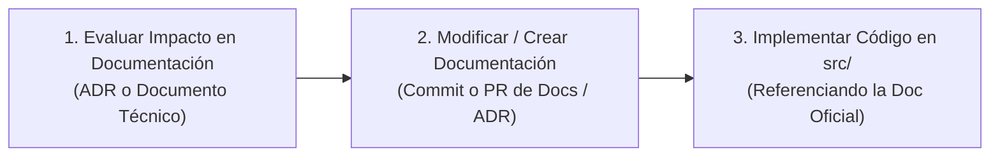

# Regla 01: Política Estricta Anti-Code Drift y Desarrollo "Document-First"
> **Ámbito:** Obligatorio para todos los miembros del equipo y agentes de desarrollo del Proyecto Midas  
> **Líder de Proyecto & Autoridad Técnica:** Daniel Echeverría  
> **Estado:** Activa e Inmutable  

---

## 1. Principio Fundamental: Cero "Code Drift"

En el proyecto **Midas**, **la documentación no es un subproducto posterior al código; la documentación es la especificación ejecutiva vinculante**.

Se define **Code Drift** como cualquier discrepancia entre el código implementado en `src/` (o manifiestos en `docker/`) y lo estipulado en la suite documental oficial (`documentation/` y `documentation/adr/`).

### ⚠️ Regla de Oro
> **ESTÁ ESTRICTAMENTE PROHIBIDO REALIZAR CAMBIOS DE CÓDIGO SI ESTÁN DESFASADOS DE LA DOCUMENTACIÓN.**  
> Si una funcionalidad, endpoint, esquema de datos, parámetro de DAG o componente de UI no está previamente especificado en la documentación o en un ADR, **el cambio será automáticamente rechazado y el Pull Request será bloqueado**.

---

## 2. Protocolo Obligatorio: "Document First, Code Second"

Antes de modificar o crear cualquier línea de código en el repositorio, todo desarrollador o agente debe seguir rigurosamente este ciclo de 3 pasos:

### Paso 1: Identificación del Impacto Documental
Pregúntate: *¿Qué aspecto del sistema se ve afectado por este cambio?*

| Si el cambio afecta a... | Documento Obligatorio a Actualizar Primero |
| :--- | :--- |
| **Decisiones de arquitectura, stack o integraciones** | Crear o enmendar un **ADR** en `documentation/adr/ADR-XXX-...` |
| **Esquemas de tablas, tipos de datos, particionado o contratos** | Actualizar `documentation/03_especificacion_base_de_datos_y_lakehouse.md` |
| **Lógica de negocio, fórmulas de métricas o playbooks de Guardian** | Actualizar `documentation/04_logica_de_negocio_y_resiliencia_guardian.md` |
| **Componentes visuales del Canvas, nodos, aristas o UI del Copiloto** | Actualizar `documentation/05_arquitectura_frontend_y_experiencia_canvas.md` |
| **Nodos de LangGraph, prompts, guardrails OWASP o conectores AI** | Actualizar `documentation/06_arquitectura_agente_ia_y_capa_semantica.md` |
| **Puertos, redes Docker, variables de entorno o volúmenes** | Actualizar `documentation/02_mvp_dorado_blueprint_global.md` |

### Paso 2: Actualización Documental Previa
- El desarrollador debe primero redactar el cambio en la documentación correspondiente.
- Si el cambio modifica una decisión estructural previa, se debe registrar un nuevo ADR que explique el contexto, la decisión y sus consecuencias.

### Paso 3: Implementación en Código
- Una vez reflejado el cambio en la documentación, se procede a implementar el código en `src/`.
- El commit o Pull Request debe referenciar explícitamente el documento o ADR que justifica la modificación:  
  `feat(lakehouse): implement dynamic schema inference according to ADR-007 and doc 03`

---

## 3. Criterios de Rechazo Inmediato en Pull Requests

Un Pull Request será rechazado y cerrado inmediatamente si incurre en alguna de las siguientes faltas:

1. **"Hidden Features" o Atajos:** Código que introduce tablas, columnas, endpoints o librerías que no figuran en `documentation/`.
2. **Fórmulas Matemáticas Alucinadas:** Código en el Copiloto o en Spark que calcule métricas con fórmulas distintas a las aprobadas en `documentation/04_logica_de_negocio_...md`.
3. **Omisión de ADR:** Cambios de tecnología (ej. cambiar Trino por Presto, o alterar el motor de base de datos) sin un ADR aprobado por Daniel Echeverría.
4. **Desfase de Contratos:** Un cambio en el backend que modifique el formato de los eventos SSE sin que `documentation/05_arquitectura_frontend_...md` haya sido actualizado previamente.

---

## 4. Registro de Entregas y Verificación (`documentation/done/`)

Cada vez que una tarea o Historia de Usuario sea finalizada:
1. Se debe crear su reporte de entrega bajo `documentation/done/[area]/[area]-[feature]-[id].md`.
2. El reporte debe incluir:
   - Referencia al documento técnico o ADR en el que se basó.
   - Lista de verificación de que el código coincide al 100% con la documentación.
   - Comandos de prueba y resultados de ejecución exitosa.
